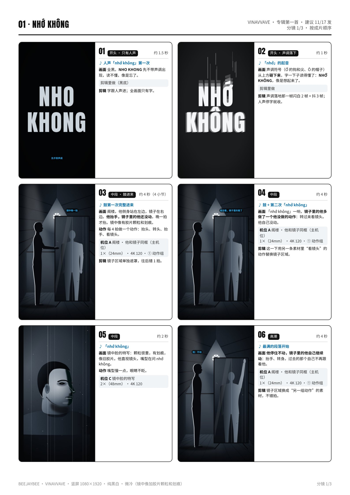
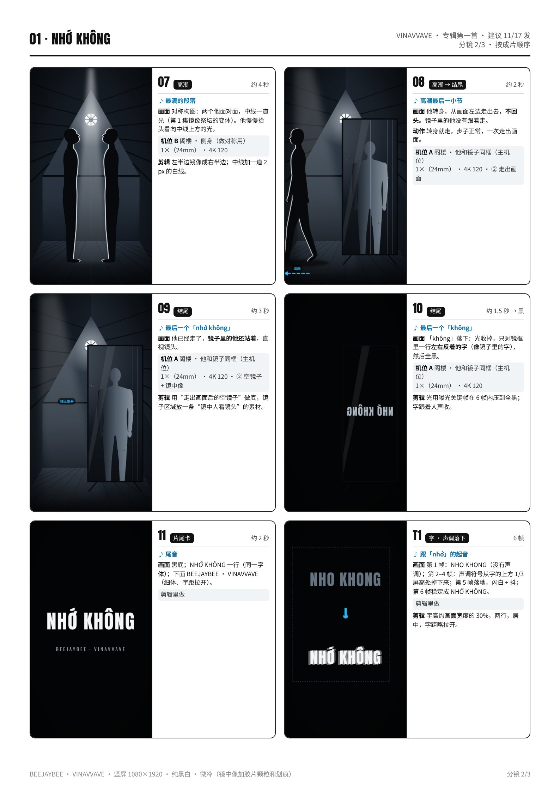
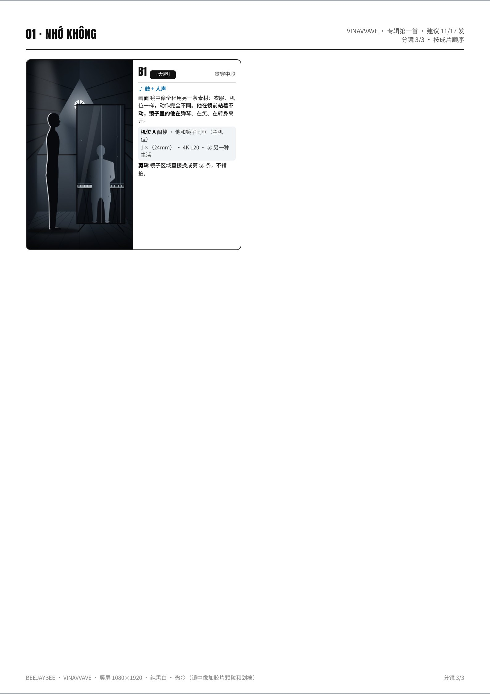

# 01 · NHỚ KHÔNG · 拍摄脚本

还记得吗｜专辑第一首 · 建议 11/17 发｜约 40 秒（30–50 秒都可以）｜颜色：纯黑白 · 微冷（镜中像加胶片颗粒和划痕）

设备：iPhone 16 Pro Max 一部，没有三脚架，靠家里现成的东西固定。通用设置见 [拍摄通用参数](拍摄通用参数_iPhone16ProMax.md)。完整版（含分镜图）见 [PDF](pdf/01_NHO_KHONG_分镜脚本.pdf)。

**本集手法：**镜子里的他永远晚一拍，那是过去的自己跟在后面。最后他走出画面，镜子里那个还站着，看着镜头问 nhớ không。

## 这一集的特殊设置
- 主机位 A 用 **4K 120**（窗光，不开顶灯）：一条视频从头录到尾，**中途不碰手机**，后期遮罩才对得上。
- **镜框要完整在画面里**，四个角都看得见，镜子不能动，后期要沿着镜框画遮罩。
- **焦点锁在镜子里的像上**（长按镜中的他），不是锁在镜面上。
- 先从手机的位置看一眼：**镜子里不能反出手机和窗外的招牌**；看到了就把镜子转 5–10°。
- 他在镜前的动作都按“**4 拍一个**”来做（抬头、转头、抬手、看镜头），动作之间停 2 秒，方便剪辑错拍。

## 机位表（每个机位拍完之前不碰手机）
### 机位 A · 阁楼 · 他和镜子同框（主机位）
- 镜头 / 帧率：1×（24mm） · 4K 120
- 支撑：椅子上叠书，手机竖着夹在书里，镜头高 **约 120 cm**（胸口高），在他右前方，离他约 **2 m**；他站在画面左 1/3，侧身对着镜子，镜子占画面右 2/3。
- 曝光 / 对焦：长按**镜子里他的脸**锁 AE/AF，**−0.7EV**。
- 要录的条：① 4 组动作（抬头、转头、抬手、看镜头），每组之间停 2 秒，录 3 条；② 他转身走出画面（往左出），**走完再录 10 秒**空镜子，3 条；③〔大胆〕同一机位再录一条“镜子里的另一种生活”：他对着镜子弹琴、笑、转身离开。

### 机位 B · 阁楼 · 侧身（做对称用）
- 镜头 / 帧率：1×（24mm） · 4K 120
- 支撑：同一个书堆，挪到他正侧面，距离约 **1.8 m**，镜头高约 120 cm；他站在画面中线左边一点，脸朝右（朝中线）。
- 曝光 / 对焦：锁他的侧脸，**−0.7EV**；窗光从他身后上方打下来，轮廓要亮。
- 要录的条：侧身站定，慢慢抬头看向中线上方 4 拍，然后闭眼 4 拍；**3 条**。剪辑里把左半边镜像成右半边，就是两个他面对面。

### 机位 C · 镜中脸的特写
- 镜头 / 帧率：2×（48mm） · 4K 120
- 支撑：书堆放在桌子上，手机斜对镜子约 **25°**，离镜面约 **0.8 m**，让镜子里他的脸占满画面，手机自己不被反进去。
- 曝光 / 对焦：长按镜子里他的眼睛锁 AE/AF，**−0.7EV**。
- 要录的条：镜子里的他直视镜头，嘴型慢慢说“nhớ không”，3 条；眼睛从下往上抬起来看镜头，3 条。

## 分镜（按成片顺序）
### 01 · 开头 · 只有人声 · 约 1.5 秒
- 声音：人声「nhớ không」第一次
- 画面：全黑。**NHO KHONG** 先不带声调出现，读不懂，像是忘了。
- 机位：剪辑里做（黑底）
- 剪辑：字跟人声进；全画面只有字。

### 02 · 开头 · 声调落下 · 约 1 秒
- 声音：「nhớ」的起音
- 画面：声调符号（Ớ 的钩和尖、Ô 的帽子）从上方**砸下来**，字一下子读得懂了：**NHỚ KHÔNG**，像是想起来了。
- 机位：剪辑里做
- 剪辑：声调落地那一帧闪白 2 帧 + 抖 3 帧；人声停字就收。

### 03 · 中段 · 鼓进来 · 约 4 秒（4 小节）
- 声音：鼓第一次完整进来
- 画面：阁楼。他侧身站在左边，镜子在右边。**他抬手，镜子里的他还没动**，晚一拍才抬。镜中像有胶片颗粒和划痕。
- 动作：每 4 拍做一个动作：抬头、转头、抬手、看镜头。
- 机位：A（① 动作组）
- 剪辑：镜子区域单独遮罩，往后错 1 拍。

### 04 · 中段 · 约 4 秒
- 声音：鼓 + 第二次「nhớ không」
- 画面：「nhớ không」一响，**镜子里的他多做了一个他没做的动作**：转过来看镜头。他自己没动。
- 机位：A（① 动作组）
- 剪辑：这一下用另一条素材里“看镜头”的动作替换镜子区域。

### 05 · 中段 · 约 2 秒
- 声音：「nhớ không」
- 画面：镜中脸的特写：颗粒很重，有划痕，像旧胶片。他直视镜头，嘴型在问 nhớ không。
- 动作：嘴型慢一点，眼睛不眨。
- 机位：C

### 06 · 高潮 · 约 4 秒
- 声音：最满的段落开始
- 画面：**他停住不动，镜子里的他自己继续动**：抬手、转身。过去的那个自己不再跟着他。
- 机位：A（① 动作组）
- 剪辑：镜子区域换成“另一组动作”的素材，不错拍。

### 07 · 高潮 · 约 4 秒
- 声音：最满的段落
- 画面：对称构图：两个他面对面，中线一道光（第 1 集镜像祭坛的变体）。他慢慢抬头看向中线上方的光。
- 机位：B
- 剪辑：左半边镜像成右半边；中线加一道 2 px 的白线。

### 08 · 高潮 → 结尾 · 约 2 秒
- 声音：高潮最后一小节
- 画面：他转身，从画面左边走出去，**不回头**。镜子里的他没有跟着走。
- 动作：转身就走，步子正常，一次走出画面。
- 机位：A（② 走出画面）

### 09 · 结尾 · 约 3 秒
- 声音：最后一个「nhớ không」
- 画面：他已经走了，**镜子里的他还站着**，直视镜头。
- 机位：A（② 空镜子 + 镜中像）
- 剪辑：用“走出画面后的空镜子”做底，镜子区域放一条“镜中人看镜头”的素材。

### 10 · 结尾 · 约 1.5 秒 → 黑
- 声音：最后一个「không」
- 画面：「không」落下：光收掉，只剩镜框里一行**左右反着的字**（像镜子里的字），然后全黑。
- 机位：A
- 剪辑：光用曝光关键帧在 6 帧内压到全黑；字跟着人声收。

### 11 · 片尾卡 · 约 2 秒
- 声音：尾音
- 画面：黑底；NHỚ KHÔNG 一行（同一字体）；下面 BEEJAYBEE · VINAVVAVE（细体、字距拉开）。
- 机位：剪辑里做

### T1 · 字 · 声调落下 · 6 帧
- 声音：跟「nhớ」的起音
- 画面：第 1 帧：NHO KHONG（没有声调）；第 2–4 帧：声调符号从字的上方 1/3 屏高处掉下来；第 5 帧落地，闪白 + 抖；第 6 帧稳定成 NHỚ KHÔNG。
- 机位：剪辑里做
- 剪辑：字高约画面宽度的 30%，两行，居中，字距略拉开。

### B1 · 〔大胆〕 · 贯穿中段
- 声音：鼓 + 人声
- 画面：镜中像全程用另一条素材：衣服、机位一样，动作完全不同。**他在镜前站着不动，镜子里的他在弹琴**、在笑、在转身离开。
- 机位：A（③ 另一种生活）
- 剪辑：镜子区域直接换成第 ③ 条，不错拍。

## 拍摄顺序（≤ 3 小时）
| 时间 | 地点 | 做什么 |
|---|---|---|
| 14:00–14:20 | 阁楼 | 布置：落地镜斜放（窗在他右边）、书夹手机（机位 A）、地上贴站位 X；关顶灯；先检查镜子里有没有反出手机和窗外招牌。 |
| 14:20–15:20 | 阁楼 | **机位 A**：动作组 × 3 条；走出画面 + 10 秒空镜子 × 3 条；〔大胆〕“另一种生活” × 2 条。每条录完马上回看。 |
| 15:20–15:50 | 阁楼 | **机位 C**：镜中脸的特写，嘴型 3 条 + 抬眼 3 条。 |
| 15:50–16:20 | 阁楼 | **机位 B**：侧身做对称用，3 条。 |
| 16:20–16:40 | 阁楼 | 补拍 + 全部回看一遍，备份素材。收工（约 2 小时 40 分）。 |

## 道具清单
- 落地镜（能斜放、能站稳）
- 椅子 + 书（手机支撑）
- 桌子（机位 C 用）
- 胶带（地上贴站位 X）
- 毛巾或镜头布、擦镜子的布

## 字（上屏设计）
- **NHỚ KHÔNG**：窄粗黑体，白字，两行居中，字距略拉开，字高约画面宽度的 30%。
- 第一次出现时**不带声调**（NHO KHONG）；「nhớ」的起音一到，声调符号从上方砸下来，落地闪白 2 帧、抖 3 帧，字才读得懂；人声停字就收。
- 最后一次：字**左右反着**出现在镜框里，像镜子里的字，跟「không」一起收。
- 片尾卡：黑底，NHỚ KHÔNG + BEEJAYBEE · VINAVVAVE。英文意思只放 IG 文案：“Nhớ không — do you remember?”

## 剪辑要点
- 时间线 1080×1920 / 30p；黑白微冷。
- **慢一拍的镜子**：主机位素材复制一层放在上面，用矩形遮罩只留镜子那块（沿镜框画），整层往后挪 **1 拍**（1 拍 = 60 ÷ BPM 秒）。
- 镜子那一层单独加胶片颗粒和竖向划痕（老唱片切片一响就加重）；他本人这一层保持干净。
- 每次「nhớ không」：镜子那一层换成“看镜头”的那条素材（镜中人多做一个他没做的动作）。
- 高潮：镜子层换成另一组动作，不错拍；对称镜头把左半边镜像成右半边，中线加一道细白线。
- 结尾：空镜子打底，镜子区域放“镜中人看镜头”的那条；最后一个「không」时用曝光关键帧在 6 帧内压到全黑。

## 开拍前 / 收工前检查
- 开拍前：电量 100%、存储 50 GB、飞行模式、擦镜头和镜子；4K 120、锁定相机、网格已开。
- 每条：录完回看——镜框四个角都在画面里、焦点在镜中像上、镜子里没有反出手机。
- 收工前：主机位至少 3 条完整动作组；空镜子至少 10 秒；当天备份。
