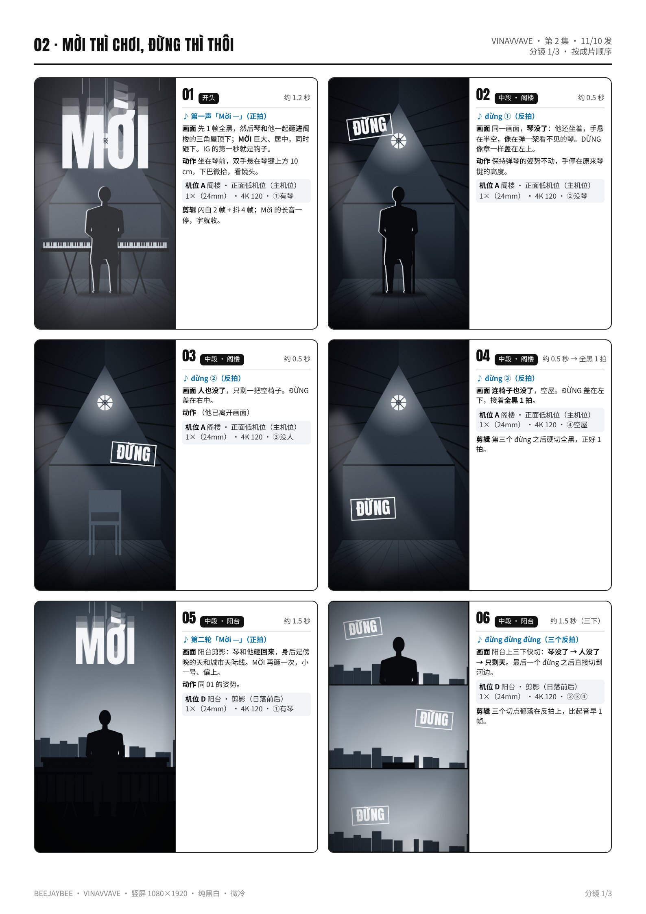
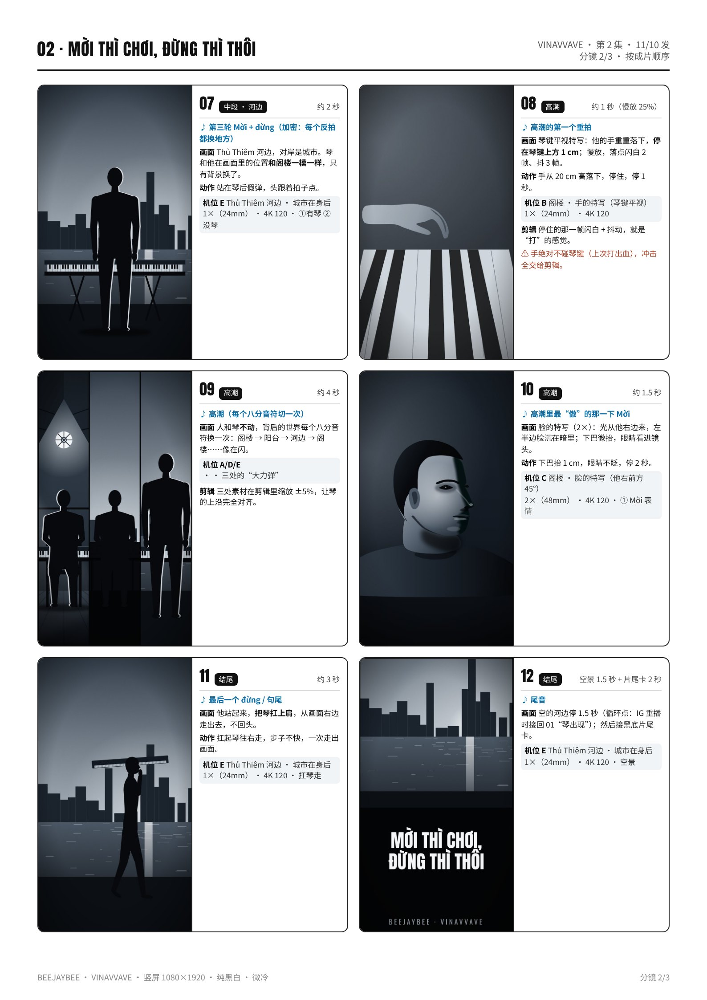
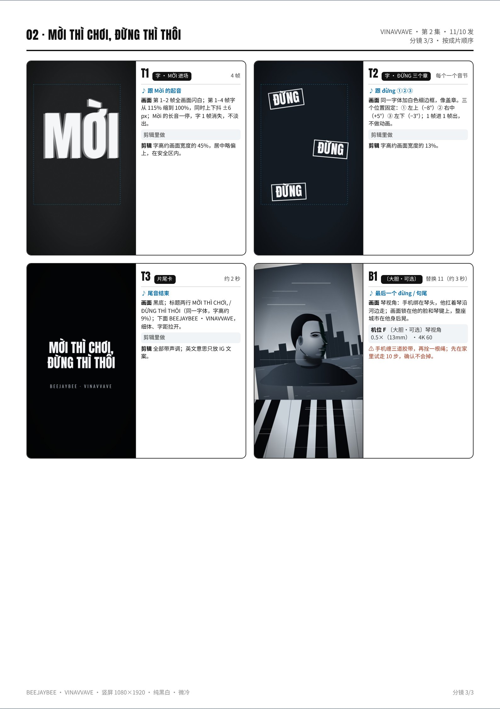

# 02 · MỜI THÌ CHƠI, ĐỪNG THÌ THÔI · 拍摄脚本

叫你来你就玩，不玩走｜第 2 集 · 11/10 发｜约 40 秒（30–50 秒都可以）｜颜色：纯黑白 · 微冷

设备：iPhone 16 Pro Max 一部，没有三脚架，靠家里现成的东西固定。通用设置见 [拍摄通用参数](拍摄通用参数_iPhone16ProMax.md)。完整版（含分镜图）见 [PDF](pdf/02_MOI_THI_CHOI_分镜脚本.pdf)。

**本集手法：**Mời（正拍）琴出现、换一个地方；đừng（三个反拍）依次消失：琴 → 人 → 椅子。高潮人和琴不动，背后的世界每个八分音符换一次。结尾扛琴走人，空景循环回第一帧。

## 这一集的特殊设置
- 所有机位都用 **4K 120 fps**：阁楼只开窗光、不开顶灯；外景是日光，不会频闪。
- 机位 A、D、E（三个地方的主机位）用**同一颗镜头 1×、同样离地 15 cm、同样距离约 2 m**，三处才能对齐。
- **网格线对齐**：琴的上沿压在下面那条三分线上，他的头顶在上面那条三分线附近，琴的中点在中间竖线上。第一个地方拍好后截一张屏，后面两处打开截图对照。
- 每个主机位都**“四段连录”**：按下录制后不碰手机，按“有琴 → 没琴 → 没人 → 空屋（空景）”的顺序，琴、人、椅子依次离开，全部录完再停。
- 他在画面里的位置：坐着，胸口正对镜头；光从他右边来（画面左边）。

## 机位表（每个机位拍完之前不碰手机）
### 机位 A · 阁楼 · 正面低机位（主机位）
- 镜头 / 帧率：1×（24mm） · 4K 120
- 支撑：两本厚书竖起来夹住手机（竖拍），放在地上，镜头离地 **15 cm**，正对琴，距离琴约 **2 m**；屋脊对准画面中间那条竖线。
- 曝光 / 对焦：长按他胸口锁 AE/AF，曝光 **−0.7EV**。窗户入画时宁可窗过曝，也不要他太暗。
- 要录的条：一条视频里连录：① 有琴，假弹 20 秒（最后 10 秒“大力弹”，手停在离琴键 1 cm）→ ② 起身把琴拿走，回来照原姿势对空气弹 15 秒 → ③ 人离开，只剩椅子 5 秒 → ④ 进来把椅子拿走，空屋 5 秒。整套 **录 3 遍**。

### 机位 B · 阁楼 · 手的特写（琴键平视）
- 镜头 / 帧率：1×（24mm） · 4K 120
- 支撑：书堆放在琴的左端外侧，手机竖拍，镜头高度 = 琴键上方 2 cm，顺着琴键看向他的手，离最近的手约 **40 cm**。
- 曝光 / 对焦：长按他右手锁 AE/AF，**−0.7EV**。
- 要录的条：手从 20 cm 高处落下，**停在琴键上方 1 cm**，停 1 秒再抬起，连做 10 次；然后把琴拿走，对着空气同样做 10 次（琴消失版）。

### 机位 C · 阁楼 · 脸的特写（他右前方 45°）
- 镜头 / 帧率：2×（48mm） · 4K 120
- 支撑：桌子上叠三本书，镜头和他眼睛一样高，在他右前方 45°，距离约 **0.9 m**。
- 曝光 / 对焦：长按他右眼（亮的一侧）锁 AE/AF，**−0.7EV**：左半边脸要沉进暗里。
- 要录的条：① Mời：下巴微抬 1 cm，眼睛看进镜头，停 2 秒；② đừng：眼睛从镜头移开，看向画面左外，停 2 秒；③ 弹琴时的侧脸，头跟着拍子点。**每种 3 条**。

### 机位 D · 阳台 · 剪影（日落前后）
- 镜头 / 帧率：1×（24mm） · 4K 120
- 支撑：书夹手机放阳台地面，离地 **15 cm**、距离约 **2 m**，书底下垫一支笔让镜头稍微仰一点：天空占画面上半部分，他整个人压在天上。琴放在椅子或小桌上，高度和阁楼一样。
- 曝光 / 对焦：长按他头旁边的天空锁 AE/AF，**−1.7EV**，人和琴要全黑成剪影。
- 要录的条：同 A 的“四段连录”（有琴 → 没琴 → 没人 → 空景）＋ 大力弹 10 秒，**录 2 遍**。17:15–17:40 之间拍完。

### 机位 E · Thủ Thiêm 河边 · 城市在身后
- 镜头 / 帧率：1×（24mm） · 4K 120
- 支撑：背包放地上，两本书夹住手机立在背包前，离地 **15 cm**，距离约 **2 m**。琴放在河边长椅或矮墙上，他站在琴后假弹。打开第一处的截图，按网格线对齐。
- 曝光 / 对焦：长按他胸口锁 AE/AF，**−0.7EV**；对岸天空太亮时改 **−1.0EV**。
- 要录的条：四段连录（有琴 → 没琴 → 没人 → 空景）× 2 遍；大力弹 10 秒；**扛琴走出画面 3 条**（从画面右边出，走完再多录 5 秒空景）。

### 机位 F · 〔大胆·可选〕琴视角
- 镜头 / 帧率：0.5×（13mm） · 4K 60
- 支撑：手机用胶带**缠三道**绑在琴的左端，镜头对着他的脸，再用一根绳把手机绕在琴上做保险。
- 曝光 / 对焦：录之前对着他的脸锁 AE/AF，**−0.7EV**。
- 要录的条：他把琴扛在右肩上，沿河边走 20 秒，**3 条**。

## 分镜（按成片顺序）
### 01 · 开头 · 约 1.2 秒
- 声音：第一声「Mời —」（正拍）
- 画面：先 1 帧全黑，然后琴和他一起**砸进**阁楼的三角屋顶下；**MỜI** 巨大、居中，同时砸下。IG 的第一秒就是钩子。
- 动作：坐在琴前，双手悬在琴键上方 10 cm，下巴微抬，看镜头。
- 机位：A（①有琴）
- 剪辑：闪白 2 帧 + 抖 4 帧；Mời 的长音一停，字就收。

### 02 · 中段 · 阁楼 · 约 0.5 秒
- 声音：đừng ①（反拍）
- 画面：同一画面，**琴没了**：他还坐着，手悬在半空，像在弹一架看不见的琴。ĐỪNG 像章一样盖在左上。
- 动作：保持弹琴的姿势不动，手停在原来琴键的高度。
- 机位：A（②没琴）

### 03 · 中段 · 阁楼 · 约 0.5 秒
- 声音：đừng ②（反拍）
- 画面：**人也没了**，只剩一把空椅子。ĐỪNG 盖在右中。
- 动作：（他已离开画面）
- 机位：A（③没人）

### 04 · 中段 · 阁楼 · 约 0.5 秒 → 全黑 1 拍
- 声音：đừng ③（反拍）
- 画面：**连椅子也没了**，空屋。ĐỪNG 盖在左下，接着**全黑 1 拍**。
- 机位：A（④空屋）
- 剪辑：第三个 đừng 之后硬切全黑，正好 1 拍。

### 05 · 中段 · 阳台 · 约 1.5 秒
- 声音：第二轮「Mời —」（正拍）
- 画面：阳台剪影：琴和他**砸回来**，身后是傍晚的天和城市天际线。MỜI 再砸一次，小一号、偏上。
- 动作：同 01 的姿势。
- 机位：D（①有琴）

### 06 · 中段 · 阳台 · 约 1.5 秒（三下）
- 声音：đừng đừng đừng（三个反拍）
- 画面：阳台上三下快切：**琴没了 → 人没了 → 只剩天**。最后一个 đừng 之后直接切到河边。
- 机位：D（②③④）
- 剪辑：三个切点都落在反拍上，比起音早 1 帧。

### 07 · 中段 · 河边 · 约 2 秒
- 声音：第三轮 Mời + đừng（加密：每个反拍都换地方）
- 画面：Thủ Thiêm 河边，对岸是城市。琴和他在画面里的位置**和阁楼一模一样**，只有背景换了。
- 动作：站在琴后假弹，头跟着拍子点。
- 机位：E（①有琴 ②没琴）

### 08 · 高潮 · 约 1 秒（慢放 25%）
- 声音：高潮的第一个重拍
- 画面：琴键平视特写：他的手重重落下，**停在琴键上方 1 cm**；慢放，落点闪白 2 帧、抖 3 帧。
- 动作：手从 20 cm 高落下，停住，停 1 秒。
- 机位：B
- 剪辑：停住的那一帧闪白 + 抖动，就是“打”的感觉。
- 注意：手绝对不碰琴键（上次打出血），冲击全交给剪辑。

### 09 · 高潮 · 约 4 秒
- 声音：高潮（每个八分音符切一次）
- 画面：人和琴**不动**，背后的世界每个八分音符换一次：阁楼 → 阳台 → 河边 → 阁楼……像在闪。
- 机位：A/D/E（三处的“大力弹”）
- 剪辑：三处素材在剪辑里缩放 ±5%，让琴的上沿完全对齐。

### 10 · 高潮 · 约 1.5 秒
- 声音：高潮里最“傲”的那一下 Mời
- 画面：脸的特写（2×）：光从他右边来，左半边脸沉在暗里；下巴微抬，眼睛看进镜头。
- 动作：下巴抬 1 cm，眼睛不眨，停 2 秒。
- 机位：C（① Mời 表情）

### 11 · 结尾 · 约 3 秒
- 声音：最后一个 đừng / 句尾
- 画面：他站起来，**把琴扛上肩**，从画面右边走出去，不回头。
- 动作：扛起琴往右走，步子不快，一次走出画面。
- 机位：E（扛琴走）

### 12 · 结尾 · 空景 1.5 秒 + 片尾卡 2 秒
- 声音：尾音
- 画面：空的河边停 1.5 秒（循环点：IG 重播时接回 01“琴出现”）；然后接黑底片尾卡。
- 机位：E（空景）

### T1 · 字 · MỜI 进场 · 4 帧
- 声音：跟 Mời 的起音
- 画面：第 1–2 帧全画面闪白；第 1–4 帧字从 115% 缩到 100%，同时上下抖 ±6 px；Mời 的长音一停，字 1 帧消失，不淡出。
- 机位：剪辑里做
- 剪辑：字高约画面宽度的 45%，居中略偏上，在安全区内。

### T2 · 字 · ĐỪNG 三个章 · 每个一个音节
- 声音：跟 đừng ①②③
- 画面：同一字体加白色细边框，像盖章。三个位置固定：① 左上（−8°）② 右中（+5°）③ 左下（−3°）；1 帧进 1 帧出，不做动画。
- 机位：剪辑里做
- 剪辑：字高约画面宽度的 13%。

### T3 · 片尾卡 · 约 2 秒
- 声音：尾音结束
- 画面：黑底；标题两行 MỜI THÌ CHƠI, / ĐỪNG THÌ THÔI（同一字体，字高约 9%）；下面 BEEJAYBEE · VINAVVAVE，细体、字距拉开。
- 机位：剪辑里做
- 剪辑：全部带声调；英文意思只放 IG 文案。

### B1 · 〔大胆·可选〕 · 替换 11（约 3 秒）
- 声音：最后一个 đừng / 句尾
- 画面：琴视角：手机绑在琴头，他扛着琴沿河边走；画面锁在他的脸和琴键上，整座城市在他身后晃。
- 机位：F
- 注意：手机缠三道胶带，再拴一根绳；先在家里试走 10 步，确认不会掉。

## 拍摄顺序（≤ 3 小时）
| 时间 | 地点 | 做什么 |
|---|---|---|
| 14:45–15:00 | 阁楼 | 布置：琴放好、椅子、书夹手机（机位 A），地上贴站位 X；关掉顶灯，只用窗光；手机设 4K 120、锁定相机、网格、飞行模式。 |
| 15:00–15:35 | 阁楼 | **机位 A**：四段连录 × 3 遍（含大力弹）。每遍录完马上回看。 |
| 15:35–15:50 | 阁楼 | **机位 B**：手的特写，有琴 10 次 + 没琴 10 次。 |
| 15:50–16:05 | 阁楼 | **机位 C**：脸的特写，三种表情各 3 条；截一张机位 A 的屏，留着对齐用。 |
| 16:05–16:25 | 路上 | 带琴（琴包）、背包、两本书去 Thủ Thiêm 河边。 |
| 16:25–17:00 | 河边 | 先转一圈看背景（旗、横幅、招牌）；**机位 E**：四段连录 × 2、大力弹、扛琴走出画面 × 3；（可选）**机位 F** 琴视角 × 3。 |
| 17:00–17:15 | 路上 | 回家，手机充一下电。 |
| 17:15–17:40 | 阳台 | **机位 D**：剪影，四段连录 × 2 + 大力弹（日落约 17:30，前后 15 分钟最好）。收工。 |

## 道具清单
- GO:PIANO88（不用通电，只假弹）＋ 琴包或背带（约 7 kg）
- 琴架或桌子（在家用），椅子 1 把
- 厚书 4 本（两本夹手机，两本备用垫高）
- 胶带（地上贴站位 X；可选：琴视角绑手机）
- 背包（外景当手机支撑）
- 一支笔（垫在书下让镜头微仰）
- 毛巾或镜头布
- （可选）细绳 1 根（琴视角的保险）

## 字（上屏设计）
- **MỜI**：窄而粗的黑体（参考 Anton 一类的开源字体，不用任何品牌字体），白字，字高约画面宽度的 45%，居中略偏上，在安全区内。第 1–2 帧闪白，第 1–4 帧从 115% 缩到 100% 并抖 ±6 px；长音一停，1 帧消失。
- **ĐỪNG**：同一字体加白色细边框，像盖章，字高约画面宽度的 13%。① 左上 −8° ② 右中 +5° ③ 左下 −3°，每个只停一个音节，不做动画。
- **片尾卡**：黑底，MỜI THÌ CHƠI, / ĐỪNG THÌ THÔI 两行，下面 BEEJAYBEE · VINAVVAVE（细体、字距拉开），约 2 秒。
- 上屏只用带声调的越南语；英文意思只放 IG 文案：“Mời thì chơi, đừng thì thôi — play if you’re invited; if not, forget it.”

## 剪辑要点
- 时间线 1080×1920 / 30p；素材 4K 120；黑白微冷（饱和度 −100，阴影偏蓝约 5%）。
- Mời 切在正拍，đừng 切在反拍；每个切点比起音**早 1 帧**。
- 三个 đừng 的顺序固定：**没琴 → 没人 → 空屋**；第三个之后**全黑 1 拍**。
- 高潮：每个八分音符换一个地方，素材都取自三处“大力弹”的 10 秒；三处缩放 ±5%，让琴的上沿对齐。
- 手的特写慢放 25%（120 → 30）；手停住的那一帧闪白 2 帧 + 抖 3 帧。
- 结尾：空景 1.5 秒后接片尾卡；IG 循环时，空景接回 01“琴出现”。封面帧用第一个 MỜI 砸下的那一帧。
- 长度：按你给的小节表剪，30–50 秒都可以；具体切点对着 WAV 定。

## 开拍前 / 收工前检查
- 开拍前：电量 100%、存储留 50 GB、飞行模式、擦镜头；相机是 4K 120、锁定相机、网格已开。
- 每个机位：录完一条马上回看——构图、焦点、手有没有停在 1 cm、背景里有没有不该有的东西。
- 外景：先转一圈，旗、横幅标语、肖像、招牌商标都不能入画；对岸的广告大屏不入画，或者让它虚掉。
- 收工前：每个机位至少 3 条能用；每处空景至少 5 秒；当天把素材备份。
