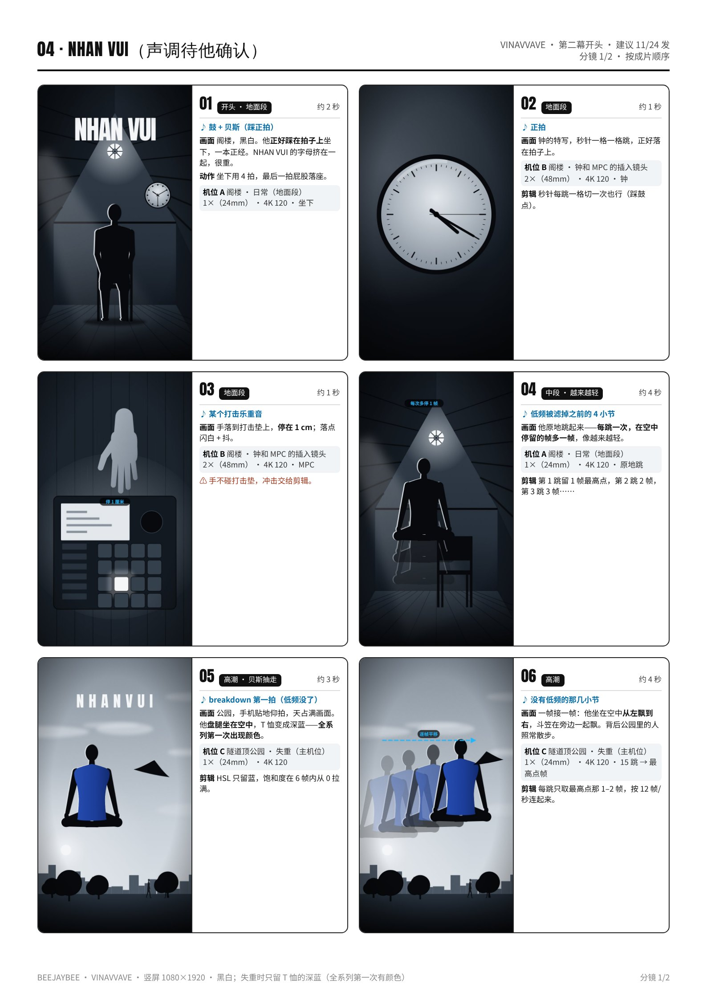
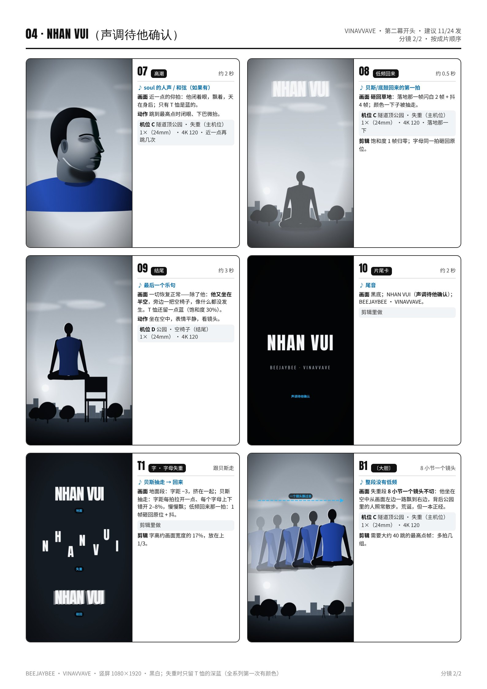

# 04 · NHAN VUI（声调待他确认） · 拍摄脚本

人生可喜｜第二幕开头 · 建议 11/24 发｜约 40 秒（30–50 秒都可以）｜颜色：黑白；失重时只留 T 恤的深蓝（全系列第一次有颜色）

设备：iPhone 16 Pro Max 一部，没有三脚架，靠家里现成的东西固定。通用设置见 [拍摄通用参数](拍摄通用参数_iPhone16ProMax.md)。完整版（含分镜图）见 [PDF](pdf/04_NHAN_VUI_分镜脚本.pdf)。

**本集手法：**贝斯一抽走，地心引力就没了，他坐在空气里；贝斯回来，一切砸回地面。失重的那几秒，全系列第一次出现颜色：他 T 恤的深蓝。

## 这一集的特殊设置
- 失重镜头全部 **4K 120 + 1×**：白天光足，快门会很快，跳到最高点的那一帧不会糊。
- 公园的主机位 **手机贴地仰拍**：手机竖着靠在背包上（或两块石头夹住），镜头稍微朝上，**地平线压在画面最下面 15%**，天占满画面。
- 每跳一次往右挪 **半步（约 50 cm）**：地上提前摆一排小石子当记号；跳起来时盘腿、背挺直、表情不变。
- 要“只留蓝”：他穿**深蓝纯色 T 恤**，画面里别有别的蓝色东西（蓝色垃圾桶、蓝色招牌都避开），后期只保留蓝色。
- 下午 4 点后拍，太阳在他侧后方（侧逆光），曝光锁在他身上，天亮一点没关系。

## 机位表（每个机位拍完之前不碰手机）
### 机位 A · 阁楼 · 日常（地面段）
- 镜头 / 帧率：1×（24mm） · 4K 120
- 支撑：椅子上叠书，手机竖拍，镜头高 **约 100 cm**，正对他，距离约 **2.5 m**；他、椅子、墙上的钟都在画面里。
- 曝光 / 对焦：锁他胸口，**−0.7EV**。
- 要录的条：每个动作正好 4 拍：坐下 → 站起 → 转头看钟 → 坐下；**3 轮**。再录 **10 次原地跳**（盘腿收腿），给“越来越轻”那段用。

### 机位 B · 阁楼 · 钟和 MPC 的插入镜头
- 镜头 / 帧率：2×（48mm） · 4K 120
- 支撑：桌上叠书，手机离钟约 **50 cm**；拍 MPC 时手机放在 MPC 侧面，和打击垫同高。
- 曝光 / 对焦：锁钟面 / 打击垫，**−0.7EV**。
- 要录的条：钟的秒针走 10 秒；手落到打击垫上方 **1 cm** 停住 × 10 次。

### 机位 C · 隧道顶公园 · 失重（主机位）
- 镜头 / 帧率：1×（24mm） · 4K 120
- 支撑：手机竖着靠在背包上贴地放，镜头稍朝上，离他约 **4 m**；地平线压在画面下 15%。地上摆一排小石子，间隔约 50 cm。
- 曝光 / 对焦：长按他的身体锁 AE/AF，**−0.3EV**（他不能是剪影，要看得见 T 恤的颜色）。
- 要录的条：**3 组 × 15 跳**：每跳在最高点盘腿、背挺直、表情不变，落地后往右挪到下一颗石子；再把斗笠往上抛 15 次（同样一颗石子挪一次）；最后录 10 秒空景。

### 机位 D · 公园 · 空椅子（结尾）
- 镜头 / 帧率：1×（24mm） · 4K 120
- 支撑：同 C，不动手机；把椅子放到最后一颗石子旁边。
- 曝光 / 对焦：同 C。
- 要录的条：空椅子 10 秒；他在椅子旁边原地跳 **10 次**（盘腿）。

## 分镜（按成片顺序）
### 01 · 开头 · 地面段 · 约 2 秒
- 声音：鼓 + 贝斯（踩正拍）
- 画面：阁楼，黑白。他**正好踩在拍子上**坐下，一本正经。NHAN VUI 的字母挤在一起，很重。
- 动作：坐下用 4 拍，最后一拍屁股落座。
- 机位：A（坐下）

### 02 · 地面段 · 约 1 秒
- 声音：正拍
- 画面：钟的特写，秒针一格一格跳，正好落在拍子上。
- 机位：B（钟）
- 剪辑：秒针每跳一格切一次也行（踩鼓点）。

### 03 · 地面段 · 约 1 秒
- 声音：某个打击乐重音
- 画面：手落到打击垫上，**停在 1 cm**；落点闪白 + 抖。
- 机位：B（MPC）
- 注意：手不碰打击垫，冲击交给剪辑。

### 04 · 中段 · 越来越轻 · 约 4 秒
- 声音：低频被滤掉之前的 4 小节
- 画面：他原地跳起来——**每跳一次，在空中停留的帧多一帧**，像越来越轻。
- 机位：A（原地跳）
- 剪辑：第 1 跳留 1 帧最高点，第 2 跳 2 帧，第 3 跳 3 帧……

### 05 · 高潮 · 贝斯抽走 · 约 3 秒
- 声音：breakdown 第一拍（低频没了）
- 画面：公园，手机贴地仰拍，天占满画面。他**盘腿坐在空中**，T 恤变成深蓝——**全系列第一次出现颜色**。
- 机位：C
- 剪辑：HSL 只留蓝，饱和度在 6 帧内从 0 拉满。

### 06 · 高潮 · 约 4 秒
- 声音：没有低频的那几小节
- 画面：一帧接一帧：他坐在空中**从左飘到右**，斗笠在旁边一起飘。背后公园里的人照常散步。
- 机位：C（15 跳 → 最高点帧）
- 剪辑：每跳只取最高点那 1–2 帧，按 12 帧/秒连起来。

### 07 · 高潮 · 约 2 秒
- 声音：soul 的人声 / 和弦（如果有）
- 画面：近一点的仰拍：他闭着眼，飘着，天在身后；只有 T 恤是蓝的。
- 动作：跳到最高点时闭眼、下巴微抬。
- 机位：C（近一点再跳几次）

### 08 · 低频回来 · 约 0.5 秒
- 声音：贝斯/底鼓回来的第一拍
- 画面：**砸回草地**：落地那一帧闪白 2 帧 + 抖 4 帧；颜色一下子被抽走。
- 机位：C（落地那一下）
- 剪辑：饱和度 1 帧归零；字母同一拍砸回原位。

### 09 · 结尾 · 约 3 秒
- 声音：最后一个乐句
- 画面：一切恢复正常——除了他：**他又坐在半空**，旁边一把空椅子，像什么都没发生。T 恤还留一点蓝（饱和度 30%）。
- 动作：坐在空中，表情平静，看镜头。
- 机位：D

### 10 · 片尾卡 · 约 2 秒
- 声音：尾音
- 画面：黑底；NHAN VUI（**声调待他确认**）；BEEJAYBEE · VINAVVAVE。
- 机位：剪辑里做

### T1 · 字 · 字母失重 · 跟贝斯走
- 声音：贝斯抽走 → 回来
- 画面：地面段：字距 −3，挤在一起；贝斯抽走：字距每拍拉开一点、每个字母上下错开 2–8%，慢慢飘；低频回来那一拍：1 帧砸回原位 + 抖。
- 机位：剪辑里做
- 剪辑：字高约画面宽度的 17%，放在上 1/3。

### B1 · 〔大胆〕 · 8 小节一个镜头
- 声音：整段没有低频
- 画面：失重段 **8 小节一个镜头不切**：他坐在空中从画面左边一路飘到右边，背后公园里的人照常散步。荒诞，但一本正经。
- 机位：C
- 剪辑：需要大约 40 跳的最高点帧：多拍几组。

## 拍摄顺序（≤ 3 小时）
| 时间 | 地点 | 做什么 |
|---|---|---|
| 14:45–15:00 | 阁楼 | 布置：椅子、钟入画、书堆机位 A；关顶灯；4K 120、锁定相机、网格。 |
| 15:00–15:35 | 阁楼 | **机位 A**：日常动作 3 轮 + 原地跳 10 次；**机位 B**：钟 10 秒、手停 1 cm × 10。 |
| 15:35–15:50 | 路上 | 带椅子、斗笠、背包、小石子去隧道顶公园。 |
| 15:50–17:00 | 公园 | 先转一圈（避开蓝色的东西、旗、横幅、招牌）；摆石子；**机位 C**：3 组 × 15 跳，每组之间歇 5 分钟；斗笠抛 15 次；空景 10 秒。 |
| 17:00–17:20 | 公园 | **机位 D**：空椅子 10 秒 + 椅子旁跳 10 次。 |
| 17:20–17:35 | 路上 | 回家，当天备份（约 2 小时 50 分）。 |

## 道具清单
- 深蓝纯色 T 恤（必须）
- 椅子 1 把（结尾带去公园）
- 斗笠（只当剪影 / 抛起来飘）
- 背包（手机贴地支撑）
- 小石子 10 颗（地面记号）
- 书（室内支撑）
- 水和毛巾（跳很累）

## 字（上屏设计）
- **NHAN VUI（声调待他确认）**：窄粗黑体，白字，放在上 1/3，字高约画面宽度的 17%。
- 地面段字距 −3，挤在一起很重；贝斯抽走时每拍拉开一点，字母上下错开、慢慢飘；低频回来那一拍 1 帧砸回原位 + 抖 4 帧。
- 上屏前一定要问他这两个字的声调，不要自己加。英文意思只放 IG 文案。

## 剪辑要点
- 时间线 1080×1920 / 30p；默认黑白微冷。
- **失重**：每跳取最高点那 1–2 帧，按 12 帧/秒（每帧停 2–3 个时间线帧）连起来，他就像坐着平移；斗笠同理。
- **颜色**：只在贝斯抽走的那段打开“只留蓝”（HSL 其他颜色饱和度 −100），6 帧内渐入；低频回来那一拍 1 帧归零；结尾留 30% 的蓝。
- 低频回来：闪白 2 帧 + 抖 4 帧；字母同一拍砸回原位。
- 越来越轻那段：第 n 跳在最高点停 n 帧。
- 长度按小节表剪，30–50 秒都可以。

## 开拍前 / 收工前检查
- 开拍前：深蓝 T 恤、电量 100%、存储 50 GB、飞行模式；4K 120、锁定相机。
- 公园：背景里没有蓝色的大东西、旗、横幅、招牌；人多的话等人走开再跳。
- 每组跳完回看：最高点那一帧清楚、姿势一致、没有出画。
- 安全：在草地上跳，鞋要防滑；累了就歇，别硬跳。
