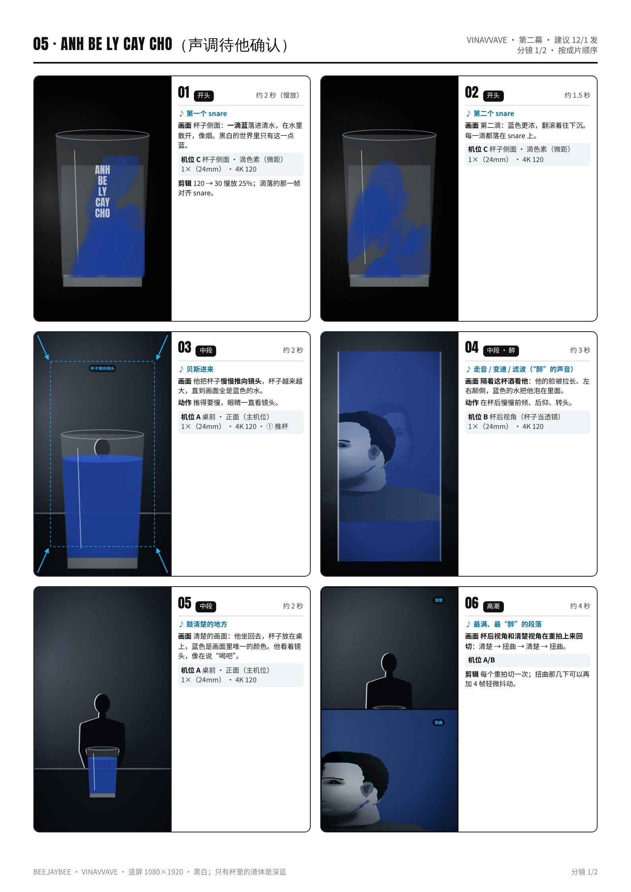
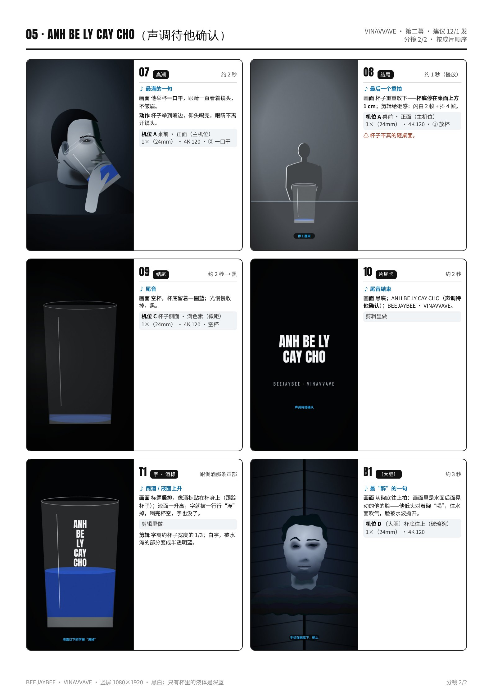

# 05 · ANH BE LY CAY CHO（声调待他确认） · 拍摄脚本

哥递给你这杯苦酒｜第二幕 · 建议 12/1 发｜约 40 秒（30–50 秒都可以）｜颜色：黑白；只有杯里的液体是深蓝

设备：iPhone 16 Pro Max 一部，没有三脚架，靠家里现成的东西固定。通用设置见 [拍摄通用参数](拍摄通用参数_iPhone16ProMax.md)。完整版（含分镜图）见 [PDF](pdf/05_ANH_BE_LY_CAY_CHO_分镜脚本.pdf)。

**本集手法：**这杯酒就是镜头：“醉”的声音一出来，画面就隔着这杯酒看，人和屋子在杯里弯曲、左右颠倒。杯里的蓝是全片唯一的颜色。

## 这一集的特殊设置
- 液体：**清水 + 一滴蓝色食用色素**（几块钱）。每条换一杯清水，色素一次只滴一滴。
- **他的 T 恤也是深蓝**：后期“只留蓝”时会把衣服一起留下来，所以要**加遮罩，只在杯子那块保留颜色**；他举杯的那几镜，用跟踪遮罩，或者那几镜整体黑白。
- **杯后视角**：手机镜头贴近直身玻璃杯 **3–5 cm**，用 1× 主摄，焦点锁在杯后的他身上（不是杯子）；杯子装满水，人在杯后 50–70 cm。
- 关掉顶灯，只留窗光（窗在他右边），杯壁反光才少；桌上铺深色布。
- 倒水、滴色素之前，**MPC 和琴全部拿开**，桌上只留杯子。

## 机位表（每个机位拍完之前不碰手机）
### 机位 A · 桌前 · 正面（主机位）
- 镜头 / 帧率：1×（24mm） · 4K 120
- 支撑：桌上叠书，手机竖拍，镜头高 = 桌面以上 **25 cm**，正对他，距离约 **1.3 m**；杯子在画面正中下方。
- 曝光 / 对焦：锁他的脸，**−0.7EV**。
- 要录的条：① 他把杯子慢慢往镜头推，一直推到杯子贴近镜头（画面全是杯子）× 3；② 举杯一口干，眼睛一直看镜头 × 3；③ 放杯：杯底**停在桌面上方 1 cm**，停 1 秒 × 5。

### 机位 B · 杯后视角（杯子当透镜）
- 镜头 / 帧率：1×（24mm） · 4K 120
- 支撑：书堆把手机顶在桌面上，镜头贴近杯子 **3–5 cm**、和杯子中间同高；杯子装满（蓝色或清水各录一遍）。
- 曝光 / 对焦：长按杯后的他（不是杯子）锁 AE/AF，**−0.5EV**。
- 要录的条：他在杯后 50–70 cm：慢慢前倾靠近 / 后仰离开 / 左右转头 / 举手 —— 每个动作 4 拍，录 3 遍。

### 机位 C · 杯子侧面 · 滴色素（微距）
- 镜头 / 帧率：1×（24mm） · 4K 120
- 支撑：书堆放在杯子侧面，镜头和水面下半杯同高，离杯壁约 **20 cm**；杯子后面挂一块黑布，窗光从侧面打进杯子。
- 曝光 / 对焦：长按杯子中间锁 AE/AF，**−1.0EV**（背景要黑）。
- 要录的条：色素从水面上方 5 cm 滴下，**一滴一条**，录 8 条（每条换一杯清水）。

### 机位 D · 〔大胆〕杯底往上（玻璃碗）
- 镜头 / 帧率：1×（24mm） · 4K 120
- 支撑：手机**屏幕朝下**平放在地上；两摞书放在手机两边，上面架一个装水的透明玻璃碗（碗底离镜头约 5 cm）。
- 曝光 / 对焦：先录 10 秒试拍、回看；锁在碗口上方他的脸，**−0.7EV**。
- 要录的条：他跪在旁边、低头对着碗“喝”（嘴不碰水）、往水面吹一口气让水面晃 × 3 条。

## 分镜（按成片顺序）
### 01 · 开头 · 约 2 秒（慢放）
- 声音：第一个 snare
- 画面：杯子侧面：**一滴蓝**落进清水，在水里散开，像烟。黑白的世界里只有这一点蓝。
- 机位：C
- 剪辑：120 → 30 慢放 25%；滴落的那一帧对齐 snare。

### 02 · 开头 · 约 1.5 秒
- 声音：第二个 snare
- 画面：第二滴：蓝色更浓，翻滚着往下沉。每一滴都落在 snare 上。
- 机位：C

### 03 · 中段 · 约 2 秒
- 声音：贝斯进来
- 画面：他把杯子**慢慢推向镜头**，杯子越来越大，直到画面全是蓝色的水。
- 动作：推得要慢，眼睛一直看镜头。
- 机位：A（① 推杯）

### 04 · 中段 · 醉 · 约 3 秒
- 声音：走音 / 变速 / 滤波（“醉”的声音）
- 画面：**隔着这杯酒看他**：他的脸被拉长、左右颠倒，蓝色的水把他泡在里面。
- 动作：在杯后慢慢前倾、后仰、转头。
- 机位：B

### 05 · 中段 · 约 2 秒
- 声音：鼓清楚的地方
- 画面：清楚的画面：他坐回去，杯子放在桌上，蓝色是画面里唯一的颜色。他看着镜头，像在说“喝吧”。
- 机位：A

### 06 · 高潮 · 约 4 秒
- 声音：最满、最“醉”的段落
- 画面：**杯后视角和清楚视角在重拍上来回切**：清楚 → 扭曲 → 清楚 → 扭曲。
- 机位：A/B
- 剪辑：每个重拍切一次；扭曲那几下可以再加 4 帧轻微抖动。

### 07 · 高潮 · 约 2 秒
- 声音：最满的一句
- 画面：他举杯**一口干**，眼睛一直看着镜头，不皱眉。
- 动作：杯子举到嘴边，仰头喝完，眼睛不离开镜头。
- 机位：A（② 一口干）

### 08 · 结尾 · 约 1 秒（慢放）
- 声音：最后一个重拍
- 画面：杯子重重放下——**杯底停在桌面上方 1 cm**；剪辑给砸感：闪白 2 帧 + 抖 4 帧。
- 机位：A（③ 放杯）
- 注意：杯子不真的砸桌面。

### 09 · 结尾 · 约 2 秒 → 黑
- 声音：尾音
- 画面：空杯，杯底留着**一圈蓝**；光慢慢收掉，黑。
- 机位：C（空杯）

### 10 · 片尾卡 · 约 2 秒
- 声音：尾音结束
- 画面：黑底；ANH BE LY CAY CHO（**声调待他确认**）；BEEJAYBEE · VINAVVAVE。
- 机位：剪辑里做

### T1 · 字 · 酒标 · 跟倒酒那条声部
- 声音：倒酒 / 液面上升
- 画面：标题**竖排**，像酒标贴在杯身上（跟踪杯子）；液面一升高，字就被一行行“淹”掉，喝完杯空，字也没了。
- 机位：剪辑里做
- 剪辑：字高约杯子宽度的 1/3；白字，被水淹的部分变成半透明蓝。

### B1 · 〔大胆〕 · 约 3 秒
- 声音：最“醉”的一句
- 画面：从碗底往上拍：画面里是水面后面晃动的他的脸——他低头对着碗“喝”，往水面吹气，脸被水波撕开。
- 机位：D

## 拍摄顺序（≤ 3 小时）
| 时间 | 地点 | 做什么 |
|---|---|---|
| 14:30–14:50 | 阁楼 | 布置：桌子靠窗（窗在他右边）、铺深色布、MPC 和琴拿开、关顶灯；准备 8 杯清水和色素。 |
| 14:50–15:20 | 阁楼 | **机位 C**：滴色素 × 8 条（每条换水）。 |
| 15:20–16:00 | 阁楼 | **机位 A**：推杯 × 3、一口干 × 3、放杯停 1 cm × 5。 |
| 16:00–16:30 | 阁楼 | **机位 B**：杯后视角，四个动作 × 3 遍（蓝水、清水各一遍）。 |
| 16:30–17:00 | 阁楼 | **机位 D**〔大胆〕：玻璃碗 × 3 条。 |
| 17:00–17:15 | 阁楼 | 擦干手机和桌子，回看，备份（约 2 小时 45 分）。 |

## 道具清单
- 直身玻璃杯 2 个（一个备用）
- 清水 8 杯的量 + 蓝色食用色素 1 瓶
- 深色桌布 / 黑布（挂在杯子后面）
- 透明玻璃碗（〔大胆〕用）
- 书 4–6 本、毛巾、纸巾
- 深蓝纯色 T 恤

## 字（上屏设计）
- **ANH BE LY CAY CHO（声调待他确认）**：窄粗黑体，**竖排**，像酒标贴在杯身上（剪辑里跟踪杯子）。
- 倒酒时液面上升，液面以下的字变成半透明蓝、被“淹掉”；喝完杯空，字一起消失。
- 片尾卡两行：ANH BE LY / CAY CHO + BEEJAYBEE · VINAVVAVE。上屏前确认声调；英文意思只放 IG 文案。

## 剪辑要点
- 时间线 1080×1920 / 30p；黑白微冷。
- **只留蓝 + 遮罩**：HSL 只留蓝之后，用遮罩只在杯子那块保留颜色（他的深蓝 T 恤要变回黑白）。
- 滴色素的那几条慢放 25%，滴落那一帧对齐 snare。
- “醉”的声音一出来就切杯后视角；最满的段落里，清楚 / 扭曲在每个重拍上来回切。
- 放杯：杯底停住的那一帧闪白 2 帧 + 抖 4 帧，就是“砸”的感觉。
- 长度按小节表剪，30–50 秒都可以。

## 开拍前 / 收工前检查
- 开拍前：电量 100%、存储 50 GB、飞行模式；4K 120、锁定相机。
- 水和电子设备分开：MPC、琴、电源线都离开桌面；手机旁边放毛巾。
- 每条回看：杯壁有没有反出窗户和手机；焦点在杯后的他身上。
- 〔大胆〕那条拍完，把手机擦干再收。
