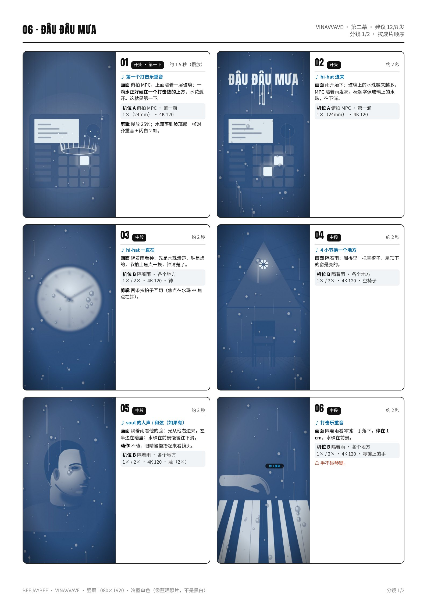
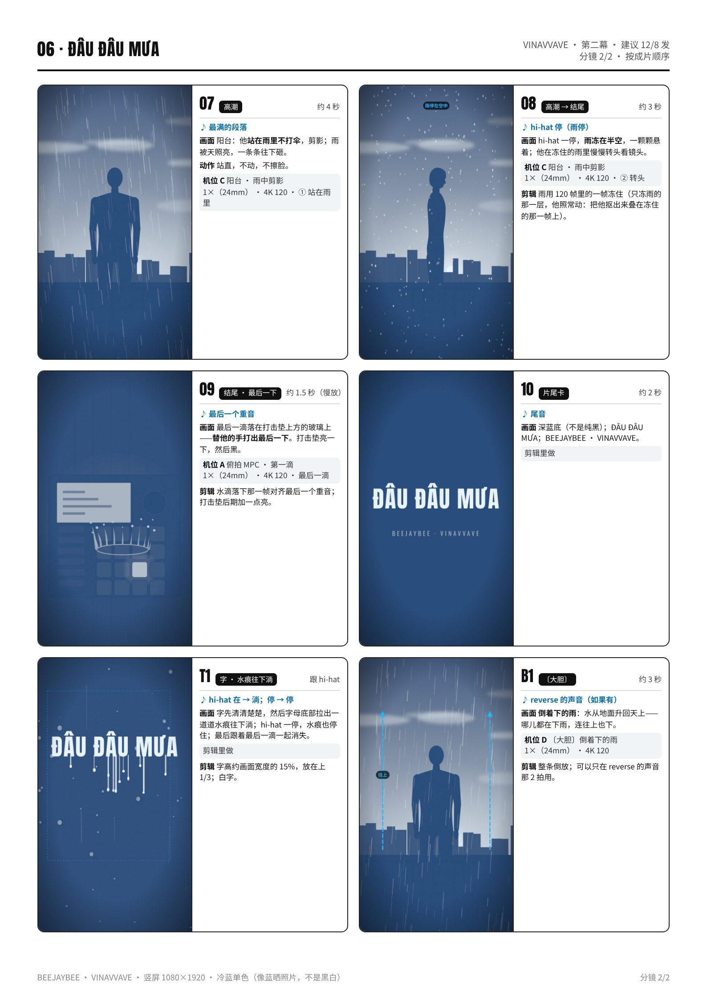

# 06 · ĐÂU ĐÂU MƯA · 拍摄脚本

哪哪都下雨｜第二幕 · 建议 12/8 发｜约 40 秒（30–50 秒都可以）｜颜色：冷蓝单色（像蓝晒照片，不是黑白）

设备：iPhone 16 Pro Max 一部，没有三脚架，靠家里现成的东西固定。通用设置见 [拍摄通用参数](拍摄通用参数_iPhone16ProMax.md)。完整版（含分镜图）见 [PDF](pdf/06_DAU_DAU_MUA_分镜脚本.pdf)。

**本集手法：**带着一块“雨”去每个地方：镜头前放一块喷了水珠的相框玻璃，所有地方都隔着雨看。雨跟着 hi-hat 走，hi-hat 一停，雨就冻在半空。

## 这一集的特殊设置
- **随身的雨**：拆一个 A4 左右的相框，只用里面那块玻璃；用喷壶喷上水珠，架在镜头前 **10–20 cm**（两摞书夹住玻璃），手机在玻璃后面拍。
- **换焦点**：每个地方录两条：一条焦点锁在水珠上，一条锁在后面的东西上，剪辑时按拍子互切；也可以录的时候在节拍上点一下屏幕换焦点。
- **冻住的雨**一定要在亮处拍（阳台对着天，日落前），4K 120 + 快门快，雨滴才是清楚的点。
- **水和电子设备分开**：俯拍 MPC 时，玻璃架在 MPC 上方 10 cm 的两摞书上，水只落在玻璃上；旁边放毛巾。
- 没下雨就做一个“雨棚”：大塑料瓶底部扎 20 个小洞，装满水，用绳子挂在阳台晾衣杆上，在他头顶上方——能下 30 秒。
- 后期整片做成**冷蓝单色**：先去色，再把暗部压成深蓝、亮部偏浅蓝（像蓝晒照片）。

## 机位表（每个机位拍完之前不碰手机）
### 机位 A · 俯拍 MPC · 第一滴
- 镜头 / 帧率：1×（24mm） · 4K 120
- 支撑：俯拍架：两把椅子背对背，扫把杆横在中间，手机缠三道胶带绑在杆中间，镜头朝下，离玻璃约 **45 cm**；玻璃架在 MPC 上方 10 cm 的两摞书上。
- 曝光 / 对焦：长按一个打击垫锁 AE/AF，**−0.7EV**。
- 要录的条：用勺子或滴管，从玻璃上方 20 cm 让**一滴水**落在正对某个打击垫的位置 × 10 次；最后一条留给结尾（最后一滴）。

### 机位 B · 隔着雨 · 各个地方
- 镜头 / 帧率：1× / 2× · 4K 120
- 支撑：书堆夹住手机；喷了水珠的玻璃竖着夹在镜头前 **10–20 cm**。按顺序换：钟、空椅子、镜子里的他、他的脸、琴键上的手。
- 曝光 / 对焦：每处两条：① 长按水珠锁 AE/AF；② 长按后面的东西锁 AE/AF。都 **−0.7EV**。
- 要录的条：每个地方 2 条 × 8 秒；每两条之间重新喷一次水。脸用 2×，其他用 1×。

### 机位 C · 阳台 · 雨中剪影
- 镜头 / 帧率：1×（24mm） · 4K 120
- 支撑：手机放在屋檐下淋不到的地方（书堆），离地 **30 cm**，距离他约 **2.5 m**；他站在阳台中间，背后是天。
- 曝光 / 对焦：长按他头旁边的天锁 AE/AF，**−1.5EV**（他是剪影，雨滴被天照亮）。
- 要录的条：① 站在雨里不打伞，不动，20 秒 × 2；② 慢慢转头看镜头 × 3（给“冻住的雨”用）。

### 机位 D · 〔大胆〕倒着下的雨
- 镜头 / 帧率：1×（24mm） · 4K 120
- 支撑：阳台，手机侧面对着天，书堆固定，离地 **60 cm**。
- 曝光 / 对焦：锁天，**−1.5EV**。
- 要录的条：他用浇花壶 / 喷壶从高处往下倒水，水在逆光里落到地面 × 5 条；后期**倒放**。

## 分镜（按成片顺序）
### 01 · 开头 · 第一下 · 约 1.5 秒（慢放）
- 声音：第一个打击乐重音
- 画面：俯拍 MPC，上面隔着一层玻璃：**一滴水正好砸在一个打击垫的上方**，水花溅开。这就是第一下。
- 机位：A
- 剪辑：慢放 25%；水滴落到玻璃那一帧对齐重音 + 闪白 2 帧。

### 02 · 开头 · 约 2 秒
- 声音：hi-hat 进来
- 画面：雨开始下：玻璃上的水珠越来越多，MPC 隔着雨发亮。标题字像玻璃上的水珠，往下淌。
- 机位：A

### 03 · 中段 · 约 2 秒
- 声音：hi-hat 一直在
- 画面：隔着雨看钟：先是水珠清楚、钟是虚的，节拍上焦点一换，钟清楚了。
- 机位：B（钟）
- 剪辑：两条按拍子互切（焦点在水珠 ↔ 焦点在钟）。

### 04 · 中段 · 约 2 秒
- 声音：4 小节换一个地方
- 画面：隔着雨：阁楼里一把空椅子，屋顶下的窗是亮的。
- 机位：B（空椅子）

### 05 · 中段 · 约 2 秒
- 声音：soul 的人声 / 和弦（如果有）
- 画面：隔着雨看他的脸：光从他右边来，左半边在暗里；水珠在前景慢慢往下滑。
- 动作：不动，眼睛慢慢抬起来看镜头。
- 机位：B（脸（2×））

### 06 · 中段 · 约 2 秒
- 声音：打击乐重音
- 画面：隔着雨看琴键：手落下，**停在 1 cm**，水珠在前景。
- 机位：B（琴键上的手）
- 注意：手不碰琴键。

### 07 · 高潮 · 约 4 秒
- 声音：最满的段落
- 画面：阳台：他**站在雨里不打伞**，剪影；雨被天照亮，一条条往下砸。
- 动作：站直，不动，不擦脸。
- 机位：C（① 站在雨里）

### 08 · 高潮 → 结尾 · 约 3 秒
- 声音：hi-hat 停（雨停）
- 画面：hi-hat 一停，**雨冻在半空**，一颗颗悬着；他在冻住的雨里慢慢转头看镜头。
- 机位：C（② 转头）
- 剪辑：雨用 120 帧里的一帧冻住（只冻雨的那一层，他照常动：把他抠出来叠在冻住的那一帧上）。

### 09 · 结尾 · 最后一下 · 约 1.5 秒（慢放）
- 声音：最后一个重音
- 画面：最后一滴落在打击垫上方的玻璃上——**替他的手打出最后一下**。打击垫亮一下，然后黑。
- 机位：A（最后一滴）
- 剪辑：水滴落下那一帧对齐最后一个重音；打击垫后期加一点亮。

### 10 · 片尾卡 · 约 2 秒
- 声音：尾音
- 画面：深蓝底（不是纯黑）；ĐÂU ĐÂU MƯA；BEEJAYBEE · VINAVVAVE。
- 机位：剪辑里做

### T1 · 字 · 水痕往下淌 · 跟 hi-hat
- 声音：hi-hat 在 → 淌；停 → 停
- 画面：字先清清楚楚，然后字母底部拉出一道道水痕往下淌；hi-hat 一停，水痕也停住；最后跟着最后一滴一起消失。
- 机位：剪辑里做
- 剪辑：字高约画面宽度的 15%，放在上 1/3；白字。

### B1 · 〔大胆〕 · 约 3 秒
- 声音：reverse 的声音（如果有）
- 画面：**倒着下的雨**：水从地面升回天上——哪儿都在下雨，连往上也下。
- 机位：D
- 剪辑：整条倒放；可以只在 reverse 的声音那 2 拍用。

## 拍摄顺序（≤ 3 小时）
| 时间 | 地点 | 做什么 |
|---|---|---|
| 15:30–15:50 | 阁楼 | 布置：俯拍架（两把椅子 + 扫把杆）、MPC 上方 10 cm 架玻璃、毛巾；准备喷壶、滴管/勺子。 |
| 15:50–16:20 | 阁楼 | **机位 A**：滴水 × 10。 |
| 16:20–17:00 | 阁楼 | **机位 B**：湿玻璃在镜头前，钟 / 空椅子 / 镜子 / 脸 / 手，每处 2 条（两种焦点）。 |
| 17:00–17:40 | 阳台 | 挂“雨棚”（或者用真雨）；**机位 C**：站在雨里 × 2、转头 × 3（日落前，天要亮）。 |
| 17:40–18:00 | 阳台 | **机位 D**〔大胆〕：倒水 × 5。 |
| 18:00–18:15 | — | 擦干手机、玻璃、地面；回看、备份（约 2 小时 45 分）。 |

## 道具清单
- 相框玻璃（A4 左右，边角用胶带包住防割手）
- 喷壶、浇花壶、滴管或小勺
- 大塑料瓶 + 绳子（雨棚）
- 两把椅子 + 扫把杆 + 胶带 + 绳子（俯拍架）
- 书 4–6 本、毛巾 2 条
- 深蓝纯色 T 恤（会淋湿，带一件换的）

## 字（上屏设计）
- **ĐÂU ĐÂU MƯA**：窄粗黑体，白字，上 1/3，字高约画面宽度的 15%。
- 字像玻璃上的水珠：先清楚，然后字母底部拉出水痕往下淌；hi-hat 停，水痕也停；最后一滴落下时字消失。
- 片尾卡用深蓝底（整片是冷蓝单色）。英文意思只放 IG 文案。

## 剪辑要点
- 时间线 1080×1920 / 30p；**整片冷蓝单色**：去色 → 暗部压深蓝、亮部浅蓝（蓝晒照片的感觉），不是黑白。
- 雨跟 hi-hat：hi-hat 在，雨正常速度下；hi-hat 停，从 120 帧素材里取一帧把雨冻住（他那一层照常动）。
- “隔着雨”的地方，每 4 小节换一个；焦点在水珠 ↔ 后面的东西，在拍子上互切。
- 第一滴、最后一滴都慢放 25%，水滴落到玻璃那一帧对齐重音。
- 长度按小节表剪，30–50 秒都可以。

## 开拍前 / 收工前检查
- 开拍前：电量 100%、存储 50 GB、飞行模式；4K 120、锁定相机；手机旁放毛巾。
- 水只落在玻璃上，不落在 MPC、琴、插线板上；俯拍架下面的手机要绑牢。
- 阳台：地滑，穿防滑的鞋；玻璃边角包好胶带。
- 收工后：擦干手机（尤其是充电口），再充电。
