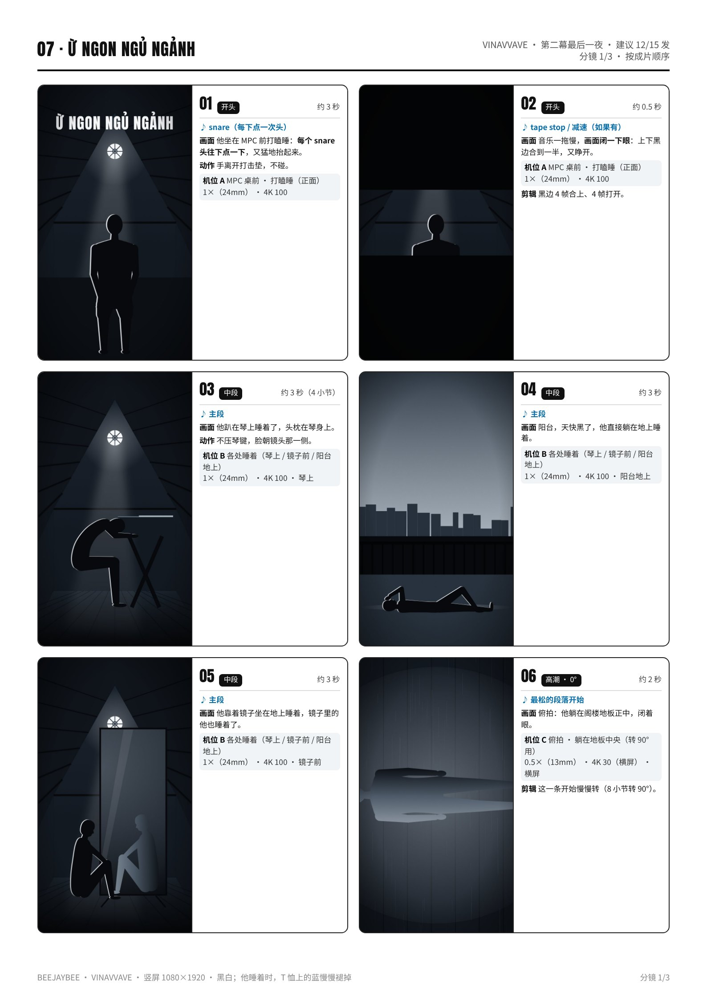
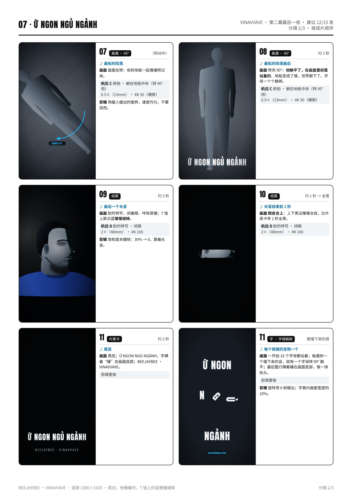
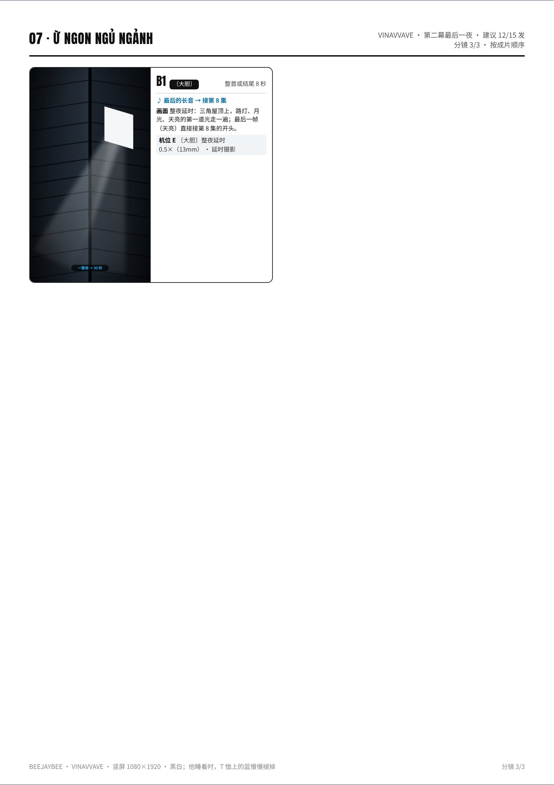

# 07 · Ừ NGON NGỦ NGẢNH · 拍摄脚本

算了，睡了吧｜第二幕最后一夜 · 建议 12/15 发｜约 40 秒（30–50 秒都可以）｜颜色：黑白；他睡着时，T 恤上的蓝慢慢褪掉

设备：iPhone 16 Pro Max 一部，没有三脚架，靠家里现成的东西固定。通用设置见 [拍摄通用参数](拍摄通用参数_iPhone16ProMax.md)。完整版（含分镜图）见 [PDF](pdf/07_U_NGON_NGU_NGANH_分镜脚本.pdf)。

**本集手法：**画面跟他一起睡着：他躺下，整个画面在 8 小节里慢慢转 90 度，他躺平了，在画面里却站着，世界横过来；最后上下黑边像眼皮一样合上。

## 这一集的特殊设置
- **俯拍转 90° 的那条用横屏拍**：手机横着绑在俯拍架上，0.5×（13mm）· 4K 30，镜头离地约 **1 m**，他的全身都在画面里；时间线里放到 **102%**，转 90° 也不会露黑边。
- 俯拍架：两把椅子背对背，扫把杆横在中间，手机缠三道胶带 + 一根绳；**正下方是他，不放 MPC**。
- “睡着”要真的放松：脸、手、肩膀都松掉，别演。
- 颜色：默认黑白；他睡着的那几镜，T 恤的蓝从 30% 慢慢褪到 0（HSL 只留蓝 + 饱和度关键帧）。
- 晚上拍：屋里只开一盏台灯当“月光”，放在他右边；台灯是 LED 的话，慢动作用 **4K 100**（避开频闪）。

## 机位表（每个机位拍完之前不碰手机）
### 机位 A · MPC 桌前 · 打瞌睡（正面）
- 镜头 / 帧率：1×（24mm） · 4K 100
- 支撑：桌上叠书，手机竖拍，镜头高 = 他的眼睛，正对他，距离约 **1.2 m**。
- 曝光 / 对焦：锁他的脸，**−0.7EV**。
- 要录的条：他坐在 MPC 前，**每个 snare 头往下点一下**，手离开打击垫（不碰），20 秒 × 3 条。

### 机位 B · 各处睡着（琴上 / 镜子前 / 阳台地上）
- 镜头 / 帧率：1×（24mm） · 4K 100
- 支撑：书堆放在地上或椅子上，每处一个固定机位；他在画面里占 2/3。
- 曝光 / 对焦：锁他的身体，**−0.7EV**（阳台用天光时 **−1.0EV**）。
- 要录的条：每处“睡着” 12 秒 × 2 条：头枕在琴身上（不压琴键）；靠着镜子坐在地上；躺在阳台地上。

### 机位 C · 俯拍 · 躺在地板中央（转 90° 用）
- 镜头 / 帧率：0.5×（13mm） · 4K 30（横屏）
- 支撑：俯拍架，手机**横着**绑在杆中间，镜头朝下，离地约 **1 m**；他躺在正下方，头朝画面左边。
- 曝光 / 对焦：锁他的胸口，**−0.7EV**。
- 要录的条：躺好，慢慢闭眼，40 秒不动 × 3 条；再录一条他翻身侧睡。

### 机位 D · 脸的特写 · 闭眼
- 镜头 / 帧率：2×（48mm） · 4K 100
- 支撑：桌子 + 书，镜头和眼睛同高，在他右前方 45°，约 **0.9 m**。
- 曝光 / 对焦：锁他右眼，**−0.7EV**。
- 要录的条：慢慢闭眼、呼吸放慢，10 秒 × 3。

### 机位 E · 〔大胆〕整夜延时
- 镜头 / 帧率：0.5×（13mm） · 延时摄影
- 支撑：手机**屏幕朝下**平放在阁楼地板正中，后置镜头对着三角屋顶；插着充电线。
- 曝光 / 对焦：延时模式会自动曝光；先录 10 秒试拍，确认屋脊在画面中线上。
- 要录的条：他真的睡一整夜（睡在镜头旁边，不入画也行）；早上停止。

## 分镜（按成片顺序）
### 01 · 开头 · 约 3 秒
- 声音：snare（每下点一次头）
- 画面：他坐在 MPC 前打瞌睡：**每个 snare 头往下点一下**，又猛地抬起来。
- 动作：手离开打击垫，不碰。
- 机位：A

### 02 · 开头 · 约 0.5 秒
- 声音：tape stop / 减速（如果有）
- 画面：音乐一拖慢，**画面闭一下眼**：上下黑边合到一半，又睁开。
- 机位：A
- 剪辑：黑边 4 帧合上、4 帧打开。

### 03 · 中段 · 约 3 秒（4 小节）
- 声音：主段
- 画面：他趴在琴上睡着了，头枕在琴身上。
- 动作：不压琴键，脸朝镜头那一侧。
- 机位：B（琴上）

### 04 · 中段 · 约 3 秒
- 声音：主段
- 画面：阳台，天快黑了，他直接躺在地上睡着。
- 机位：B（阳台地上）

### 05 · 中段 · 约 3 秒
- 声音：主段
- 画面：他靠着镜子坐在地上睡着，镜子里的他也睡着了。
- 机位：B（镜子前）

### 06 · 高潮 · 0° · 约 2 秒
- 声音：最松的段落开始
- 画面：俯拍：他躺在阁楼地板正中，闭着眼。
- 机位：C（横屏）
- 剪辑：这一条开始慢慢转（8 小节转 90°）。

### 07 · 高潮 · 45° · （转动中）
- 声音：最松的段落
- 画面：画面在转：他和地板一起慢慢转过来。
- 机位：C
- 剪辑：用缓入缓出的旋转，速度均匀，不要突然。

### 08 · 高潮 · 90° · 约 2 秒
- 声音：最松的段落最后
- 画面：转完 90°：**他躺平了，在画面里却是站着的**，地板变成了墙，世界躺下了。字母一个个躺倒。
- 机位：C

### 09 · 结尾 · 约 2 秒
- 声音：最后一个长音
- 画面：脸的特写，闭着眼，呼吸很慢；T 恤上那点蓝**慢慢褪掉**。
- 机位：D
- 剪辑：饱和度关键帧：30% → 0，跟着长音。

### 10 · 结尾 · 约 1 秒 → 全黑
- 声音：长音结束前 1 秒
- 画面：**眼皮合上**：上下黑边慢慢合拢，比片尾卡早 1 秒全黑。
- 机位：D

### 11 · 片尾卡 · 约 2 秒
- 声音：尾音
- 画面：黑底；Ừ NGON NGỦ NGẢNH，字横着“睡”在画面底部；BEEJAYBEE · VINAVVAVE。
- 机位：剪辑里做

### T1 · 字 · 字母躺倒 · 跟慢下来的音
- 声音：每个拖慢的音倒一个
- 画面：一开始 16 个字母都站着；每遇到一个慢下来的音，就有一个字母转 90° 躺平；最后整行横着睡在画面底部，像一排枕头。
- 机位：剪辑里做
- 剪辑：旋转用 6 帧缓出；字高约画面宽度的 10%。

### B1 · 〔大胆〕 · 整首或结尾 8 秒
- 声音：最后的长音 → 接第 8 集
- 画面：整夜延时：三角屋顶上，路灯、月光、天亮的第一道光走一遍；最后一帧（天亮）直接接第 8 集的开头。
- 机位：E

## 拍摄顺序（≤ 3 小时）
| 时间 | 地点 | 做什么 |
|---|---|---|
| 15:00–15:20 | 阁楼 | 布置：MPC 桌、书堆机位 A；台灯放在他右边。 |
| 15:20–15:50 | 阁楼 | **机位 A**：打瞌睡 × 3 条。 |
| 15:50–16:40 | 阁楼 / 阳台 | **机位 B**：琴上、镜子前、阳台地上，各 2 条（阳台放在天快黑的时候）。 |
| 16:40–17:20 | 阁楼 | 搭俯拍架（手机横着、0.5×）；**机位 C**：躺在地板中央 × 3 + 翻身 × 1。 |
| 17:20–17:40 | 阁楼 | **机位 D**：闭眼特写 × 3。 |
| 17:40–17:55 | 阁楼 | 回看、备份（约 2 小时 55 分）。〔大胆〕延时：晚上睡前摆好，早上停。 |

## 道具清单
- 两把椅子 + 扫把杆 + 胶带 + 绳子（俯拍架）
- 台灯 1 盏（当月光，放他右边）
- 枕头（可入画）
- 书 4–6 本
- 充电线（整夜延时用）
- 深蓝纯色 T 恤

## 字（上屏设计）
- **Ừ NGON NGỦ NGẢNH**：窄粗黑体，白字，字高约画面宽度的 10%。
- 字母一个个躺倒：每个慢下来的音转 90° 躺平一个，最后整行横着睡在画面底部。
- 片尾卡上的字也是横着躺在底部。英文意思只放 IG 文案。

## 剪辑要点
- 时间线 1080×1920 / 30p；黑白微冷。
- **画面转 90°**：俯拍那条（横屏 4K）放到 102%，在 8 小节里用缓入缓出转 90°，不露黑边。
- **眼皮**：上下两条黑边，拖慢的声音一出来，4 帧合到一半、4 帧打开；结尾合拢，比片尾卡早 1 秒全黑。
- 各处睡着：4 小节换一个地方，切点落在小节的第一拍。
- 颜色：只在他睡着的几镜开“只留蓝”，饱和度 30% → 0 跟着长音褪掉。
- 长度按小节表剪，30–50 秒都可以。

## 开拍前 / 收工前检查
- 开拍前：电量 100%、存储 50 GB、飞行模式；4K 100（台灯）、锁定相机。
- 俯拍架下面只有人，没有 MPC、琴、玻璃杯；手机三道胶带 + 一根绳。
- 每条回看：他的全身都在画面里、头的位置每条一样。
- 〔大胆〕延时：手机插着电；勿扰模式；开始前清出存储。
