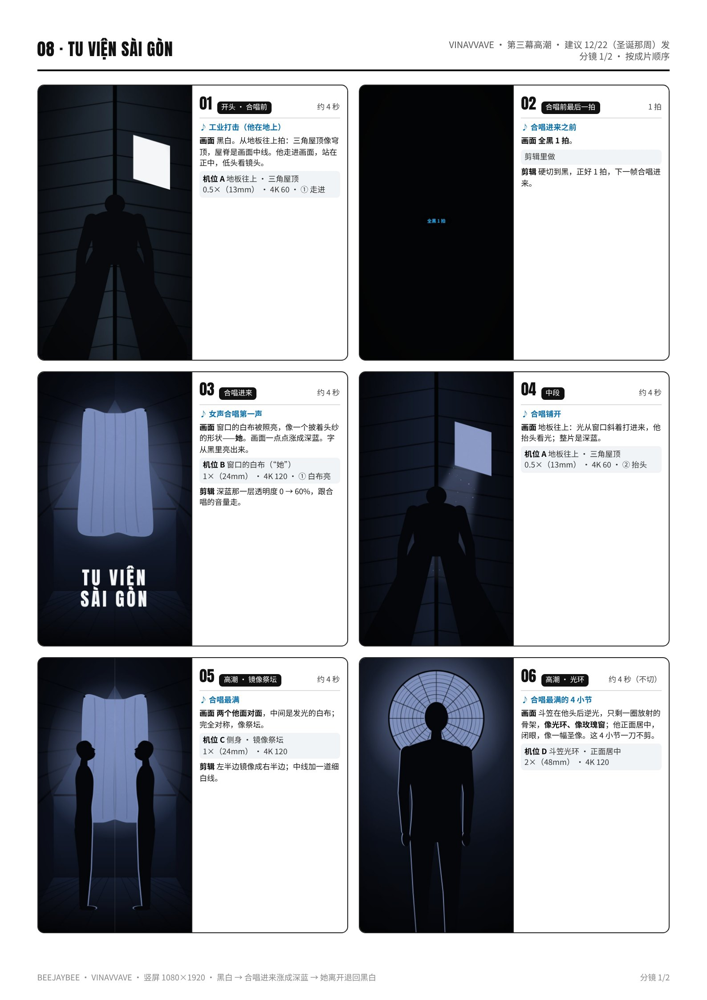
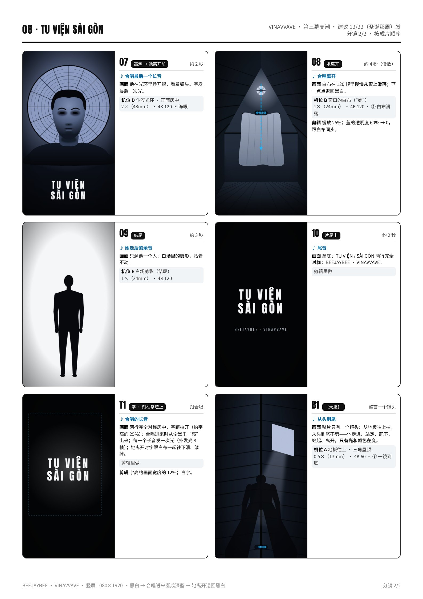

# 08 · TU VIỆN SÀI GÒN · 拍摄脚本

西贡修道院｜第三幕高潮 · 建议 12/22（圣诞那周）发｜约 45 秒（30–50 秒都可以）｜颜色：黑白 → 合唱进来涨成深蓝 → 她离开退回黑白

设备：iPhone 16 Pro Max 一部，没有三脚架，靠家里现成的东西固定。通用设置见 [拍摄通用参数](拍摄通用参数_iPhone16ProMax.md)。完整版（含分镜图）见 [PDF](pdf/08_TU_VIEN_SAI_GON_分镜脚本.pdf)。

**本集手法：**她不现身，只有光：合唱一进来，窗口的白布被照亮成一个披着头纱的形状，画面涨成深蓝；她离开时，白布在 120 帧里慢慢滑落，蓝退回黑白。

## 这一集的特殊设置
- 这一集全靠窗光：**选窗光最强的 1.5 小时**拍机位 B、D、E（太阳直射窗户时，白布最亮）。
- **白布**：一条白床单，上面两个角用胶带贴在窗框上；下角绑一根细绳，拉到画面外。拉一下绳，胶带脱开，白布就滑下来。每次重新挂好。
- **地板往上拍（机位 A）**：手机屏幕朝下平放在阁楼地板正中，用后置 **0.5×**；看不到屏幕，先录 10 秒试拍、回看，确认屋脊在画面中线上。
- **逆光**（白布、斗笠、窗）一律长按亮处锁 AE/AF，压到 **−1.5EV**，人是剪影或半剪影。
- **斗笠**只当剪影：挂在窗前，逆光里只剩一圈放射的骨架，他站在斗笠前面，头正好在斗笠中心。

## 机位表（每个机位拍完之前不碰手机）
### 机位 A · 地板往上 · 三角屋顶
- 镜头 / 帧率：0.5×（13mm） · 4K 60
- 支撑：手机**屏幕朝下**平放在阁楼地板正中，屋脊对准画面中线；他站在手机正上方（两脚在手机两边）。
- 曝光 / 对焦：长按屋顶靠窗那一侧锁 AE/AF，**−1.0EV**。
- 要录的条：① 走进画面、站定、低头看镜头 × 3；② 慢慢抬头看窗口 × 3；③〔大胆〕一镜到底：走进—站定—跪下—站起—离开 × 2。

### 机位 B · 窗口的白布（“她”）
- 镜头 / 帧率：1×（24mm） · 4K 120
- 支撑：书堆放在地上，离窗约 **2.5 m**，镜头稍微仰，窗和白布在画面上 2/3。
- 曝光 / 对焦：长按白布最亮处锁 AE/AF，**−1.5EV**。
- 要录的条：① 白布被照亮，20 秒 × 3；② 拉绳让白布滑落 × 5（每次重新挂）。

### 机位 C · 侧身 · 镜像祭坛
- 镜头 / 帧率：1×（24mm） · 4K 120
- 支撑：书堆放在椅子上，镜头高约 **120 cm**，正对窗；他站在画面中线左边，侧身脸朝中线（朝白布）。
- 曝光 / 对焦：锁白布，**−1.5EV**（他是半剪影）。
- 要录的条：侧身站定 4 拍，慢慢抬头看白布 4 拍 × 3 条。剪辑里把左半边镜像成右半边。

### 机位 D · 斗笠光环 · 正面居中
- 镜头 / 帧率：2×（48mm） · 4K 120
- 支撑：斗笠用绳挂在窗前；他站在斗笠前 **30 cm**，镜头高 = 他的眼睛，距离约 **2 m**；从镜头看，他的头正好在斗笠中心。
- 曝光 / 对焦：长按斗笠的亮处锁 AE/AF，**−1.5EV**。
- 要录的条：正面站定、闭眼 8 拍 × 3；睁眼看镜头 4 拍 × 3。

### 机位 E · 白场剪影（结尾）
- 镜头 / 帧率：1×（24mm） · 4K 120
- 支撑：同 B 的位置；白布拿掉，他站在窗前。
- 曝光 / 对焦：长按屋里暗处锁 AE/AF，**0EV**：窗全白，他是黑剪影。
- 要录的条：站定不动 10 秒 × 3。

## 分镜（按成片顺序）
### 01 · 开头 · 合唱前 · 约 4 秒
- 声音：工业打击（他在地上）
- 画面：黑白。从地板往上拍：三角屋顶像穹顶，屋脊是画面中线。他走进画面，站在正中，低头看镜头。
- 机位：A（① 走进）

### 02 · 合唱前最后一拍 · 1 拍
- 声音：合唱进来之前
- 画面：**全黑 1 拍**。
- 机位：剪辑里做
- 剪辑：硬切到黑，正好 1 拍，下一帧合唱进来。

### 03 · 合唱进来 · 约 4 秒
- 声音：女声合唱第一声
- 画面：窗口的白布被照亮，像一个披着头纱的形状——**她**。画面一点点涨成深蓝。字从黑里亮出来。
- 机位：B（① 白布亮）
- 剪辑：深蓝那一层透明度 0 → 60%，跟合唱的音量走。

### 04 · 中段 · 约 4 秒
- 声音：合唱铺开
- 画面：地板往上：光从窗口斜着打进来，他抬头看光；整片是深蓝。
- 机位：A（② 抬头）

### 05 · 高潮 · 镜像祭坛 · 约 4 秒
- 声音：合唱最满
- 画面：**两个他面对面**，中间是发光的白布；完全对称，像祭坛。
- 机位：C
- 剪辑：左半边镜像成右半边；中线加一道细白线。

### 06 · 高潮 · 光环 · 约 4 秒（不切）
- 声音：合唱最满的 4 小节
- 画面：斗笠在他头后逆光，只剩一圈放射的骨架，**像光环、像玫瑰窗**；他正面居中，闭眼，像一幅圣像。这 4 小节一刀不剪。
- 机位：D

### 07 · 高潮 → 她离开前 · 约 2 秒
- 声音：合唱最后一个长音
- 画面：他在光环里睁开眼，看着镜头。字发最后一次光。
- 机位：D（睁眼）

### 08 · 她离开 · 约 4 秒（慢放）
- 声音：合唱离开
- 画面：白布在 120 帧里**慢慢从窗上滑落**；蓝一点点退回黑白。
- 机位：B（② 白布滑落）
- 剪辑：慢放 25%；蓝的透明度 60% → 0，跟白布同步。

### 09 · 结尾 · 约 3 秒
- 声音：她走后的余音
- 画面：只剩他一个人：**白场里的剪影**，站着不动。
- 机位：E

### 10 · 片尾卡 · 约 2 秒
- 声音：尾音
- 画面：黑底；TU VIỆN / SÀI GÒN 两行完全对称；BEEJAYBEE · VINAVVAVE。
- 机位：剪辑里做

### T1 · 字 · 刻在祭坛上 · 跟合唱
- 声音：合唱的长音
- 画面：两行完全对称居中，字距拉开（约字高的 25%）；合唱进来时从全黑里“亮”出来；每一个长音发一次光（外发光 8 帧）；她离开时字跟白布一起往下滑、淡掉。
- 机位：剪辑里做
- 剪辑：字高约画面宽度的 12%；白字。

### B1 · 〔大胆〕 · 整首一个镜头
- 声音：从头到尾
- 画面：整片只有一个镜头：从地板往上拍，从头到尾不剪——他走进、站定、跪下、站起、离开，**只有光和颜色在变**。
- 机位：A（③ 一镜到底）

## 拍摄顺序（≤ 3 小时）
| 时间 | 地点 | 做什么 |
|---|---|---|
| （窗光最强前 20 分钟） | 阁楼 | 布置：白床单挂窗（上面两角贴胶带，下角绑细绳拉到画面外）；斗笠用绳挂好；书堆、椅子。 |
| +0:20 – +0:50 | 阁楼 | **机位 B**：白布亮 × 3、滑落 × 5（每次重新挂）。 |
| +0:50 – +1:20 | 阁楼 | **机位 A**：走进 × 3、抬头 × 3；〔大胆〕一镜到底 × 2。 |
| +1:20 – +1:50 | 阁楼 | **机位 C**：侧身对称 × 3。 |
| +1:50 – +2:20 | 阁楼 | **机位 D**：斗笠光环 × 6。 |
| +2:20 – +2:40 | 阁楼 | **机位 E**：白场剪影 × 3。 |
| +2:40 – +2:55 | 阁楼 | 回看、备份。 |

## 道具清单
- 白床单 1 条
- 胶带、细绳（拉白布）
- 斗笠 1 顶 + 挂斗笠的绳（只当剪影）
- 书、椅子（手机支撑）
- 深蓝纯色 T 恤

## 字（上屏设计）
- **TU VIỆN / SÀI GÒN**：窄粗黑体，两行完全对称居中，字距拉开，像刻在祭坛上；字高约画面宽度的 12%。
- 合唱进来时从全黑里“亮”出来；合唱的每个长音外发光一次（8 帧）；她离开时跟白布一起往下滑、淡掉。
- 片尾卡同样两行对称 + BEEJAYBEE · VINAVVAVE。英文意思只放 IG 文案：“Tu viện Sài Gòn — the Saigon monastery.”

## 剪辑要点
- 时间线 1080×1920 / 30p；开头黑白微冷。
- **涨蓝**：加一层深蓝（约 #1B3C96）用“正片叠底”或“颜色”混合，透明度 0 → 60% 跟着合唱的音量走；她离开时 60% → 0，跟白布滑落同步。
- 合唱进来前**全黑 1 拍**；合唱最满的 4 小节（斗笠光环）一刀不剪。
- 镜像祭坛：左半边镜像成右半边，中线加一道细白线。
- 白布滑落：120 → 30 慢放 25%。
- 长度按小节表剪，30–50 秒都可以（这一集可以放到 45–50 秒）。

## 开拍前 / 收工前检查
- 开拍前：电量 100%、存储 50 GB、飞行模式；地板往上那条用 0.5× · 4K 60。
- 白布每次滑落前检查胶带只贴了一点点，一拉就掉；绳子不入画。
- 逆光镜头每条回看：剪影干净、窗外没有招牌和旗。
- 斗笠只当剪影，不戴在头上。
