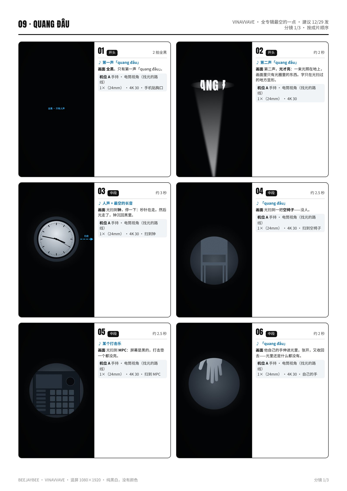
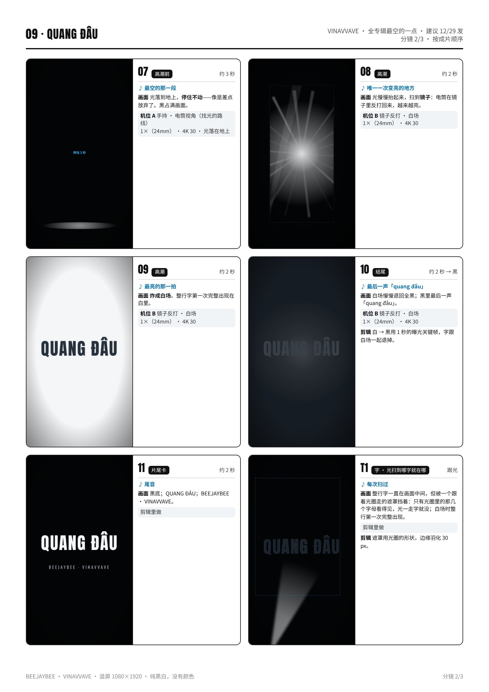
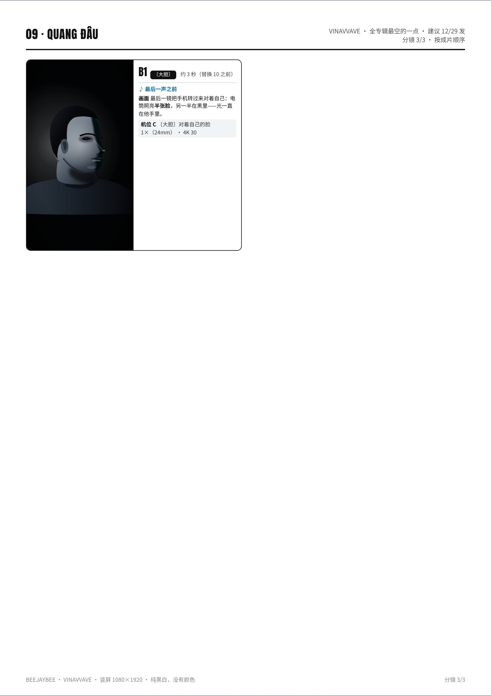

# 09 · QUANG ĐÂU · 拍摄脚本

光在哪里｜全专辑最空的一点 · 建议 12/29 发｜约 35 秒（30–50 秒都可以）｜颜色：纯黑白，没有颜色

设备：iPhone 16 Pro Max 一部，没有三脚架，靠家里现成的东西固定。通用设置见 [拍摄通用参数](拍摄通用参数_iPhone16ProMax.md)。完整版（含分镜图）见 [PDF](pdf/09_QUANG_DAU_分镜脚本.pdf)。

**本集手法：**手机就是唯一的光：全片只开手机电筒，镜头和光是同一样东西，拍到哪，哪才亮；每问一次「quang đâu」，光扫一次，扫过去就黑；最后光扫到镜子，自己反打回来，炸成白场。

## 这一集的特殊设置
- **全片手持**（全系列唯一一集）：视频模式里点闪电图标，把闪光灯设成**常亮**——电筒和镜头在同一个方向。
- 用 **1× · 4K 30**：只有电筒的光，30 帧比 120 帧亮得多、干净得多；打开“增强防抖”。
- 夜里拍，关掉所有灯，窗用被子挡住：**黑要真黑**。
- 曝光：先把电筒对着 1 m 外的一样东西，长按锁 AE/AF，再拖到 **−1.0EV**，扫到哪里都不会自己变亮变暗。
- 镜子的角度：**斜 10–15°** 时电筒不会直接反进镜头；**正对**才会炸成白场——先试好再录。
- “找光的路线”提前摆好：钟 → 空椅子 → MPC → 他的手 → 地面 → 镜子，按这个顺序扫。

## 机位表（每个机位拍完之前不碰手机）
### 机位 A · 手持 · 电筒视角（找光的路线）
- 镜头 / 帧率：1×（24mm） · 4K 30
- 支撑：手持，手肘贴着身体走，动作慢；电筒常亮。每个东西离镜头 **0.8–1.2 m**。
- 曝光 / 对焦：对着 1 m 外的东西锁 AE/AF，**−1.0EV**。
- 要录的条：一整条从黑开始：手机贴在胸口（全黑）→ 抬起来 → 扫到钟停 1 秒 → 扫走 → 椅子 → MPC → 自己的手伸进光里 → 光落到地上停住 → 慢慢抬起、扫到镜子。**5 条**，每条 40–60 秒。

### 机位 B · 镜子反打 · 白场
- 镜头 / 帧率：1×（24mm） · 4K 30
- 支撑：手持，正对镜子走近，最后停在离镜子 **1 m**，手机**正对**镜面。
- 曝光 / 对焦：同 A，不要重新锁。
- 要录的条：先斜 15° 走近（不炸），再转到正对（炸成白），停 3 秒 × 6 条。

### 机位 C · 〔大胆〕对着自己的脸
- 镜头 / 帧率：1×（24mm） · 4K 30
- 支撑：手机转过来，后置镜头对着自己，手臂伸直（约 **60 cm**），手机放在他**右前方**，让左半边脸落进暗里。
- 曝光 / 对焦：对着自己的脸锁 AE/AF，**−0.7EV**。
- 要录的条：慢慢把手机从下往上抬到脸前，光一下子照亮半张脸，停 3 秒 × 3 条。

## 分镜（按成片顺序）
### 01 · 开头 · 2 拍全黑
- 声音：第一声「quang đâu」
- 画面：**全黑**。只有第一声「quang đâu」。
- 机位：A（手机贴胸口）

### 02 · 开头 · 约 2 秒
- 声音：第二声「quang đâu」
- 画面：第二声，**光才亮**：一束光照在地上，画面里只有光圈里的东西。字只在光扫过的地方显形。
- 机位：A

### 03 · 中段 · 约 3 秒
- 声音：人声 + 最空的长音
- 画面：光扫到**钟**，停一下：秒针在走。然后光走了，钟沉回黑里。
- 机位：A（扫到钟）

### 04 · 中段 · 约 2.5 秒
- 声音：「quang đâu」
- 画面：光扫到一把**空椅子**——没人。
- 机位：A（扫到空椅子）

### 05 · 中段 · 约 2.5 秒
- 声音：某个打击乐
- 画面：光扫到 **MPC**：屏幕是黑的，打击垫一个都没亮。
- 机位：A（扫到 MPC）

### 06 · 中段 · 约 2 秒
- 声音：「quang đâu」
- 画面：他自己的手伸进光里，张开，又收回去——光里还是什么都没有。
- 机位：A（自己的手）

### 07 · 高潮前 · 约 3 秒
- 声音：最空的那一段
- 画面：光落到地上，**停住不动**——像是差点放弃了。黑占满画面。
- 机位：A（光落在地上）

### 08 · 高潮 · 约 2 秒
- 声音：唯一一次变亮的地方
- 画面：光慢慢抬起来，扫到**镜子**：电筒在镜子里反打回来，越来越亮。
- 机位：B

### 09 · 高潮 · 约 2 秒
- 声音：最亮的那一拍
- 画面：**炸成白场**。整行字第一次完整出现在白里。
- 机位：B

### 10 · 结尾 · 约 2 秒 → 黑
- 声音：最后一声「quang đâu」
- 画面：白场慢慢退回全黑；黑里最后一声「quang đâu」。
- 机位：B
- 剪辑：白 → 黑用 1 秒的曝光关键帧，字跟白场一起退掉。

### 11 · 片尾卡 · 约 2 秒
- 声音：尾音
- 画面：黑底；QUANG ĐÂU；BEEJAYBEE · VINAVVAVE。
- 机位：剪辑里做

### T1 · 字 · 光扫到哪字就在哪 · 跟光
- 声音：每次扫过
- 画面：整行字一直在画面中间，但被一个跟着光圈走的遮罩挡着：只有光圈里的那几个字母看得见，光一走字就没；白场时整行第一次完整出现。
- 机位：剪辑里做
- 剪辑：遮罩用光圈的形状，边缘羽化 30 px。

### B1 · 〔大胆〕 · 约 3 秒（替换 10 之前）
- 声音：最后一声之前
- 画面：最后一镜把手机转过来对着自己：电筒照亮**半张脸**，另一半在黑里——光一直在他手里。
- 机位：C

## 拍摄顺序（≤ 3 小时）
| 时间 | 地点 | 做什么 |
|---|---|---|
| 20:00–20:15 | 阁楼 | 布置：关灯、窗用被子挡住；钟、空椅子、MPC、镜子摆成一条路线；手机：1× · 4K 30、闪光灯常亮、防抖开。 |
| 20:15–21:00 | 阁楼 | **机位 A**：找光路线 × 5 条（每条 40–60 秒）。 |
| 21:00–21:20 | 阁楼 | **机位 B**：镜子反打 × 6（先试角度）。 |
| 21:20–21:35 | 阁楼 | **机位 C**〔大胆〕：对着自己的脸 × 3。 |
| 21:35–21:50 | 阁楼 | 回看、备份（约 1 小时 50 分）。 |

## 道具清单
- 落地镜
- 钟
- 空椅子
- MPC（不开机，屏幕黑）
- 被子或厚窗帘（挡窗）
- 深蓝纯色 T 恤

## 字（上屏设计）
- **QUANG ĐÂU**：窄粗黑体，白字，居中，字高约画面宽度的 16%。
- 字一直在，但只有被光扫到的部分看得见（遮罩跟着光圈走），光走字就没。
- 白场时整行字第一次完整出现，然后跟白场一起退掉。英文意思只放 IG 文案。

## 剪辑要点
- 时间线 1080×1920 / 30p；纯黑白，黑要压到真黑（暗部 0）。
- 每次「quang đâu」= 一次扫光：切点落在人声的起音上，扫过去就黑。
- 黑的时间要比亮的多：开头 2 拍全黑；光停在地上那段不要剪短。
- 镜子炸白：曝光关键帧把白再推满 8 帧，然后 1 秒退回黑。
- 长度按小节表剪，30–50 秒都可以（这一集短一点更空）。

## 开拍前 / 收工前检查
- 开拍前：电量 100%（电筒很耗电）、存储 30 GB、飞行模式；1× · 4K 30、闪光灯常亮。
- 屋里一点光都不能有（看一眼路由器、充电器的指示灯）。
- 每条回看：黑是不是真黑、光圈里的东西清不清楚。
- 手持走动时注意脚下：先把地上的线和杂物收好。
