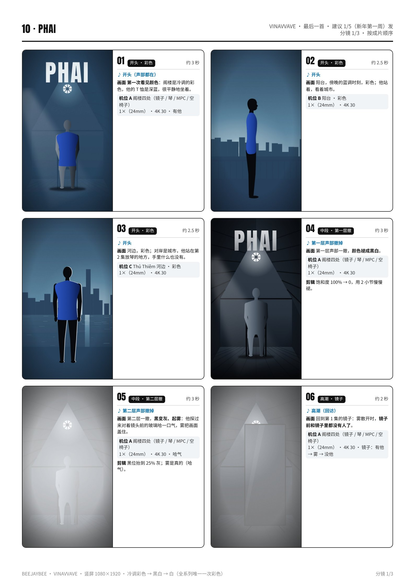
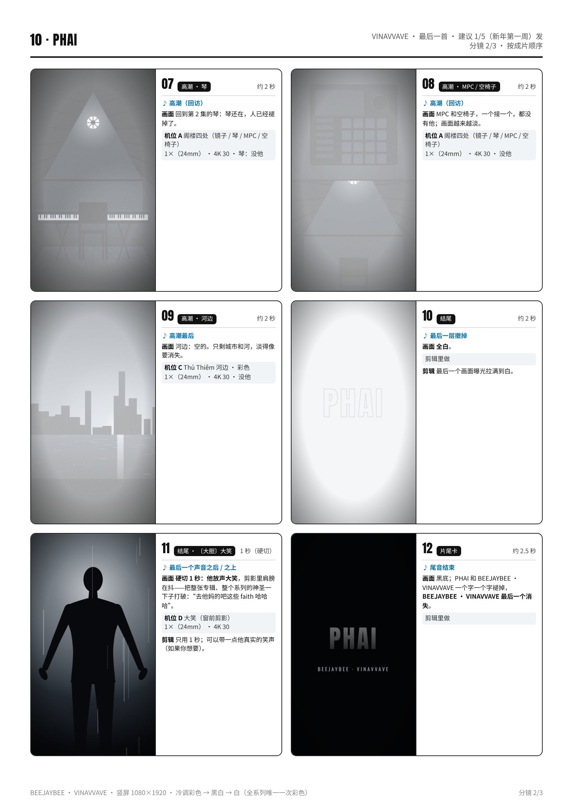
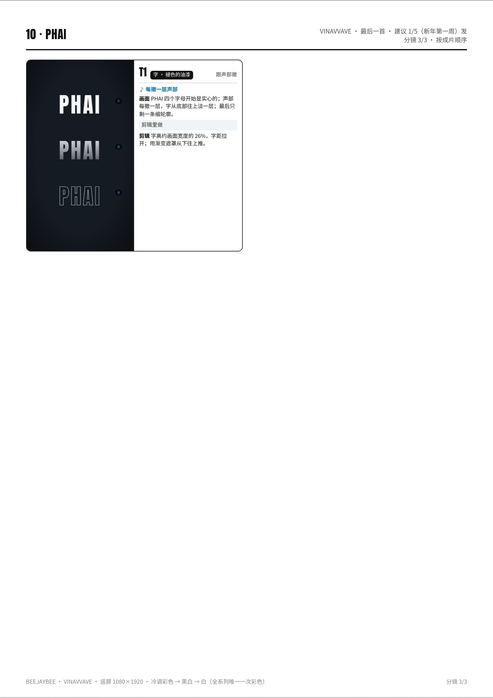

# 10 · PHAI · 拍摄脚本

消散｜最后一首 · 建议 1/5（新年第一周）发｜约 45 秒（30–50 秒都可以）｜颜色：冷调彩色 → 黑白 → 白（全系列唯一一次彩色）

设备：iPhone 16 Pro Max 一部，没有三脚架，靠家里现成的东西固定。通用设置见 [拍摄通用参数](拍摄通用参数_iPhone16ProMax.md)。完整版（含分镜图）见 [PDF](pdf/10_PHAI_分镜脚本.pdf)。

**本集手法：**phai 本来就是“褪色”：这一集从彩色开始，一层层褪——先褪成黑白，再褪成雾，最后他从前几集的每个地方褪掉，只剩空景；最后一秒，他笑了。

## 这一集的特殊设置
- **彩色**：只有这一集要保留颜色。设置里打开“锁定白平衡”；尽量在阴天光、窗光、蓝调时刻拍，后期整体往冷调（不要暖黄）。
- **有他 / 没他**：每个地方一个固定机位，按录制后不碰手机，先“有他”10 秒，再“哈气”，再“没他”10 秒，一条录完。
- **哈气起雾**：相框玻璃竖着夹在镜头前 **10 cm**；他从画面侧面探进来，对着玻璃哈一口长气，然后从侧面退出画面；雾散开时他已经不在了。
- 天冷不起雾的话：玻璃先放冰箱 5 分钟再拿出来，哈气就会起雾。
- 每个地方的机位尽量和前几集一样（同样的高度和距离），这一集是在“回访”。

## 机位表（每个机位拍完之前不碰手机）
### 机位 A · 阁楼四处（镜子 / 琴 / MPC / 空椅子）
- 镜头 / 帧率：1×（24mm） · 4K 30
- 支撑：书堆固定，机位和前几集一样；玻璃夹在镜头前 10 cm。
- 曝光 / 对焦：锁他的身体，**−0.7EV**；白平衡锁定。
- 要录的条：每处一条：有他 10 秒 → 哈气 → 没他 10 秒；**每处 2 条**。

### 机位 B · 阳台 · 彩色
- 镜头 / 帧率：1×（24mm） · 4K 30
- 支撑：书堆放在阳台地上，离地 15 cm；玻璃在镜头前。
- 曝光 / 对焦：锁他，**−0.7EV**（天太亮时 **−1.0EV**）。
- 要录的条：有他 → 哈气 → 没他 × 2 条（傍晚蓝调时刻）。

### 机位 C · Thủ Thiêm 河边 · 彩色
- 镜头 / 帧率：1×（24mm） · 4K 30
- 支撑：背包 + 书，离地 15 cm，和第 2 集同一个位置。
- 曝光 / 对焦：锁他，**−0.7EV**。
- 要录的条：有他 → 哈气 → 没他 × 2 条。

### 机位 D · 大笑（窗前剪影）
- 镜头 / 帧率：1×（24mm） · 4K 30
- 支撑：书堆放在椅子上，对着窗，离他约 **2 m**。
- 曝光 / 对焦：长按窗户锁 AE/AF，**−1.5EV**：他是剪影。
- 要录的条：真的笑出来（想一件真好笑的事），肩膀在抖，5 条；只取最好的 1 秒。

## 分镜（按成片顺序）
### 01 · 开头 · 彩色 · 约 3 秒
- 声音：开头（声部都在）
- 画面：**第一次看见颜色**：阁楼是冷调的彩色，他的 T 恤是深蓝，很平静地坐着。
- 机位：A（有他）

### 02 · 开头 · 彩色 · 约 2.5 秒
- 声音：开头
- 画面：阳台，傍晚的蓝调时刻，彩色；他站着，看着城市。
- 机位：B

### 03 · 开头 · 彩色 · 约 2.5 秒
- 声音：开头
- 画面：河边，彩色；对岸是城市，他站在第 2 集放琴的地方，手里什么也没有。
- 机位：C

### 04 · 中段 · 第一层撤 · 约 3 秒
- 声音：第一层声部撤掉
- 画面：第一层声部一撤，**颜色褪成黑白**。
- 机位：A
- 剪辑：饱和度 100% → 0，用 2 小节慢慢褪。

### 05 · 中段 · 第二层撤 · 约 3 秒
- 声音：第二层声部撤掉
- 画面：第二层一撤，**黑变灰、起雾**：他探过来对着镜头前的玻璃哈一口气，雾把画面盖住。
- 机位：A（哈气）
- 剪辑：黑位抬到 25% 灰；雾是真的（哈气）。

### 06 · 高潮 · 镜子 · 约 2 秒
- 声音：高潮（回访）
- 画面：回到第 1 集的镜子：雾散开时，**镜子前和镜子里都没有人了**。
- 机位：A（镜子：有他 → 雾 → 没他）

### 07 · 高潮 · 琴 · 约 2 秒
- 声音：高潮（回访）
- 画面：回到第 2 集的琴：琴还在，人已经褪掉了。
- 机位：A（琴：没他）

### 08 · 高潮 · MPC / 空椅子 · 约 2 秒
- 声音：高潮（回访）
- 画面：MPC 和空椅子，一个接一个，都没有他；画面越来越淡。
- 机位：A（没他）

### 09 · 高潮 · 河边 · 约 2 秒
- 声音：高潮最后
- 画面：河边：空的。只剩城市和河，淡得像要消失。
- 机位：C（没他）

### 10 · 结尾 · 约 2 秒
- 声音：最后一层撤掉
- 画面：**全白**。
- 机位：剪辑里做
- 剪辑：最后一个画面曝光拉满到白。

### 11 · 结尾 · 〔大胆〕大笑 · 1 秒（硬切）
- 声音：最后一个声音之后 / 之上
- 画面：**硬切 1 秒：他放声大笑**，剪影里肩膀在抖——把整张专辑、整个系列的神圣一下子打破：“去他妈的吧这些 faith 哈哈哈”。
- 机位：D
- 剪辑：只用 1 秒；可以带一点他真实的笑声（如果你想要）。

### 12 · 片尾卡 · 约 2.5 秒
- 声音：尾音结束
- 画面：黑底；PHAI 和 BEEJAYBEE · VINAVVAVE 一个字一个字褪掉，**BEEJAYBEE · VINAVVAVE 最后一个消失**。
- 机位：剪辑里做

### T1 · 字 · 褪色的油漆 · 跟声部撤
- 声音：每撤一层声部
- 画面：PHAI 四个字母开始是实心的；声部每撤一层，字从底部往上淡一层；最后只剩一条细轮廓。
- 机位：剪辑里做
- 剪辑：字高约画面宽度的 26%，字距拉开；用渐变遮罩从下往上推。

## 拍摄顺序（≤ 3 小时）
| 时间 | 地点 | 做什么 |
|---|---|---|
| 14:30–14:40 | 阁楼 | 布置：锁定白平衡；相框玻璃（先放冰箱 5 分钟）；书堆。 |
| 14:40–15:35 | 阁楼 | **机位 A**：镜子、琴、MPC、空椅子四处，每处“有他 → 哈气 → 没他” × 2（每处约 12 分钟）。 |
| 15:35–15:55 | 路上 | 去 Thủ Thiêm 河边（带玻璃、书、背包）。 |
| 15:55–16:30 | 河边 | **机位 C**：彩色，有他 → 哈气 → 没他 × 2。 |
| 16:30–16:50 | 路上 | 回家。 |
| 16:50–17:10 | 阳台 | **机位 B**：蓝调时刻，彩色 × 2。 |
| 17:10–17:25 | 阁楼 | **机位 D**：大笑 × 5（窗还亮的时候）。 |
| 17:25–17:30 | — | 回看、备份（约 3 小时）。 |

## 道具清单
- 相框玻璃（哈气起雾用；先冰 5 分钟）
- 前几集的道具：落地镜、GO:PIANO88、MPC、椅子
- 书、背包（支撑）
- 深蓝纯色 T 恤（这一集颜色看得见）

## 字（上屏设计）
- **PHAI**：窄粗黑体，白字，字距拉开，字高约画面宽度的 26%，放在上 1/3。
- 像褪色的油漆：开始实心；声部每撤一层，字从底部往上淡一层；最后只剩一条细轮廓。
- 片尾卡也一个字一个字褪掉，BEEJAYBEE · VINAVVAVE 最后一个消失。英文意思只放 IG 文案：“Phai — to fade.”

## 剪辑要点
- 时间线 1080×1920 / 30p。**开头彩色**（整体往冷调：色温偏蓝、去掉暖黄），这是全系列唯一一次彩色。
- **声部退一层，画面褪一层**：① 饱和度 100% → 0（2 小节）；② 黑位抬到 25% 灰 + 哈气的雾；③ 他从每个地方消失（雾当转场，雾后面换成“没他”那一段）。
- 回访的地方按前几集的顺序：镜子（第 1 集）→ 琴（第 2 集）→ MPC / 空椅子 → 河边。
- 最后一层撤掉：曝光拉满到白；然后**硬切 1 秒大笑**；再接片尾卡（字一个个褪掉）。
- 长度按小节表剪，30–50 秒都可以（这一集可以到 45–50 秒）。

## 开拍前 / 收工前检查
- 开拍前：电量 100%、存储 50 GB、飞行模式；**锁定白平衡**；4K 30。
- 每处“有他 / 没他”同一条录完，中途不碰手机。
- 外景：先转一圈，旗、横幅、招牌商标不入画（彩色更显眼，尤其注意）。
- 大笑要真笑：多拍几条，只用最好的 1 秒。
