# VINAVVAVE 短视频系列 · 全部（九首）

BEEJAYBEE · 剩下九集的创意、拍摄脚本与分镜。iPhone 16 Pro Max 一部，一个人拍，每集 ≤ 3 小时。

带分镜图的完整版见同目录的 **全部_分镜脚本.pdf**（每首也有单独的 PDF，在 `pdf/` 里）。

**目录**
- 总览
- 拍摄通用参数（iPhone 16 Pro Max）
- 三位导演原稿 + 每首三个剪辑版本
- 01 · 一页纸 + 拍摄脚本
- 02 · 一页纸 + 拍摄脚本
- 04 · 一页纸 + 拍摄脚本
- 05 · 一页纸 + 拍摄脚本
- 06 · 一页纸 + 拍摄脚本
- 07 · 一页纸 + 拍摄脚本
- 08 · 一页纸 + 拍摄脚本
- 09 · 一页纸 + 拍摄脚本
- 10 · 一页纸 + 拍摄脚本

---

# VINAVVAVE 短视频系列 · 剩下九首总览

| # | 集名 | 手法一句 | 地方 | 难度 |
|---|---|---|---|---|
| 1 | NHỚ KHÔNG | 镜子里的他永远晚一拍；他走了，镜子里那个还在问 | 阁楼 + 落地镜 | ★★☆ |
| 2 | MỜI THÌ CHƠI, ĐỪNG THÌ THÔI（11/10） | 正拍琴出现，反拍琴、人、椅子依次消失；不玩就扛琴走 | 阁楼、Thủ Thiêm 河边、阳台 | ★★★ |
| 4 | NHAN VUI* | 贝斯一抽走就失重，第一次出现颜色（他的深蓝 T 恤） | 阁楼、隧道顶公园 | ★★★ |
| 5 | ANH BE LY CAY CHO* | 隔着这杯酒看世界，杯里的蓝是唯一的颜色 | 阁楼桌前 | ★★☆ |
| 6 | DAU DAU MUA* | 带着一块“雨”去每个地方，hi-hat 一停雨就停在半空 | 阁楼、阳台 | ★★☆ |
| 7 | U NGON NGU NGANH* | 画面跟他一起睡着，转 90 度，眼皮合上 | 阁楼地板、阳台 | ★★☆ |
| 8 | TU VIỆN SÀI GÒN | 她只有光：白布、深蓝、斗笠光环，然后白布落下 | 阁楼 | ★★★ |
| 9 | QUANG DAU* | 手机电筒是唯一的光，最后在镜子里找到 | 夜里的阁楼 | ★☆☆ |
| 10 | PHAI | 从彩色褪成黑白再褪成白，他从每个地方消失，最后一笑 | 前几集的地方 | ★★★ |

\* 声调待他确认，上屏前不要自己加声调。

这九集放在一起是一个完整的系列：第一幕（第 1、2 首）是“问”，问镜子里的过去，也问街头的邀请；第二幕（第 4–7 首）在日常里失重、喝苦酒、淋雨、睡着；第三幕（第 8–10 首）里神来了又走，他自己找光，最后笑着褪掉。第 3 首之后如果按 2 → 1 → 4 → … → 10 每周一集，第 8 首正好落在圣诞那周（12/22），第 10 首落在新年第一周（1/5）。

整个系列的字和视觉识别用一句话定：带声调的越南语用窄而粗的黑体当主角砸进来，声音收字就收；画面以黑白微冷为底，全系列只有一种颜色，就是他 T 恤的深蓝：第 4 集第一次出现，第 8 集涨满，第 9 集消失，第 10 集最后一次看见全部颜色，然后全部褪掉。

---

# 拍摄通用参数 · iPhone 16 Pro Max（一个人、一部手机）

九集共用这一页。每集脚本里只写这一集的特殊设置。菜单名称以手机实际显示为准。

## 一、开拍前一次性设好（设置 → 相机）
| 设置 | 选什么 | 为什么 |
|---|---|---|
| 格式 | 高效（HEVC） | 4K 120 fps 只能用高效格式录 |
| 录制视频 | 默认 4K · 120 fps；不动的空镜可以用 4K · 30 fps | 120 帧在 30p 时间线里慢放 4 倍；也能按正常速度用 |
| 显示 PAL 制式 | 开 | 打开后才有 25/100 fps。室内开着 LED 灯拍慢动作，用 4K 100 fps 避开 50Hz 频闪 |
| HDR 视频 | 跟第 1 集保持一致（建议关） | 黑白调色更好控，IG 上不会发灰或过曝 |
| 自动帧率（Auto FPS） | 关 | 不关的话，暗处会自动掉帧 |
| 锁定相机 | 开 | 录制中不会自己切换镜头 |
| 锁定白平衡 | 开 | 彩色或留蓝的几集，颜色不会跳 |
| 增强防抖 | 固定机位关，手持开 | 关掉时画面不会被额外裁切 |
| 微距控制 | 开（平时把小花图标点掉） | 拍近处时不会自己跳到超广角 |
| 保留设置 → 曝光调整 | 开 | 曝光补偿不会每次都清零 |
| 网格、水平仪 | 开 | 对称构图和多个地点对齐都靠网格线 |

## 二、镜头怎么选
- **0.5×（13mm 超广角，f/2.2）**：从地板往上拍屋顶；最近 2 厘米的微距（水珠、琴键）。
- **1×（24mm 主摄，f/1.78，进光最多）**：默认镜头，4K 120 最稳，暗处首选。
- **2×（48mm，主摄裁切）**：拍脸，透视自然，不变形。
- **5×（120mm 长焦，f/2.8）**：压缩远景，把河对岸的城市“贴”在他身后；需要光线充足。
- 慢动作镜头只用 1× 或 2×。0.5× 和 5× 用来拍正常速度的镜头（这两颗能不能开 120，以手机实际为准）。

## 三、曝光和对焦（每一条都要锁）
- 长按画面上要对焦的地方，等出现“自动曝光/自动对焦锁定”，再上下拖小太阳调曝光补偿。
- 参考值：半边脸在暗里 −0.7EV；对着天的剪影 −1.5 到 −2.0EV；手电或暗场 −1.0EV；逆光的白布 −1.5EV。宁可拍暗一点，后期再提亮。
- 人还不在画面里时，先在站位上放个背包或椅子，锁好焦点再拿走。
- 拍镜子里的人，焦点锁在镜子里的像上，不是镜面上。

## 四、没有三脚架，一个人怎么固定手机
- **地面低机位**：两本厚书竖起来，把手机竖着夹在中间，放在地上，镜头离地 10–15 厘米。
- **平视机位**：桌子或椅子上叠书，调到他眼睛的高度。
- **正上方俯拍**：两把椅子背对背放，中间横一根扫把杆。手机用胶带缠三道绑在杆中间，镜头朝下，再拴一根绳做保险。正下方不放 MPC 和琴。
- **往上拍**：手机屏幕朝下平放在地上，用后置镜头拍天花板。看不到屏幕，所以先录 10 秒试拍，回看后再调。
- **外景**：用背包、台阶、栏杆下的平台，手机夹在书或背包里。
- **整个机位拍完之前不碰手机**：先按录制，再走到站位，前后各留 3 秒，剪辑时剪掉。

## 五、一个人怎么看画面、怎么对拍子
- 站位：地上贴一个胶带“X”，每条都踩在上面。
- 看画面：把手机屏幕对着一面镜子，站在位置上就能从镜子里看到画面（左右是反的）。
- 每条录完马上回看：构图、焦点、背景，还有手有没有停在 1 厘米。
- 对拍子：室内用工作室音箱放歌，手机会把声音一起录进去，剪辑时按波形对齐。外景没有音箱，就默数 1-2-3-4 做动作，多做几遍，剪辑时再卡拍。
- 每个镜头至少留 3 条能用的。

## 六、开拍前检查
- 电量 100%，存储至少留 50GB（4K 120 大约每分钟 0.8–1GB）。
- 开飞行模式和勿扰，防止来电打断录制。
- 擦镜头：逆光、电筒和镜子最怕指纹。
- 屋里只用窗光或手机电筒，不开 LED 顶灯，以免频闪；一定要开灯，就改用 4K 100。
- 4K 120 会发热，拍几条歇一下，手机别在太阳底下晒着。

## 七、安全和红线（每次都过一遍）
- 所有“打”的动作，手停在离琴键或打击垫 1 厘米处，或者只是轻碰。冲击感交给剪辑：慢放、闪白、抖动。
- 不定格一只正在弹或拍的手。
- 水和电子设备分开：喷水、倒水之前，先把 MPC 和琴拿走。
- 外景先转一圈：旗、横幅标语、肖像、招牌商标，一样都不能进画面。拍完回看背景再走。
- 画面、字幕、文案都不碰任何历史和政治联想。

## 八、剪辑统一规格
- 时间线 1080×1920，30p。素材是 4K，给推拉和对齐留余量。
- 黑白：饱和度 −100，对比度略加，阴影往蓝偏 5–8%（微冷）。
- 只留蓝：在 HSL 里，把除蓝色以外所有颜色的饱和度拉到 −100。
- 切点比声音的起音早 1 帧，看起来才是“在拍上”。
- 字只放在安全区：上面留出 12%，下面留出 26%（会被 IG 的按钮和文案挡住）。
- 片尾卡：黑底，标题加 BEEJAYBEE · VINAVVAVE，约 2 秒。
- 导出：1080×1920，30p，H.264 或 HEVC，高码率。

---

# 三位导演原稿 + 每首三个剪辑版本

这些是编辑合成“一页纸”之前，三位导演分头写的原稿。每首后面附三个剪辑版本，每位导演各剪一个，30–50 秒，按 2 小节或 4 小节一段跳着剪。

- 小节数是按段落估的，具体切在第几小节，等对着 WAV 再定。
- 按 120 BPM 估算：1 小节约 2 秒，16 小节约 32 秒，20 小节约 40 秒，24 小节约 48 秒。实际按每首的 BPM 换算。
- IG 的三条规矩：第 1 秒就要有钩子；结尾要能接回第一帧循环；字放在安全区里。

---

## 01 · NHỚ KHÔNG
- **音乐结构导演**：人声「nhớ không」是镜中人，鼓是他本人，一个出声、一个晚一拍回应。如果有 70 年代老唱片切片，它一响，镜中像就加划痕。每次「không」之后留半拍黑。字跟着人声进出。
- **画面手法导演**：镜子那块单独遮罩、往后错一拍，一个人加一部手机就能做。他占画面左边 1/3，镜子占右边 2/3。声调符号从上面砸下来，字才读得懂。
- **情绪弧线导演**：这是专辑第一首，是第一幕的门。不是怀旧，是点名。从冷冷的一问，到认出过去的自己，再到傲骨地告别。结尾他走了，镜子里那个还在问。
- **三个剪辑版本**
  - A｜结构版（20 小节）：只有人声 2 → 鼓进来 8（4+4）→ 最满的段落 8 → 尾句 2。
  - B｜画面版（19 小节）：只有人声 1 → 鼓进来 4 → 第二次 nhớ không 4 → 最满的段落 8（镜中人自己动 4 + 对称 4）→ 尾句 2。
  - C｜IG 版（18 小节）：第 1 秒放“声调砸下”加最满的那一拍 → 只有人声 2（倒叙）→ 鼓 8 → 最满 4 → 最后一个 không 收进全黑，可以接回第一帧循环。
  - **编辑选 C**：IG 第一秒必须有冲击。想要专辑开场的完整感，就用 A。

## 02 · MỜI THÌ CHƠI, ĐỪNG THÌ THÔI（下一集）
- **音乐结构导演**：Mời 是呼，落在正拍，琴出现；đừng ×3 是应，落在反拍，东西依次消失。底鼓是画面不动的锚。第三个 đừng 之后全黑 1 拍。高潮每个八分音符切一次。
- **画面手法导演**：同一机位连录“有琴、没琴、没人、空屋”四段，按拍子切。三个地方的琴用网格线对齐，只有世界在换。ĐỪNG 像盖章一样盖在画面上。
- **情绪弧线导演**：挑衅的邀请 → 一来一回的游戏 → 真弹起来的狠 → 无所谓地走人。这是第一幕最“街”的一集。结尾的空景正好接回第一帧。
- **三个剪辑版本**
  - A｜结构版（18 小节）：第一轮 Mời–đừng×3（2）→ 第二轮（2）→ 主段 4 → 高潮 8 → 最后一轮 + 尾音 2。
  - B｜画面版（17 小节）：Mời 轮 × 3（阁楼、阳台、河边各 2 = 6）→ 高潮 8（地点每拍闪）→ 扛琴走 2 + 空景 1。
  - C｜IG 版（14–16 小节，约 30 秒）：从第一个 Mời 直接开始 → 两轮问答 4 → 跳到高潮 8 → 最后一个 đừng + 空景，循环接回 Mời。
  - **编辑选 C**：循环点最干净，30 秒左右在 IG 上完播率最高。

## 04 · NHAN VUI（声调待他确认）
- **音乐结构导演**：低频就是重力。低频在，他就在地上；低频被滤掉，他就失重；低频回来那一拍砸地。如果有 soul 的人声或和弦，它一进来，T 恤就变蓝。
- **画面手法导演**：用 4K120 拍他一次次跳，每跳只取最高点那一帧，一帧接一帧地平移。手机贴地仰拍，以天为底。
- **情绪弧线导演**：第二幕的开头，从街头回到家里的荒诞日常。喜，就是第一次看见颜色。结尾一本正经地坐在半空。
- **三个剪辑版本**
  - A｜结构版（22 小节）：地面段 4 → 抽低频前 4 → breakdown 8 → 低频回来 4 → 尾 2。
  - B｜画面版（18 小节）：地面 2 → 越来越轻 4 → 失重 8（一镜到底）→ 砸地 2 → 坐在空中 2。
  - C｜IG 版（16 小节）：第 1 秒先给“砸地”那一拍（倒叙）→ 地面 2 → 抽低频 8 → 回来 2 → 坐在空中 2。
  - **编辑选 B**：失重段是这一集的魂，要完整的 8 小节。

## 05 · ANH BE LY CAY CHO（声调待他确认）
- **音乐结构导演**：鼓清楚，画面就清楚；“醉”的声音（走音、变速、滤波）一出来，就切到杯后视角。倒酒的每一滴落在 snare 上。喝下去那一刻留 1 拍黑。
- **画面手法导演**：杯子就是透镜。手机贴着装满水的直身杯后面拍，世界自己就颠倒了。杯里的蓝是唯一的颜色，后期要加遮罩，因为他的 T 恤也是蓝的。
- **情绪弧线导演**：大哥式的递 → 苦 → 一口干、不皱眉 → 空杯。“宁可让你不舒服，也不要你没感觉”，这一杯就是那个不舒服。
- **三个剪辑版本**
  - A｜结构版（20 小节）：前奏 2 → 主段 4 → 醉的段落 8 → 最满 4 → 尾 2。
  - B｜画面版（18 小节）：滴色素 2（慢放）→ 推杯 2 → 杯后视角 4 → 清楚和扭曲来回切 8 → 放杯 1 + 空杯 1。
  - C｜IG 版（14–16 小节）：第 1 秒是蓝色滴进清水，配最满段的重拍 → 推杯 2 → 醉 4 → 一口干 4 → 放杯。
  - **编辑选 C**：第一帧那滴蓝就是封面。

## 06 · DAU DAU MUA（声调待他确认）
- **音乐结构导演**：雨就是 hi-hat、沙锤这类密的声部。它们一停，雨就冻在空中。如果有倒放的声音，雨就往上下。最后一下不是手打的，是一滴雨打的。
- **画面手法导演**：一块相框玻璃加一个喷壶，就是随身带的雨。对焦在水珠和后面的人之间来回切。整片做成冷蓝单色。
- **情绪弧线导演**：闷 → 不躲 → 雨听他的 → 最后一滴。这是第二幕里最“湿”的一集，soul 泡在雨里。
- **三个剪辑版本**
  - A｜结构版（21 小节）：前奏 2 → hi-hat 进来 8 → 最满 8 → hi-hat 停 2 → 尾 1。
  - B｜画面版（16 小节）：第一滴 1 → 隔着雨看各处 8（4 个地方 × 2）→ 阳台雨中 4 → 雨冻住 2 → 最后一滴 1。
  - C｜IG 版（15 小节）：第 1 秒是冻住的雨（最怪的画面）→ 倒回第一滴 → 各处 4 → 阳台 4 → 最后一滴。
  - **编辑选 B**：“哪儿都下雨”要靠地点一个个换出来。

## 07 · U NGON NGU NGANH（声调待他确认）
- **音乐结构导演**：一有拖慢或 tape stop，画面就闭一下眼；长音来时，画面跟着呼吸推拉。结尾的黑比片尾卡早 1 秒。
- **画面手法导演**：俯拍架是两把椅子加一根扫把杆，用横屏 4K 拍，剪辑里慢慢转 90 度。他躺平了，在画面里却是站着的。
- **情绪弧线导演**：累 → 算了 → 睡着 → 安静。算了不是认输，是放下。睡着，就是进入第三幕的门。
- **三个剪辑版本**
  - A｜结构版（20 小节）：前奏 2 → 主段 8 → 最松的段落 8 → 结尾长音 2。
  - B｜画面版（18 小节）：打瞌睡 2 → 各处睡着 6（3 个地方 × 2）→ 转 90° 8 → 闭眼 2。
  - C｜IG 版（14 小节）：第 1 秒是转到一半的画面（45°）→ 打瞌睡 2 → 各处 4 → 转 90° 4 → 闭眼。
  - **编辑选 B**：转 90° 要有完整的 8 小节才舒服。

## 08 · TU VIỆN SÀI GÒN
- **音乐结构导演**：女声合唱就是“她”，只用光和蓝来表现。工业打击是他，在地上；合唱在天上。合唱进来前留 1 拍黑。最满的 4 小节一刀不剪。
- **画面手法导演**：手机屏幕朝下平放在地板正中，从地板往上拍三角屋顶。斗笠在逆光里变成光环。白布滑落就是她的离开。
- **情绪弧线导演**：空 → 神来了 → 最高处 → 她离开 → 一个人的庄严。这是全系列颜色最满的几秒，建议放在圣诞那周发。
- **三个剪辑版本**
  - A｜结构版（22 小节 + 1 拍）：合唱前 4 → 1 拍黑 → 合唱进来 4 → 最满 8 → 离开 4 → 余音 2。
  - B｜画面版（24 小节，约 45–50 秒）：地板往上 2 → 1 拍黑 → 白布亮 4 → 镜像 4 → 光环 4（不切）→ 白布落 4 → 白场 2。
  - C｜IG 版（18 小节）：第 1 秒是光环加合唱最满的一拍 → 黑 1 拍 → 合唱进来 4 → 最满 4 → 离开 4 → 白场。
  - **编辑选 B**：这一集值得放长。

## 09 · QUANG DAU（声调待他确认）
- **音乐结构导演**：人声「quang đâu」响一次，手电就扫一次；最空的长音就是光在慢慢移动。黑的时间要比亮的多。
- **画面手法导演**：视频模式里把闪光灯设成常亮，一部手机既拍又照，这是全系列唯一一集手持。最后光扫到镜子，炸成白场。
- **情绪弧线导演**：最空 → 找 → 差点放弃 → 在镜子里找到。神走了，他自己找光，其实光一直在他手里。
- **三个剪辑版本**
  - A｜结构版（18 小节）：开头的空 2 → 主段 8 → 最空的段落 4 → 唯一变亮的地方 2 → 尾 2。
  - B｜画面版（15 小节）：全黑 2 拍 → 扫到 4 样东西 × 2 = 8 → 光停在地上 2 → 镜子炸白 2 → 黑 1。
  - C｜IG 版（14 小节，约 30 秒）：第 1 秒是镜子炸白 → 硬切全黑 → quang đâu → 扫光 6 → 停在地上 2 → 白场再来一次。
  - **编辑选 B**：这一集要空，钩子不要太满；它在系列里本来就是“喘口气”的一集。

## 10 · PHAI
- **音乐结构导演**：声部退一层，画面就褪一层：先是颜色，然后是对比度，最后是他本人。如果有笑声，结尾就硬切到他笑。
- **画面手法导演**：每个地方拍“有他”和“没他”两条，用哈气起雾的玻璃做转场。这一集回访前几集的地方。
- **情绪弧线导演**：彩色的现实 → 褪色 → 他从每个地方消失 → 笑。拒绝信仰，用笑来收。片尾卡也褪掉。
- **三个剪辑版本**
  - A｜结构版（约 23 小节）：用结尾那段，按原曲顺序：彩色 4 → 第一层撤 4 → 第二层撤 4 → 回访 8 → 白 2 → 笑 1 拍 + 片尾卡。
  - B｜画面版（约 22 小节）：彩色三处 6 → 褪色 4 → 雾 2 → 回访 4 个地方 × 2 = 8 → 白 2 → 笑。
  - C｜IG 版（约 20 小节）：第 1 秒是大笑（倒叙）→ 硬切彩色 → 褪 → 回访 → 白 → 再接回大笑，形成循环。
  - **编辑选 A**：这首撤声部的顺序就是它的结构，按原曲顺序剪最对。

---

# 01 · NHỚ KHÔNG
还记得吗｜专辑第一首｜约 40 秒

**1. 手法**
镜子里的他永远晚一拍，那是过去的自己跟在后面。最后他走出画面，镜子里那个还站着，看着镜头问：nhớ không。
颜色：纯黑白（第一幕）。只给镜中像加胶片颗粒和划痕，现实这边保持干净。

**2. 三位导演最好的一句**
- 音乐结构：人声「nhớ không」是镜中人，鼓是他本人，一个出声、一个晚一拍回应。
- 画面手法：剪辑时把镜子那块单独遮罩，往后错一拍。一个人加一部手机就能做出带时间差的镜子。
- 情绪弧线：这不是怀旧，是点名：点过去那个自己的名，然后转身就走，不回头。

**3. 段落草图**
- 开头（只有人声）：全黑。NHO KHONG 先不带声调出现，读不懂；「nhớ」一响，声调符号砸下来，字才读得懂，像是“想起来了”。
- 中段（鼓进来，4 小节一段）：阁楼，他和落地镜同框。他抬头、转头、抬手，镜中人每个动作都晚一拍。每次「nhớ không」，镜中人都多做一个他没做的动作：看镜头。
- 高潮（最满的 8 小节）：他停住，镜中人自己继续动。切到对称构图：两个他面对面，中线一道光。
- 结尾：他走出画面，镜中人留下直视镜头。最后一个「không」收字、收光，黑。接片尾卡。

**4. 地方 / 道具 / 时长 / 难点**
- 地方：阁楼，镜子斜放，窗在他右边。
- 道具：落地镜、书（夹手机）、地上贴的站位胶带。
- 时长：约 2 小时（主机位多录几条，再补 2 个特写）。
- 难点：手机全程不碰，每条从头录到尾不停机。镜框要完整入画，后期遮罩才好做。检查镜子里有没有反出手机或窗外招牌。

**5. 字**
NHỚ KHÔNG 两行，用窄粗黑体居中。先不带声调出现，声调符号随「nhớ」的起音从上方砸进来，抖一下，人声停字就收。最后一次，字左右反着出现在镜框里，像是镜子里的字。

**6. 〔大胆〕**
镜中像全程用另一条素材：衣服和机位一样，动作完全不同。他在镜前站着不动，镜子里的他在弹琴，在笑，在转身离开，像过着另一种生活。

**7. 要问他**
1. 「nhớ không」在歌里出现几次？分别在哪一段？
2. 有没有 70 年代的老唱片切片？在哪一段？
3. 最重要的是人声单独出来那一下，还是鼓第一次完整进来那一下？

---

# 01 · NHỚ KHÔNG · 拍摄脚本

还记得吗｜专辑第一首 · 建议 11/17 发｜约 40 秒（30–50 秒都可以）｜颜色：纯黑白 · 微冷（镜中像加胶片颗粒和划痕）

设备：iPhone 16 Pro Max 一部，没有三脚架，靠家里现成的东西固定。通用设置见 [拍摄通用参数](拍摄通用参数_iPhone16ProMax.md)。完整版（含分镜图）见 [PDF](pdf/01_NHO_KHONG_分镜脚本.pdf)。

**本集手法：**镜子里的他永远晚一拍，那是过去的自己跟在后面。最后他走出画面，镜子里那个还站着，看着镜头问 nhớ không。

## 这一集的特殊设置
- 主机位 A 用 **4K 120**（窗光，不开顶灯）：一条视频从头录到尾，**中途不碰手机**，后期遮罩才对得上。
- **镜框要完整在画面里**，四个角都看得见，镜子不能动，后期要沿着镜框画遮罩。
- **焦点锁在镜子里的像上**（长按镜中的他），不是锁在镜面上。
- 先从手机的位置看一眼：**镜子里不能反出手机和窗外的招牌**；看到了就把镜子转 5–10°。
- 他在镜前的动作都按“**4 拍一个**”来做（抬头、转头、抬手、看镜头），动作之间停 2 秒，方便剪辑错拍。

## 机位表（每个机位拍完之前不碰手机）
### 机位 A · 阁楼 · 他和镜子同框（主机位）
- 镜头 / 帧率：1×（24mm） · 4K 120
- 支撑：椅子上叠书，手机竖着夹在书里，镜头高 **约 120 cm**（胸口高），在他右前方，离他约 **2 m**；他站在画面左 1/3，侧身对着镜子，镜子占画面右 2/3。
- 曝光 / 对焦：长按**镜子里他的脸**锁 AE/AF，**−0.7EV**。
- 要录的条：① 4 组动作（抬头、转头、抬手、看镜头），每组之间停 2 秒，录 3 条；② 他转身走出画面（往左出），**走完再录 10 秒**空镜子，3 条；③〔大胆〕同一机位再录一条“镜子里的另一种生活”：他对着镜子弹琴、笑、转身离开。

### 机位 B · 阁楼 · 侧身（做对称用）
- 镜头 / 帧率：1×（24mm） · 4K 120
- 支撑：同一个书堆，挪到他正侧面，距离约 **1.8 m**，镜头高约 120 cm；他站在画面中线左边一点，脸朝右（朝中线）。
- 曝光 / 对焦：锁他的侧脸，**−0.7EV**；窗光从他身后上方打下来，轮廓要亮。
- 要录的条：侧身站定，慢慢抬头看向中线上方 4 拍，然后闭眼 4 拍；**3 条**。剪辑里把左半边镜像成右半边，就是两个他面对面。

### 机位 C · 镜中脸的特写
- 镜头 / 帧率：2×（48mm） · 4K 120
- 支撑：书堆放在桌子上，手机斜对镜子约 **25°**，离镜面约 **0.8 m**，让镜子里他的脸占满画面，手机自己不被反进去。
- 曝光 / 对焦：长按镜子里他的眼睛锁 AE/AF，**−0.7EV**。
- 要录的条：镜子里的他直视镜头，嘴型慢慢说“nhớ không”，3 条；眼睛从下往上抬起来看镜头，3 条。

## 分镜（按成片顺序）
### 01 · 开头 · 只有人声 · 约 1.5 秒
- 声音：人声「nhớ không」第一次
- 画面：全黑。**NHO KHONG** 先不带声调出现，读不懂，像是忘了。
- 机位：剪辑里做（黑底）
- 剪辑：字跟人声进；全画面只有字。

### 02 · 开头 · 声调落下 · 约 1 秒
- 声音：「nhớ」的起音
- 画面：声调符号（Ớ 的钩和尖、Ô 的帽子）从上方**砸下来**，字一下子读得懂了：**NHỚ KHÔNG**，像是想起来了。
- 机位：剪辑里做
- 剪辑：声调落地那一帧闪白 2 帧 + 抖 3 帧；人声停字就收。

### 03 · 中段 · 鼓进来 · 约 4 秒（4 小节）
- 声音：鼓第一次完整进来
- 画面：阁楼。他侧身站在左边，镜子在右边。**他抬手，镜子里的他还没动**，晚一拍才抬。镜中像有胶片颗粒和划痕。
- 动作：每 4 拍做一个动作：抬头、转头、抬手、看镜头。
- 机位：A（① 动作组）
- 剪辑：镜子区域单独遮罩，往后错 1 拍。

### 04 · 中段 · 约 4 秒
- 声音：鼓 + 第二次「nhớ không」
- 画面：「nhớ không」一响，**镜子里的他多做了一个他没做的动作**：转过来看镜头。他自己没动。
- 机位：A（① 动作组）
- 剪辑：这一下用另一条素材里“看镜头”的动作替换镜子区域。

### 05 · 中段 · 约 2 秒
- 声音：「nhớ không」
- 画面：镜中脸的特写：颗粒很重，有划痕，像旧胶片。他直视镜头，嘴型在问 nhớ không。
- 动作：嘴型慢一点，眼睛不眨。
- 机位：C

### 06 · 高潮 · 约 4 秒
- 声音：最满的段落开始
- 画面：**他停住不动，镜子里的他自己继续动**：抬手、转身。过去的那个自己不再跟着他。
- 机位：A（① 动作组）
- 剪辑：镜子区域换成“另一组动作”的素材，不错拍。

### 07 · 高潮 · 约 4 秒
- 声音：最满的段落
- 画面：对称构图：两个他面对面，中线一道光（第 1 集镜像祭坛的变体）。他慢慢抬头看向中线上方的光。
- 机位：B
- 剪辑：左半边镜像成右半边；中线加一道 2 px 的白线。

### 08 · 高潮 → 结尾 · 约 2 秒
- 声音：高潮最后一小节
- 画面：他转身，从画面左边走出去，**不回头**。镜子里的他没有跟着走。
- 动作：转身就走，步子正常，一次走出画面。
- 机位：A（② 走出画面）

### 09 · 结尾 · 约 3 秒
- 声音：最后一个「nhớ không」
- 画面：他已经走了，**镜子里的他还站着**，直视镜头。
- 机位：A（② 空镜子 + 镜中像）
- 剪辑：用“走出画面后的空镜子”做底，镜子区域放一条“镜中人看镜头”的素材。

### 10 · 结尾 · 约 1.5 秒 → 黑
- 声音：最后一个「không」
- 画面：「không」落下：光收掉，只剩镜框里一行**左右反着的字**（像镜子里的字），然后全黑。
- 机位：A
- 剪辑：光用曝光关键帧在 6 帧内压到全黑；字跟着人声收。

### 11 · 片尾卡 · 约 2 秒
- 声音：尾音
- 画面：黑底；NHỚ KHÔNG 一行（同一字体）；下面 BEEJAYBEE · VINAVVAVE（细体、字距拉开）。
- 机位：剪辑里做

### T1 · 字 · 声调落下 · 6 帧
- 声音：跟「nhớ」的起音
- 画面：第 1 帧：NHO KHONG（没有声调）；第 2–4 帧：声调符号从字的上方 1/3 屏高处掉下来；第 5 帧落地，闪白 + 抖；第 6 帧稳定成 NHỚ KHÔNG。
- 机位：剪辑里做
- 剪辑：字高约画面宽度的 30%，两行，居中，字距略拉开。

### B1 · 〔大胆〕 · 贯穿中段
- 声音：鼓 + 人声
- 画面：镜中像全程用另一条素材：衣服、机位一样，动作完全不同。**他在镜前站着不动，镜子里的他在弹琴**、在笑、在转身离开。
- 机位：A（③ 另一种生活）
- 剪辑：镜子区域直接换成第 ③ 条，不错拍。

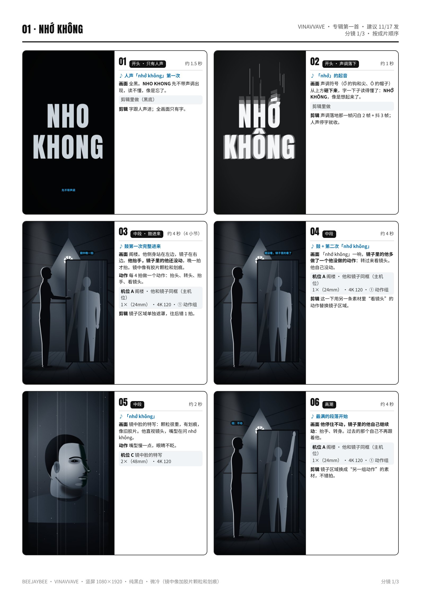
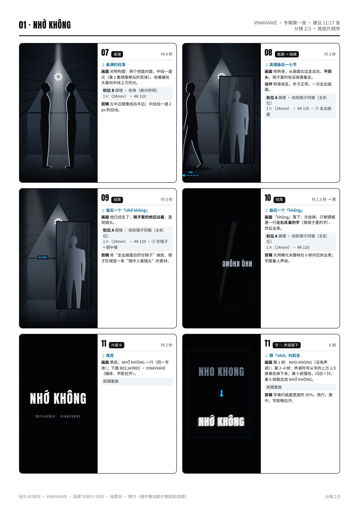
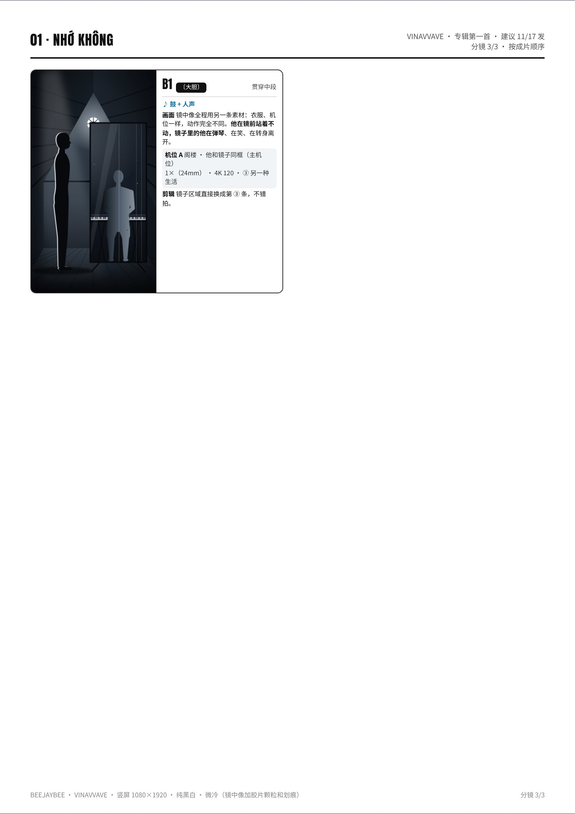

## 拍摄顺序（≤ 3 小时）
| 时间 | 地点 | 做什么 |
|---|---|---|
| 14:00–14:20 | 阁楼 | 布置：落地镜斜放（窗在他右边）、书夹手机（机位 A）、地上贴站位 X；关顶灯；先检查镜子里有没有反出手机和窗外招牌。 |
| 14:20–15:20 | 阁楼 | **机位 A**：动作组 × 3 条；走出画面 + 10 秒空镜子 × 3 条；〔大胆〕“另一种生活” × 2 条。每条录完马上回看。 |
| 15:20–15:50 | 阁楼 | **机位 C**：镜中脸的特写，嘴型 3 条 + 抬眼 3 条。 |
| 15:50–16:20 | 阁楼 | **机位 B**：侧身做对称用，3 条。 |
| 16:20–16:40 | 阁楼 | 补拍 + 全部回看一遍，备份素材。收工（约 2 小时 40 分）。 |

## 道具清单
- 落地镜（能斜放、能站稳）
- 椅子 + 书（手机支撑）
- 桌子（机位 C 用）
- 胶带（地上贴站位 X）
- 毛巾或镜头布、擦镜子的布

## 字（上屏设计）
- **NHỚ KHÔNG**：窄粗黑体，白字，两行居中，字距略拉开，字高约画面宽度的 30%。
- 第一次出现时**不带声调**（NHO KHONG）；「nhớ」的起音一到，声调符号从上方砸下来，落地闪白 2 帧、抖 3 帧，字才读得懂；人声停字就收。
- 最后一次：字**左右反着**出现在镜框里，像镜子里的字，跟「không」一起收。
- 片尾卡：黑底，NHỚ KHÔNG + BEEJAYBEE · VINAVVAVE。英文意思只放 IG 文案：“Nhớ không — do you remember?”

## 剪辑要点
- 时间线 1080×1920 / 30p；黑白微冷。
- **慢一拍的镜子**：主机位素材复制一层放在上面，用矩形遮罩只留镜子那块（沿镜框画），整层往后挪 **1 拍**（1 拍 = 60 ÷ BPM 秒）。
- 镜子那一层单独加胶片颗粒和竖向划痕（老唱片切片一响就加重）；他本人这一层保持干净。
- 每次「nhớ không」：镜子那一层换成“看镜头”的那条素材（镜中人多做一个他没做的动作）。
- 高潮：镜子层换成另一组动作，不错拍；对称镜头把左半边镜像成右半边，中线加一道细白线。
- 结尾：空镜子打底，镜子区域放“镜中人看镜头”的那条；最后一个「không」时用曝光关键帧在 6 帧内压到全黑。

## 开拍前 / 收工前检查
- 开拍前：电量 100%、存储 50 GB、飞行模式、擦镜头和镜子；4K 120、锁定相机、网格已开。
- 每条：录完回看——镜框四个角都在画面里、焦点在镜中像上、镜子里没有反出手机。
- 收工前：主机位至少 3 条完整动作组；空镜子至少 10 秒；当天备份。

---

# 02 · MỜI THÌ CHƠI, ĐỪNG THÌ THÔI
叫你来你就玩，不玩走｜第 2 集（11/10）｜约 40 秒

**1. 手法**
琴在不在由节拍决定：Mời（正拍）琴出现、换一个地方；đừng（三个反拍）东西依次消失：先是琴，再是人，最后是椅子。结尾他扛琴走人，不玩就算了。
颜色：纯黑白微冷（第一幕，跟第 1 集一致）。

**2. 三位导演最好的一句**
- 音乐结构：Mời 是呼，琴出现；đừng ×3 是应，东西依次消失。正拍给出去，反拍收回来。
- 画面手法：同一机位连录“有琴、没琴、没人、空屋”四段，按拍子切；三处的琴用网格线对齐，只有世界在换。
- 情绪弧线：不玩我扛琴就走。傲骨不靠喊，靠走得无所谓。

**3. 段落草图**
- 开头：第一声 Mời，琴和他砸进阁楼的三角屋顶下，MỜI 跟着砸下。IG 第一秒就是钩子。
- 中段：两轮问答，先阁楼，再阳台剪影。第一个 đừng 琴没了，他的手还悬在空中；第二个人没了；第三个连椅子也没了，然后全黑 1 拍。
- 高潮：河边真弹，手停在琴键上方 1 厘米处，冲击交给慢放、闪白、抖动。每个八分音符换一个地方，人和琴不动，背后的世界在闪。
- 结尾：他把琴扛上肩，从画面右边走出去。空景停 1.5 秒，正好循环回第一帧，接片尾卡。

**4. 地方 / 道具 / 时长 / 难点**
- 地方：阁楼、Thủ Thiêm 河边、阳台（日落前后）。
- 道具：GO:PIANO88（不通电，假弹）、桌子或琴架、椅子、书、胶带。
- 时长：约 2 小时 55 分，含带琴来回河边。
- 难点：手机用两本书夹着立在地上；四段在同一条视频里连录，中途不碰手机；外景先转一圈，旗、横幅、招牌商标不能入画。

**5. 字**
MỜI：窄粗黑体，巨大，居中。和琴同一帧砸进来，闪白 2 帧、抖 4 帧，Mời 的长音收字就收。
ĐỪNG：像盖章，三个反拍盖三次，分别在左上、右中、左下，角度各歪一点，每次只停一个音节。完整标题只放在片尾卡。

**6. 〔大胆〕**
结尾用“琴视角”：手机用胶带绑在琴的一头，对着他。他扛着琴沿河边走，画面锁在他的脸和琴键上，整座城市在身后晃。手机缠三道胶带、拴绳保险。

**7. 要问他**
1. 「Mời — đừng đừng đừng」一共几轮？每轮一样吗？
2. 除了这个采样，还有哪些主要声部？
3. 你最想用哪一段做高潮？

---

# 02 · MỜI THÌ CHƠI, ĐỪNG THÌ THÔI · 拍摄脚本

叫你来你就玩，不玩走｜第 2 集 · 11/10 发｜约 40 秒（30–50 秒都可以）｜颜色：纯黑白 · 微冷

设备：iPhone 16 Pro Max 一部，没有三脚架，靠家里现成的东西固定。通用设置见 [拍摄通用参数](拍摄通用参数_iPhone16ProMax.md)。完整版（含分镜图）见 [PDF](pdf/02_MOI_THI_CHOI_分镜脚本.pdf)。

**本集手法：**Mời（正拍）琴出现、换一个地方；đừng（三个反拍）依次消失：琴 → 人 → 椅子。高潮人和琴不动，背后的世界每个八分音符换一次。结尾扛琴走人，空景循环回第一帧。

## 这一集的特殊设置
- 所有机位都用 **4K 120 fps**：阁楼只开窗光、不开顶灯；外景是日光，不会频闪。
- 机位 A、D、E（三个地方的主机位）用**同一颗镜头 1×、同样离地 15 cm、同样距离约 2 m**，三处才能对齐。
- **网格线对齐**：琴的上沿压在下面那条三分线上，他的头顶在上面那条三分线附近，琴的中点在中间竖线上。第一个地方拍好后截一张屏，后面两处打开截图对照。
- 每个主机位都**“四段连录”**：按下录制后不碰手机，按“有琴 → 没琴 → 没人 → 空屋（空景）”的顺序，琴、人、椅子依次离开，全部录完再停。
- 他在画面里的位置：坐着，胸口正对镜头；光从他右边来（画面左边）。

## 机位表（每个机位拍完之前不碰手机）
### 机位 A · 阁楼 · 正面低机位（主机位）
- 镜头 / 帧率：1×（24mm） · 4K 120
- 支撑：两本厚书竖起来夹住手机（竖拍），放在地上，镜头离地 **15 cm**，正对琴，距离琴约 **2 m**；屋脊对准画面中间那条竖线。
- 曝光 / 对焦：长按他胸口锁 AE/AF，曝光 **−0.7EV**。窗户入画时宁可窗过曝，也不要他太暗。
- 要录的条：一条视频里连录：① 有琴，假弹 20 秒（最后 10 秒“大力弹”，手停在离琴键 1 cm）→ ② 起身把琴拿走，回来照原姿势对空气弹 15 秒 → ③ 人离开，只剩椅子 5 秒 → ④ 进来把椅子拿走，空屋 5 秒。整套 **录 3 遍**。

### 机位 B · 阁楼 · 手的特写（琴键平视）
- 镜头 / 帧率：1×（24mm） · 4K 120
- 支撑：书堆放在琴的左端外侧，手机竖拍，镜头高度 = 琴键上方 2 cm，顺着琴键看向他的手，离最近的手约 **40 cm**。
- 曝光 / 对焦：长按他右手锁 AE/AF，**−0.7EV**。
- 要录的条：手从 20 cm 高处落下，**停在琴键上方 1 cm**，停 1 秒再抬起，连做 10 次；然后把琴拿走，对着空气同样做 10 次（琴消失版）。

### 机位 C · 阁楼 · 脸的特写（他右前方 45°）
- 镜头 / 帧率：2×（48mm） · 4K 120
- 支撑：桌子上叠三本书，镜头和他眼睛一样高，在他右前方 45°，距离约 **0.9 m**。
- 曝光 / 对焦：长按他右眼（亮的一侧）锁 AE/AF，**−0.7EV**：左半边脸要沉进暗里。
- 要录的条：① Mời：下巴微抬 1 cm，眼睛看进镜头，停 2 秒；② đừng：眼睛从镜头移开，看向画面左外，停 2 秒；③ 弹琴时的侧脸，头跟着拍子点。**每种 3 条**。

### 机位 D · 阳台 · 剪影（日落前后）
- 镜头 / 帧率：1×（24mm） · 4K 120
- 支撑：书夹手机放阳台地面，离地 **15 cm**、距离约 **2 m**，书底下垫一支笔让镜头稍微仰一点：天空占画面上半部分，他整个人压在天上。琴放在椅子或小桌上，高度和阁楼一样。
- 曝光 / 对焦：长按他头旁边的天空锁 AE/AF，**−1.7EV**，人和琴要全黑成剪影。
- 要录的条：同 A 的“四段连录”（有琴 → 没琴 → 没人 → 空景）＋ 大力弹 10 秒，**录 2 遍**。17:15–17:40 之间拍完。

### 机位 E · Thủ Thiêm 河边 · 城市在身后
- 镜头 / 帧率：1×（24mm） · 4K 120
- 支撑：背包放地上，两本书夹住手机立在背包前，离地 **15 cm**，距离约 **2 m**。琴放在河边长椅或矮墙上，他站在琴后假弹。打开第一处的截图，按网格线对齐。
- 曝光 / 对焦：长按他胸口锁 AE/AF，**−0.7EV**；对岸天空太亮时改 **−1.0EV**。
- 要录的条：四段连录（有琴 → 没琴 → 没人 → 空景）× 2 遍；大力弹 10 秒；**扛琴走出画面 3 条**（从画面右边出，走完再多录 5 秒空景）。

### 机位 F · 〔大胆·可选〕琴视角
- 镜头 / 帧率：0.5×（13mm） · 4K 60
- 支撑：手机用胶带**缠三道**绑在琴的左端，镜头对着他的脸，再用一根绳把手机绕在琴上做保险。
- 曝光 / 对焦：录之前对着他的脸锁 AE/AF，**−0.7EV**。
- 要录的条：他把琴扛在右肩上，沿河边走 20 秒，**3 条**。

## 分镜（按成片顺序）
### 01 · 开头 · 约 1.2 秒
- 声音：第一声「Mời —」（正拍）
- 画面：先 1 帧全黑，然后琴和他一起**砸进**阁楼的三角屋顶下；**MỜI** 巨大、居中，同时砸下。IG 的第一秒就是钩子。
- 动作：坐在琴前，双手悬在琴键上方 10 cm，下巴微抬，看镜头。
- 机位：A（①有琴）
- 剪辑：闪白 2 帧 + 抖 4 帧；Mời 的长音一停，字就收。

### 02 · 中段 · 阁楼 · 约 0.5 秒
- 声音：đừng ①（反拍）
- 画面：同一画面，**琴没了**：他还坐着，手悬在半空，像在弹一架看不见的琴。ĐỪNG 像章一样盖在左上。
- 动作：保持弹琴的姿势不动，手停在原来琴键的高度。
- 机位：A（②没琴）

### 03 · 中段 · 阁楼 · 约 0.5 秒
- 声音：đừng ②（反拍）
- 画面：**人也没了**，只剩一把空椅子。ĐỪNG 盖在右中。
- 动作：（他已离开画面）
- 机位：A（③没人）

### 04 · 中段 · 阁楼 · 约 0.5 秒 → 全黑 1 拍
- 声音：đừng ③（反拍）
- 画面：**连椅子也没了**，空屋。ĐỪNG 盖在左下，接着**全黑 1 拍**。
- 机位：A（④空屋）
- 剪辑：第三个 đừng 之后硬切全黑，正好 1 拍。

### 05 · 中段 · 阳台 · 约 1.5 秒
- 声音：第二轮「Mời —」（正拍）
- 画面：阳台剪影：琴和他**砸回来**，身后是傍晚的天和城市天际线。MỜI 再砸一次，小一号、偏上。
- 动作：同 01 的姿势。
- 机位：D（①有琴）

### 06 · 中段 · 阳台 · 约 1.5 秒（三下）
- 声音：đừng đừng đừng（三个反拍）
- 画面：阳台上三下快切：**琴没了 → 人没了 → 只剩天**。最后一个 đừng 之后直接切到河边。
- 机位：D（②③④）
- 剪辑：三个切点都落在反拍上，比起音早 1 帧。

### 07 · 中段 · 河边 · 约 2 秒
- 声音：第三轮 Mời + đừng（加密：每个反拍都换地方）
- 画面：Thủ Thiêm 河边，对岸是城市。琴和他在画面里的位置**和阁楼一模一样**，只有背景换了。
- 动作：站在琴后假弹，头跟着拍子点。
- 机位：E（①有琴 ②没琴）

### 08 · 高潮 · 约 1 秒（慢放 25%）
- 声音：高潮的第一个重拍
- 画面：琴键平视特写：他的手重重落下，**停在琴键上方 1 cm**；慢放，落点闪白 2 帧、抖 3 帧。
- 动作：手从 20 cm 高落下，停住，停 1 秒。
- 机位：B
- 剪辑：停住的那一帧闪白 + 抖动，就是“打”的感觉。
- 注意：手绝对不碰琴键（上次打出血），冲击全交给剪辑。

### 09 · 高潮 · 约 4 秒
- 声音：高潮（每个八分音符切一次）
- 画面：人和琴**不动**，背后的世界每个八分音符换一次：阁楼 → 阳台 → 河边 → 阁楼……像在闪。
- 机位：A/D/E（三处的“大力弹”）
- 剪辑：三处素材在剪辑里缩放 ±5%，让琴的上沿完全对齐。

### 10 · 高潮 · 约 1.5 秒
- 声音：高潮里最“傲”的那一下 Mời
- 画面：脸的特写（2×）：光从他右边来，左半边脸沉在暗里；下巴微抬，眼睛看进镜头。
- 动作：下巴抬 1 cm，眼睛不眨，停 2 秒。
- 机位：C（① Mời 表情）

### 11 · 结尾 · 约 3 秒
- 声音：最后一个 đừng / 句尾
- 画面：他站起来，**把琴扛上肩**，从画面右边走出去，不回头。
- 动作：扛起琴往右走，步子不快，一次走出画面。
- 机位：E（扛琴走）

### 12 · 结尾 · 空景 1.5 秒 + 片尾卡 2 秒
- 声音：尾音
- 画面：空的河边停 1.5 秒（循环点：IG 重播时接回 01“琴出现”）；然后接黑底片尾卡。
- 机位：E（空景）

### T1 · 字 · MỜI 进场 · 4 帧
- 声音：跟 Mời 的起音
- 画面：第 1–2 帧全画面闪白；第 1–4 帧字从 115% 缩到 100%，同时上下抖 ±6 px；Mời 的长音一停，字 1 帧消失，不淡出。
- 机位：剪辑里做
- 剪辑：字高约画面宽度的 45%，居中略偏上，在安全区内。

### T2 · 字 · ĐỪNG 三个章 · 每个一个音节
- 声音：跟 đừng ①②③
- 画面：同一字体加白色细边框，像盖章。三个位置固定：① 左上（−8°）② 右中（+5°）③ 左下（−3°）；1 帧进 1 帧出，不做动画。
- 机位：剪辑里做
- 剪辑：字高约画面宽度的 13%。

### T3 · 片尾卡 · 约 2 秒
- 声音：尾音结束
- 画面：黑底；标题两行 MỜI THÌ CHƠI, / ĐỪNG THÌ THÔI（同一字体，字高约 9%）；下面 BEEJAYBEE · VINAVVAVE，细体、字距拉开。
- 机位：剪辑里做
- 剪辑：全部带声调；英文意思只放 IG 文案。

### B1 · 〔大胆·可选〕 · 替换 11（约 3 秒）
- 声音：最后一个 đừng / 句尾
- 画面：琴视角：手机绑在琴头，他扛着琴沿河边走；画面锁在他的脸和琴键上，整座城市在他身后晃。
- 机位：F
- 注意：手机缠三道胶带，再拴一根绳；先在家里试走 10 步，确认不会掉。

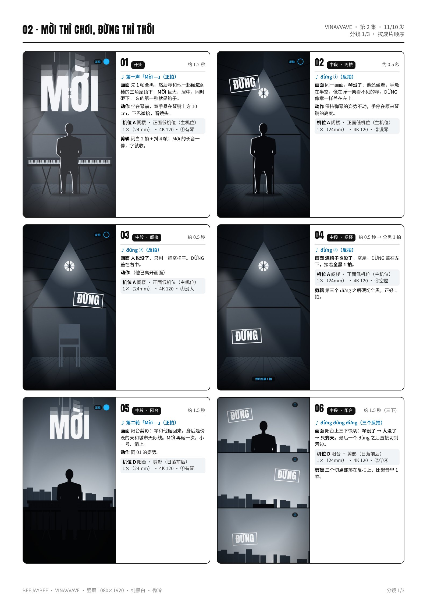
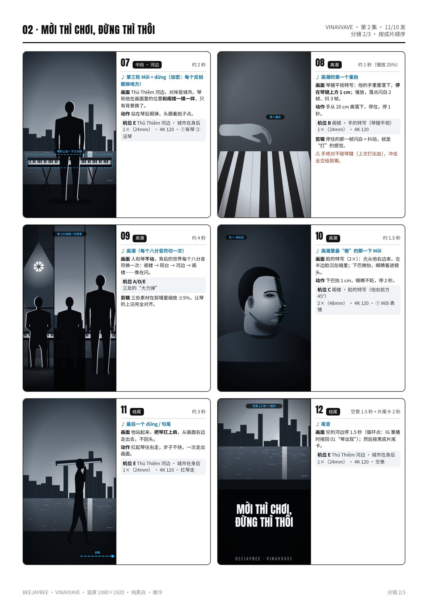
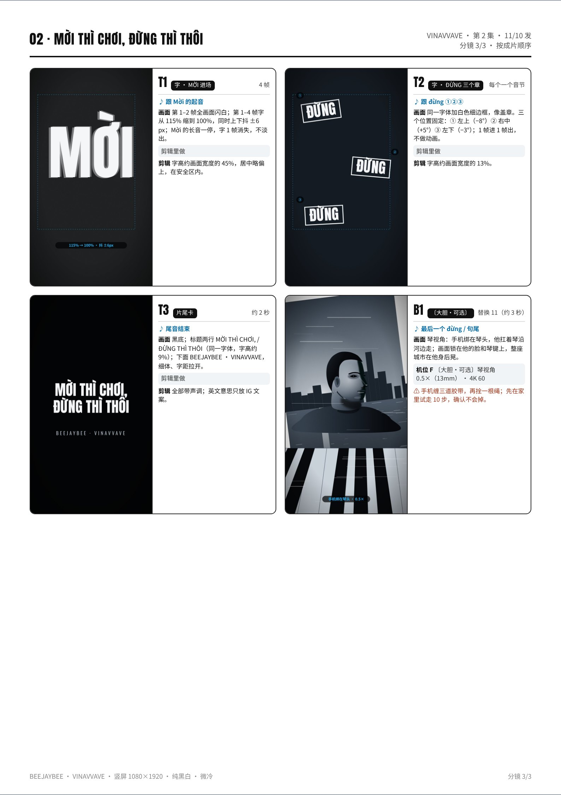

## 拍摄顺序（≤ 3 小时）
| 时间 | 地点 | 做什么 |
|---|---|---|
| 14:45–15:00 | 阁楼 | 布置：琴放好、椅子、书夹手机（机位 A），地上贴站位 X；关掉顶灯，只用窗光；手机设 4K 120、锁定相机、网格、飞行模式。 |
| 15:00–15:35 | 阁楼 | **机位 A**：四段连录 × 3 遍（含大力弹）。每遍录完马上回看。 |
| 15:35–15:50 | 阁楼 | **机位 B**：手的特写，有琴 10 次 + 没琴 10 次。 |
| 15:50–16:05 | 阁楼 | **机位 C**：脸的特写，三种表情各 3 条；截一张机位 A 的屏，留着对齐用。 |
| 16:05–16:25 | 路上 | 带琴（琴包）、背包、两本书去 Thủ Thiêm 河边。 |
| 16:25–17:00 | 河边 | 先转一圈看背景（旗、横幅、招牌）；**机位 E**：四段连录 × 2、大力弹、扛琴走出画面 × 3；（可选）**机位 F** 琴视角 × 3。 |
| 17:00–17:15 | 路上 | 回家，手机充一下电。 |
| 17:15–17:40 | 阳台 | **机位 D**：剪影，四段连录 × 2 + 大力弹（日落约 17:30，前后 15 分钟最好）。收工。 |

## 道具清单
- GO:PIANO88（不用通电，只假弹）＋ 琴包或背带（约 7 kg）
- 琴架或桌子（在家用），椅子 1 把
- 厚书 4 本（两本夹手机，两本备用垫高）
- 胶带（地上贴站位 X；可选：琴视角绑手机）
- 背包（外景当手机支撑）
- 一支笔（垫在书下让镜头微仰）
- 毛巾或镜头布
- （可选）细绳 1 根（琴视角的保险）

## 字（上屏设计）
- **MỜI**：窄而粗的黑体（参考 Anton 一类的开源字体，不用任何品牌字体），白字，字高约画面宽度的 45%，居中略偏上，在安全区内。第 1–2 帧闪白，第 1–4 帧从 115% 缩到 100% 并抖 ±6 px；长音一停，1 帧消失。
- **ĐỪNG**：同一字体加白色细边框，像盖章，字高约画面宽度的 13%。① 左上 −8° ② 右中 +5° ③ 左下 −3°，每个只停一个音节，不做动画。
- **片尾卡**：黑底，MỜI THÌ CHƠI, / ĐỪNG THÌ THÔI 两行，下面 BEEJAYBEE · VINAVVAVE（细体、字距拉开），约 2 秒。
- 上屏只用带声调的越南语；英文意思只放 IG 文案：“Mời thì chơi, đừng thì thôi — play if you’re invited; if not, forget it.”

## 剪辑要点
- 时间线 1080×1920 / 30p；素材 4K 120；黑白微冷（饱和度 −100，阴影偏蓝约 5%）。
- Mời 切在正拍，đừng 切在反拍；每个切点比起音**早 1 帧**。
- 三个 đừng 的顺序固定：**没琴 → 没人 → 空屋**；第三个之后**全黑 1 拍**。
- 高潮：每个八分音符换一个地方，素材都取自三处“大力弹”的 10 秒；三处缩放 ±5%，让琴的上沿对齐。
- 手的特写慢放 25%（120 → 30）；手停住的那一帧闪白 2 帧 + 抖 3 帧。
- 结尾：空景 1.5 秒后接片尾卡；IG 循环时，空景接回 01“琴出现”。封面帧用第一个 MỜI 砸下的那一帧。
- 长度：按你给的小节表剪，30–50 秒都可以；具体切点对着 WAV 定。

## 开拍前 / 收工前检查
- 开拍前：电量 100%、存储留 50 GB、飞行模式、擦镜头；相机是 4K 120、锁定相机、网格已开。
- 每个机位：录完一条马上回看——构图、焦点、手有没有停在 1 cm、背景里有没有不该有的东西。
- 外景：先转一圈，旗、横幅标语、肖像、招牌商标都不能入画；对岸的广告大屏不入画，或者让它虚掉。
- 收工前：每个机位至少 3 条能用；每处空景至少 5 秒；当天把素材备份。

---

# 04 · NHAN VUI（声调待他确认）
人生可喜｜第二幕开头｜约 40 秒

**1. 手法**
贝斯一抽走，地心引力就没了，他坐在空气里；贝斯一回来，一切砸回地面。“人生可喜”的那一下喜，来自全系列第一次出现的颜色。
颜色：黑白。失重时只留他 T 恤的深蓝，这是全系列第一次有颜色（剪辑里用 HSL 只保留蓝）。

**2. 三位导演最好的一句**
- 音乐结构：低频就是重力。低频在，他就在地上；被滤掉，他和斗笠一起浮起来；回来那一下，砸地，闪白加抖动。
- 画面手法：用 4K120 拍他一次次跳起来，剪辑时只取每跳最高点的那一帧，一帧接一帧，他就像坐在空中慢慢平移。
- 情绪弧线：喜不是笑，是第一次看见颜色。

**3. 段落草图**
- 开头（地面段）：阁楼，日常动作一板一眼踩着鼓点：坐下、站起、看钟、按 MPC（手停在 1 厘米）。黑白。
- 中段（低频抽走前 4 小节）：画面越来越轻，他每跳一次，在空中停留的帧就多一帧。
- 高潮（贝斯没了）：隧道顶公园的草地，手机贴地仰拍，以天为底。他盘腿坐在空中从左飘到右，斗笠在旁边一起飘，T 恤变成深蓝。
- 结尾（低频回来）：砸回草地，闪白加抖动。最后一镜，他又坐在半空，旁边一把空椅子，像什么都没发生过。接片尾卡。

**4. 地方 / 道具 / 时长 / 难点**
- 地方：阁楼；隧道顶公园草地（下午 4 点后，侧逆光）。
- 道具：一把椅子、斗笠（只当剪影）、石子当记号。
- 时长：约 2.5 小时（跳很累，分 3 组，每组 15 跳）。
- 难点：手机靠背包立在地上。每跳一次往右挪半步，地上的石子当记号；跳起来的姿势要固定。公园选没人的那一侧。

**5. 字**
NHAN VUI（声调待他确认）。在地面段，字母挤在一起，显得很重；贝斯抽走时，字距一点点拉开，字母上下错开飘起来；低频回来那一拍，字砸回原位抖一下。字跟着贝斯走。

**6. 〔大胆〕**
失重段 8 小节一个镜头不切：他坐在空中，从画面左边一路飘到右边，背后公园里的人照常散步。荒诞，但一本正经。

**7. 要问他**
1. 有没有贝斯抽走的段落？在哪？多长？
2. 有没有 soul 的人声或和弦？在哪进来？
3. 这首更像轻快地笑，还是懒洋洋地乐？

---

# 04 · NHAN VUI（声调待他确认） · 拍摄脚本

人生可喜｜第二幕开头 · 建议 11/24 发｜约 40 秒（30–50 秒都可以）｜颜色：黑白；失重时只留 T 恤的深蓝（全系列第一次有颜色）

设备：iPhone 16 Pro Max 一部，没有三脚架，靠家里现成的东西固定。通用设置见 [拍摄通用参数](拍摄通用参数_iPhone16ProMax.md)。完整版（含分镜图）见 [PDF](pdf/04_NHAN_VUI_分镜脚本.pdf)。

**本集手法：**贝斯一抽走，地心引力就没了，他坐在空气里；贝斯回来，一切砸回地面。失重的那几秒，全系列第一次出现颜色：他 T 恤的深蓝。

## 这一集的特殊设置
- 失重镜头全部 **4K 120 + 1×**：白天光足，快门会很快，跳到最高点的那一帧不会糊。
- 公园的主机位 **手机贴地仰拍**：手机竖着靠在背包上（或两块石头夹住），镜头稍微朝上，**地平线压在画面最下面 15%**，天占满画面。
- 每跳一次往右挪 **半步（约 50 cm）**：地上提前摆一排小石子当记号；跳起来时盘腿、背挺直、表情不变。
- 要“只留蓝”：他穿**深蓝纯色 T 恤**，画面里别有别的蓝色东西（蓝色垃圾桶、蓝色招牌都避开），后期只保留蓝色。
- 下午 4 点后拍，太阳在他侧后方（侧逆光），曝光锁在他身上，天亮一点没关系。

## 机位表（每个机位拍完之前不碰手机）
### 机位 A · 阁楼 · 日常（地面段）
- 镜头 / 帧率：1×（24mm） · 4K 120
- 支撑：椅子上叠书，手机竖拍，镜头高 **约 100 cm**，正对他，距离约 **2.5 m**；他、椅子、墙上的钟都在画面里。
- 曝光 / 对焦：锁他胸口，**−0.7EV**。
- 要录的条：每个动作正好 4 拍：坐下 → 站起 → 转头看钟 → 坐下；**3 轮**。再录 **10 次原地跳**（盘腿收腿），给“越来越轻”那段用。

### 机位 B · 阁楼 · 钟和 MPC 的插入镜头
- 镜头 / 帧率：2×（48mm） · 4K 120
- 支撑：桌上叠书，手机离钟约 **50 cm**；拍 MPC 时手机放在 MPC 侧面，和打击垫同高。
- 曝光 / 对焦：锁钟面 / 打击垫，**−0.7EV**。
- 要录的条：钟的秒针走 10 秒；手落到打击垫上方 **1 cm** 停住 × 10 次。

### 机位 C · 隧道顶公园 · 失重（主机位）
- 镜头 / 帧率：1×（24mm） · 4K 120
- 支撑：手机竖着靠在背包上贴地放，镜头稍朝上，离他约 **4 m**；地平线压在画面下 15%。地上摆一排小石子，间隔约 50 cm。
- 曝光 / 对焦：长按他的身体锁 AE/AF，**−0.3EV**（他不能是剪影，要看得见 T 恤的颜色）。
- 要录的条：**3 组 × 15 跳**：每跳在最高点盘腿、背挺直、表情不变，落地后往右挪到下一颗石子；再把斗笠往上抛 15 次（同样一颗石子挪一次）；最后录 10 秒空景。

### 机位 D · 公园 · 空椅子（结尾）
- 镜头 / 帧率：1×（24mm） · 4K 120
- 支撑：同 C，不动手机；把椅子放到最后一颗石子旁边。
- 曝光 / 对焦：同 C。
- 要录的条：空椅子 10 秒；他在椅子旁边原地跳 **10 次**（盘腿）。

## 分镜（按成片顺序）
### 01 · 开头 · 地面段 · 约 2 秒
- 声音：鼓 + 贝斯（踩正拍）
- 画面：阁楼，黑白。他**正好踩在拍子上**坐下，一本正经。NHAN VUI 的字母挤在一起，很重。
- 动作：坐下用 4 拍，最后一拍屁股落座。
- 机位：A（坐下）

### 02 · 地面段 · 约 1 秒
- 声音：正拍
- 画面：钟的特写，秒针一格一格跳，正好落在拍子上。
- 机位：B（钟）
- 剪辑：秒针每跳一格切一次也行（踩鼓点）。

### 03 · 地面段 · 约 1 秒
- 声音：某个打击乐重音
- 画面：手落到打击垫上，**停在 1 cm**；落点闪白 + 抖。
- 机位：B（MPC）
- 注意：手不碰打击垫，冲击交给剪辑。

### 04 · 中段 · 越来越轻 · 约 4 秒
- 声音：低频被滤掉之前的 4 小节
- 画面：他原地跳起来——**每跳一次，在空中停留的帧多一帧**，像越来越轻。
- 机位：A（原地跳）
- 剪辑：第 1 跳留 1 帧最高点，第 2 跳 2 帧，第 3 跳 3 帧……

### 05 · 高潮 · 贝斯抽走 · 约 3 秒
- 声音：breakdown 第一拍（低频没了）
- 画面：公园，手机贴地仰拍，天占满画面。他**盘腿坐在空中**，T 恤变成深蓝——**全系列第一次出现颜色**。
- 机位：C
- 剪辑：HSL 只留蓝，饱和度在 6 帧内从 0 拉满。

### 06 · 高潮 · 约 4 秒
- 声音：没有低频的那几小节
- 画面：一帧接一帧：他坐在空中**从左飘到右**，斗笠在旁边一起飘。背后公园里的人照常散步。
- 机位：C（15 跳 → 最高点帧）
- 剪辑：每跳只取最高点那 1–2 帧，按 12 帧/秒连起来。

### 07 · 高潮 · 约 2 秒
- 声音：soul 的人声 / 和弦（如果有）
- 画面：近一点的仰拍：他闭着眼，飘着，天在身后；只有 T 恤是蓝的。
- 动作：跳到最高点时闭眼、下巴微抬。
- 机位：C（近一点再跳几次）

### 08 · 低频回来 · 约 0.5 秒
- 声音：贝斯/底鼓回来的第一拍
- 画面：**砸回草地**：落地那一帧闪白 2 帧 + 抖 4 帧；颜色一下子被抽走。
- 机位：C（落地那一下）
- 剪辑：饱和度 1 帧归零；字母同一拍砸回原位。

### 09 · 结尾 · 约 3 秒
- 声音：最后一个乐句
- 画面：一切恢复正常——除了他：**他又坐在半空**，旁边一把空椅子，像什么都没发生。T 恤还留一点蓝（饱和度 30%）。
- 动作：坐在空中，表情平静，看镜头。
- 机位：D

### 10 · 片尾卡 · 约 2 秒
- 声音：尾音
- 画面：黑底；NHAN VUI（**声调待他确认**）；BEEJAYBEE · VINAVVAVE。
- 机位：剪辑里做

### T1 · 字 · 字母失重 · 跟贝斯走
- 声音：贝斯抽走 → 回来
- 画面：地面段：字距 −3，挤在一起；贝斯抽走：字距每拍拉开一点、每个字母上下错开 2–8%，慢慢飘；低频回来那一拍：1 帧砸回原位 + 抖。
- 机位：剪辑里做
- 剪辑：字高约画面宽度的 17%，放在上 1/3。

### B1 · 〔大胆〕 · 8 小节一个镜头
- 声音：整段没有低频
- 画面：失重段 **8 小节一个镜头不切**：他坐在空中从画面左边一路飘到右边，背后公园里的人照常散步。荒诞，但一本正经。
- 机位：C
- 剪辑：需要大约 40 跳的最高点帧：多拍几组。

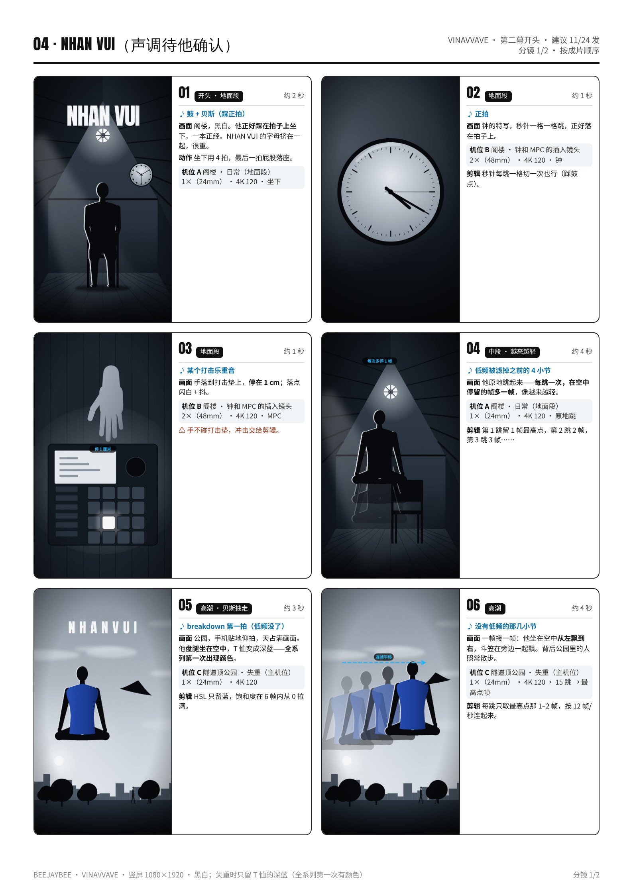
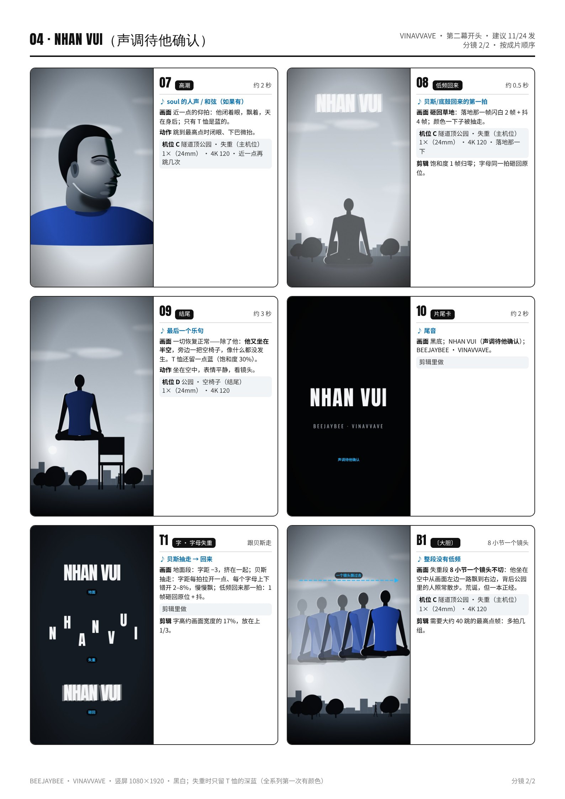

## 拍摄顺序（≤ 3 小时）
| 时间 | 地点 | 做什么 |
|---|---|---|
| 14:45–15:00 | 阁楼 | 布置：椅子、钟入画、书堆机位 A；关顶灯；4K 120、锁定相机、网格。 |
| 15:00–15:35 | 阁楼 | **机位 A**：日常动作 3 轮 + 原地跳 10 次；**机位 B**：钟 10 秒、手停 1 cm × 10。 |
| 15:35–15:50 | 路上 | 带椅子、斗笠、背包、小石子去隧道顶公园。 |
| 15:50–17:00 | 公园 | 先转一圈（避开蓝色的东西、旗、横幅、招牌）；摆石子；**机位 C**：3 组 × 15 跳，每组之间歇 5 分钟；斗笠抛 15 次；空景 10 秒。 |
| 17:00–17:20 | 公园 | **机位 D**：空椅子 10 秒 + 椅子旁跳 10 次。 |
| 17:20–17:35 | 路上 | 回家，当天备份（约 2 小时 50 分）。 |

## 道具清单
- 深蓝纯色 T 恤（必须）
- 椅子 1 把（结尾带去公园）
- 斗笠（只当剪影 / 抛起来飘）
- 背包（手机贴地支撑）
- 小石子 10 颗（地面记号）
- 书（室内支撑）
- 水和毛巾（跳很累）

## 字（上屏设计）
- **NHAN VUI（声调待他确认）**：窄粗黑体，白字，放在上 1/3，字高约画面宽度的 17%。
- 地面段字距 −3，挤在一起很重；贝斯抽走时每拍拉开一点，字母上下错开、慢慢飘；低频回来那一拍 1 帧砸回原位 + 抖 4 帧。
- 上屏前一定要问他这两个字的声调，不要自己加。英文意思只放 IG 文案。

## 剪辑要点
- 时间线 1080×1920 / 30p；默认黑白微冷。
- **失重**：每跳取最高点那 1–2 帧，按 12 帧/秒（每帧停 2–3 个时间线帧）连起来，他就像坐着平移；斗笠同理。
- **颜色**：只在贝斯抽走的那段打开“只留蓝”（HSL 其他颜色饱和度 −100），6 帧内渐入；低频回来那一拍 1 帧归零；结尾留 30% 的蓝。
- 低频回来：闪白 2 帧 + 抖 4 帧；字母同一拍砸回原位。
- 越来越轻那段：第 n 跳在最高点停 n 帧。
- 长度按小节表剪，30–50 秒都可以。

## 开拍前 / 收工前检查
- 开拍前：深蓝 T 恤、电量 100%、存储 50 GB、飞行模式；4K 120、锁定相机。
- 公园：背景里没有蓝色的大东西、旗、横幅、招牌；人多的话等人走开再跳。
- 每组跳完回看：最高点那一帧清楚、姿势一致、没有出画。
- 安全：在草地上跳，鞋要防滑；累了就歇，别硬跳。

---

# 05 · ANH BE LY CAY CHO（声调待他确认）
哥递给你这杯苦酒｜第二幕｜约 40 秒

**1. 手法**
这杯酒就是镜头。“醉”的声音一出来，画面就隔着这杯酒看：人和屋子在杯里弯曲、左右颠倒。杯里的蓝是全片唯一的颜色。
颜色：黑白，只有杯里的液体是深蓝（清水加一滴蓝色食用色素）。

**2. 三位导演最好的一句**
- 音乐结构：鼓清楚的地方，画面也清楚；走音、变速、滤波这类“醉”的声音一出来，就切到杯后视角。倒酒的每一滴都落在 snare 上。
- 画面手法：手机贴在装满水的直身玻璃杯后面拍，杯子就是透镜，不用任何特效，世界自己就颠倒了。
- 情绪弧线：这杯是现在的他递给过去的他的。苦，但不皱眉。

**3. 段落草图**
- 开头：俯拍黑桌面，蓝色一滴滴落进清水，120 帧慢放，在水里散开，像烟。
- 中段：他把杯子往镜头推，画面穿进杯子，隔着蓝色的水看他，脸被拉长、颠倒。
- 高潮（最“醉”的段落）：杯后视角和清楚视角在重拍上来回切。他举杯一口干，眼睛一直看着镜头。
- 结尾：杯子放下，停在桌面上方 1 厘米，剪辑给砸感和抖动。空杯底留一圈蓝，黑。接片尾卡。

**4. 地方 / 道具 / 时长 / 难点**
- 地方：阁楼桌前，窗在他右边。
- 道具：直身玻璃杯、清水、蓝色食用色素、深色桌布、书、毛巾。
- 时长：约 2 小时。
- 难点：杯壁会反光，关掉顶灯，只留窗光。倒水前先把 MPC 和琴从桌上拿开。杯后视角用 1× 主摄，贴近杯子 3–5 厘米，对焦锁在杯后的他身上。

**5. 字**
ANH BE LY CAY CHO（声调待他确认）竖排，像酒标贴在杯身上。倒酒时液面上升，字被一行行淹掉；喝完杯空，字也没了。字跟着倒酒那条声部走。

**6. 〔大胆〕**
从杯底往上拍：手机屏幕朝下平放在地上，上面用两摞书架一个装水的透明玻璃碗。他低头对着碗喝，画面里是水面后面晃动的脸。

**7. 要问他**
1. 有没有走音、变速、滤波这种“醉”的声音？在哪？
2. 哪个声音最“苦”？
3. 最满的一段在哪？

---

# 05 · ANH BE LY CAY CHO（声调待他确认） · 拍摄脚本

哥递给你这杯苦酒｜第二幕 · 建议 12/1 发｜约 40 秒（30–50 秒都可以）｜颜色：黑白；只有杯里的液体是深蓝

设备：iPhone 16 Pro Max 一部，没有三脚架，靠家里现成的东西固定。通用设置见 [拍摄通用参数](拍摄通用参数_iPhone16ProMax.md)。完整版（含分镜图）见 [PDF](pdf/05_ANH_BE_LY_CAY_CHO_分镜脚本.pdf)。

**本集手法：**这杯酒就是镜头：“醉”的声音一出来，画面就隔着这杯酒看，人和屋子在杯里弯曲、左右颠倒。杯里的蓝是全片唯一的颜色。

## 这一集的特殊设置
- 液体：**清水 + 一滴蓝色食用色素**（几块钱）。每条换一杯清水，色素一次只滴一滴。
- **他的 T 恤也是深蓝**：后期“只留蓝”时会把衣服一起留下来，所以要**加遮罩，只在杯子那块保留颜色**；他举杯的那几镜，用跟踪遮罩，或者那几镜整体黑白。
- **杯后视角**：手机镜头贴近直身玻璃杯 **3–5 cm**，用 1× 主摄，焦点锁在杯后的他身上（不是杯子）；杯子装满水，人在杯后 50–70 cm。
- 关掉顶灯，只留窗光（窗在他右边），杯壁反光才少；桌上铺深色布。
- 倒水、滴色素之前，**MPC 和琴全部拿开**，桌上只留杯子。

## 机位表（每个机位拍完之前不碰手机）
### 机位 A · 桌前 · 正面（主机位）
- 镜头 / 帧率：1×（24mm） · 4K 120
- 支撑：桌上叠书，手机竖拍，镜头高 = 桌面以上 **25 cm**，正对他，距离约 **1.3 m**；杯子在画面正中下方。
- 曝光 / 对焦：锁他的脸，**−0.7EV**。
- 要录的条：① 他把杯子慢慢往镜头推，一直推到杯子贴近镜头（画面全是杯子）× 3；② 举杯一口干，眼睛一直看镜头 × 3；③ 放杯：杯底**停在桌面上方 1 cm**，停 1 秒 × 5。

### 机位 B · 杯后视角（杯子当透镜）
- 镜头 / 帧率：1×（24mm） · 4K 120
- 支撑：书堆把手机顶在桌面上，镜头贴近杯子 **3–5 cm**、和杯子中间同高；杯子装满（蓝色或清水各录一遍）。
- 曝光 / 对焦：长按杯后的他（不是杯子）锁 AE/AF，**−0.5EV**。
- 要录的条：他在杯后 50–70 cm：慢慢前倾靠近 / 后仰离开 / 左右转头 / 举手 —— 每个动作 4 拍，录 3 遍。

### 机位 C · 杯子侧面 · 滴色素（微距）
- 镜头 / 帧率：1×（24mm） · 4K 120
- 支撑：书堆放在杯子侧面，镜头和水面下半杯同高，离杯壁约 **20 cm**；杯子后面挂一块黑布，窗光从侧面打进杯子。
- 曝光 / 对焦：长按杯子中间锁 AE/AF，**−1.0EV**（背景要黑）。
- 要录的条：色素从水面上方 5 cm 滴下，**一滴一条**，录 8 条（每条换一杯清水）。

### 机位 D · 〔大胆〕杯底往上（玻璃碗）
- 镜头 / 帧率：1×（24mm） · 4K 120
- 支撑：手机**屏幕朝下**平放在地上；两摞书放在手机两边，上面架一个装水的透明玻璃碗（碗底离镜头约 5 cm）。
- 曝光 / 对焦：先录 10 秒试拍、回看；锁在碗口上方他的脸，**−0.7EV**。
- 要录的条：他跪在旁边、低头对着碗“喝”（嘴不碰水）、往水面吹一口气让水面晃 × 3 条。

## 分镜（按成片顺序）
### 01 · 开头 · 约 2 秒（慢放）
- 声音：第一个 snare
- 画面：杯子侧面：**一滴蓝**落进清水，在水里散开，像烟。黑白的世界里只有这一点蓝。
- 机位：C
- 剪辑：120 → 30 慢放 25%；滴落的那一帧对齐 snare。

### 02 · 开头 · 约 1.5 秒
- 声音：第二个 snare
- 画面：第二滴：蓝色更浓，翻滚着往下沉。每一滴都落在 snare 上。
- 机位：C

### 03 · 中段 · 约 2 秒
- 声音：贝斯进来
- 画面：他把杯子**慢慢推向镜头**，杯子越来越大，直到画面全是蓝色的水。
- 动作：推得要慢，眼睛一直看镜头。
- 机位：A（① 推杯）

### 04 · 中段 · 醉 · 约 3 秒
- 声音：走音 / 变速 / 滤波（“醉”的声音）
- 画面：**隔着这杯酒看他**：他的脸被拉长、左右颠倒，蓝色的水把他泡在里面。
- 动作：在杯后慢慢前倾、后仰、转头。
- 机位：B

### 05 · 中段 · 约 2 秒
- 声音：鼓清楚的地方
- 画面：清楚的画面：他坐回去，杯子放在桌上，蓝色是画面里唯一的颜色。他看着镜头，像在说“喝吧”。
- 机位：A

### 06 · 高潮 · 约 4 秒
- 声音：最满、最“醉”的段落
- 画面：**杯后视角和清楚视角在重拍上来回切**：清楚 → 扭曲 → 清楚 → 扭曲。
- 机位：A/B
- 剪辑：每个重拍切一次；扭曲那几下可以再加 4 帧轻微抖动。

### 07 · 高潮 · 约 2 秒
- 声音：最满的一句
- 画面：他举杯**一口干**，眼睛一直看着镜头，不皱眉。
- 动作：杯子举到嘴边，仰头喝完，眼睛不离开镜头。
- 机位：A（② 一口干）

### 08 · 结尾 · 约 1 秒（慢放）
- 声音：最后一个重拍
- 画面：杯子重重放下——**杯底停在桌面上方 1 cm**；剪辑给砸感：闪白 2 帧 + 抖 4 帧。
- 机位：A（③ 放杯）
- 注意：杯子不真的砸桌面。

### 09 · 结尾 · 约 2 秒 → 黑
- 声音：尾音
- 画面：空杯，杯底留着**一圈蓝**；光慢慢收掉，黑。
- 机位：C（空杯）

### 10 · 片尾卡 · 约 2 秒
- 声音：尾音结束
- 画面：黑底；ANH BE LY CAY CHO（**声调待他确认**）；BEEJAYBEE · VINAVVAVE。
- 机位：剪辑里做

### T1 · 字 · 酒标 · 跟倒酒那条声部
- 声音：倒酒 / 液面上升
- 画面：标题**竖排**，像酒标贴在杯身上（跟踪杯子）；液面一升高，字就被一行行“淹”掉，喝完杯空，字也没了。
- 机位：剪辑里做
- 剪辑：字高约杯子宽度的 1/3；白字，被水淹的部分变成半透明蓝。

### B1 · 〔大胆〕 · 约 3 秒
- 声音：最“醉”的一句
- 画面：从碗底往上拍：画面里是水面后面晃动的他的脸——他低头对着碗“喝”，往水面吹气，脸被水波撕开。
- 机位：D

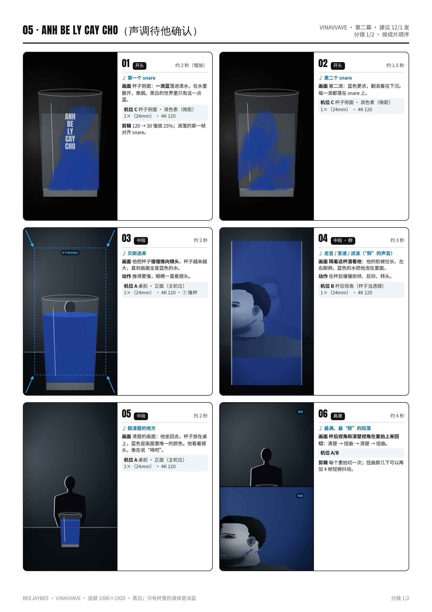
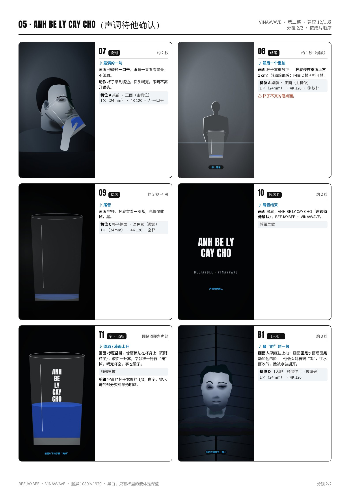

## 拍摄顺序（≤ 3 小时）
| 时间 | 地点 | 做什么 |
|---|---|---|
| 14:30–14:50 | 阁楼 | 布置：桌子靠窗（窗在他右边）、铺深色布、MPC 和琴拿开、关顶灯；准备 8 杯清水和色素。 |
| 14:50–15:20 | 阁楼 | **机位 C**：滴色素 × 8 条（每条换水）。 |
| 15:20–16:00 | 阁楼 | **机位 A**：推杯 × 3、一口干 × 3、放杯停 1 cm × 5。 |
| 16:00–16:30 | 阁楼 | **机位 B**：杯后视角，四个动作 × 3 遍（蓝水、清水各一遍）。 |
| 16:30–17:00 | 阁楼 | **机位 D**〔大胆〕：玻璃碗 × 3 条。 |
| 17:00–17:15 | 阁楼 | 擦干手机和桌子，回看，备份（约 2 小时 45 分）。 |

## 道具清单
- 直身玻璃杯 2 个（一个备用）
- 清水 8 杯的量 + 蓝色食用色素 1 瓶
- 深色桌布 / 黑布（挂在杯子后面）
- 透明玻璃碗（〔大胆〕用）
- 书 4–6 本、毛巾、纸巾
- 深蓝纯色 T 恤

## 字（上屏设计）
- **ANH BE LY CAY CHO（声调待他确认）**：窄粗黑体，**竖排**，像酒标贴在杯身上（剪辑里跟踪杯子）。
- 倒酒时液面上升，液面以下的字变成半透明蓝、被“淹掉”；喝完杯空，字一起消失。
- 片尾卡两行：ANH BE LY / CAY CHO + BEEJAYBEE · VINAVVAVE。上屏前确认声调；英文意思只放 IG 文案。

## 剪辑要点
- 时间线 1080×1920 / 30p；黑白微冷。
- **只留蓝 + 遮罩**：HSL 只留蓝之后，用遮罩只在杯子那块保留颜色（他的深蓝 T 恤要变回黑白）。
- 滴色素的那几条慢放 25%，滴落那一帧对齐 snare。
- “醉”的声音一出来就切杯后视角；最满的段落里，清楚 / 扭曲在每个重拍上来回切。
- 放杯：杯底停住的那一帧闪白 2 帧 + 抖 4 帧，就是“砸”的感觉。
- 长度按小节表剪，30–50 秒都可以。

## 开拍前 / 收工前检查
- 开拍前：电量 100%、存储 50 GB、飞行模式；4K 120、锁定相机。
- 水和电子设备分开：MPC、琴、电源线都离开桌面；手机旁边放毛巾。
- 每条回看：杯壁有没有反出窗户和手机；焦点在杯后的他身上。
- 〔大胆〕那条拍完，把手机擦干再收。

---

# 06 · DAU DAU MUA（声调待他确认）
哪哪都下雨｜第二幕｜约 40 秒

**1. 手法**
带着一块“雨”去每个地方：镜头前放一块喷了水珠的相框玻璃，阁楼、MPC、琴、镜子、他的脸，全都隔着雨看。雨跟着 hi-hat 走，hi-hat 一停，雨就停在半空。
颜色：冷蓝单色，像蓝晒照片。不是黑白，是整片的蓝：第二幕里，soul 泡在雨里。

**2. 三位导演最好的一句**
- 音乐结构：雨就是 hi-hat、沙锤这类密的声部。它们响着，雨就在下；它们一停，雨滴就冻在空中（从 120 帧里取一帧，只冻雨，不冻手）。
- 画面手法：一块相框玻璃加一个喷壶，就是随身带着的雨；对焦跟着节奏，在水珠和后面的人之间来回切。
- 情绪弧线：哪儿都在下，他不躲。最后一下不是他打的，是一滴雨打的。

**3. 段落草图**
- 开头：俯拍 MPC，上方架着玻璃。一滴水正对一个打击垫落在玻璃上，120 帧，这是第一下。
- 中段：隔着雨看每个地方：钟、空椅子、镜子里的他、琴键上的手（手停在 1 厘米）。4 小节换一个地方。
- 高潮：阳台，有真雨就用真雨，没有就用喷壶从上往下喷。他站在雨里不打伞，剪影。
- 结尾：hi-hat 停，雨冻在半空，他在冻住的雨里慢慢转头。最后一滴落在打击垫上方的玻璃上，替他的手打出最后一下。接片尾卡。

**4. 地方 / 道具 / 时长 / 难点**
- 地方：阁楼、阳台。
- 道具：相框玻璃（A4 左右）、喷壶、毛巾、书。
- 时长：约 2 小时。真雨看天，带喷壶备用。
- 难点：水不能碰到 MPC 和琴。玻璃架在两摞书上，离设备 10 厘米以上。冻住的雨要在亮处用 4K120 拍，暗处拍不清雨滴。

**5. 字**
DAU DAU MUA（声调待他确认）。字像玻璃上的水珠：先清清楚楚，然后字母底部拉出一道道水痕往下淌；hi-hat 一停，水痕也停住。

**6. 〔大胆〕**
倒着下的雨：阳台逆光，他用喷壶往下喷水，侧面拍，倒放之后，水珠从地面升回天上。哪儿都在下雨，连往上也下。

**7. 要问他**
1. 有没有密的 hi-hat 或沙锤？在哪里停？
2. 有没有倒放（reverse）的声音？
3. 这首是闷的还是爽的？

---

# 06 · DAU DAU MUA（声调待他确认） · 拍摄脚本

哪哪都下雨｜第二幕 · 建议 12/8 发｜约 40 秒（30–50 秒都可以）｜颜色：冷蓝单色（像蓝晒照片，不是黑白）

设备：iPhone 16 Pro Max 一部，没有三脚架，靠家里现成的东西固定。通用设置见 [拍摄通用参数](拍摄通用参数_iPhone16ProMax.md)。完整版（含分镜图）见 [PDF](pdf/06_DAU_DAU_MUA_分镜脚本.pdf)。

**本集手法：**带着一块“雨”去每个地方：镜头前放一块喷了水珠的相框玻璃，所有地方都隔着雨看。雨跟着 hi-hat 走，hi-hat 一停，雨就冻在半空。

## 这一集的特殊设置
- **随身的雨**：拆一个 A4 左右的相框，只用里面那块玻璃；用喷壶喷上水珠，架在镜头前 **10–20 cm**（两摞书夹住玻璃），手机在玻璃后面拍。
- **换焦点**：每个地方录两条：一条焦点锁在水珠上，一条锁在后面的东西上，剪辑时按拍子互切；也可以录的时候在节拍上点一下屏幕换焦点。
- **冻住的雨**一定要在亮处拍（阳台对着天，日落前），4K 120 + 快门快，雨滴才是清楚的点。
- **水和电子设备分开**：俯拍 MPC 时，玻璃架在 MPC 上方 10 cm 的两摞书上，水只落在玻璃上；旁边放毛巾。
- 没下雨就做一个“雨棚”：大塑料瓶底部扎 20 个小洞，装满水，用绳子挂在阳台晾衣杆上，在他头顶上方——能下 30 秒。
- 后期整片做成**冷蓝单色**：先去色，再把暗部压成深蓝、亮部偏浅蓝（像蓝晒照片）。

## 机位表（每个机位拍完之前不碰手机）
### 机位 A · 俯拍 MPC · 第一滴
- 镜头 / 帧率：1×（24mm） · 4K 120
- 支撑：俯拍架：两把椅子背对背，扫把杆横在中间，手机缠三道胶带绑在杆中间，镜头朝下，离玻璃约 **45 cm**；玻璃架在 MPC 上方 10 cm 的两摞书上。
- 曝光 / 对焦：长按一个打击垫锁 AE/AF，**−0.7EV**。
- 要录的条：用勺子或滴管，从玻璃上方 20 cm 让**一滴水**落在正对某个打击垫的位置 × 10 次；最后一条留给结尾（最后一滴）。

### 机位 B · 隔着雨 · 各个地方
- 镜头 / 帧率：1× / 2× · 4K 120
- 支撑：书堆夹住手机；喷了水珠的玻璃竖着夹在镜头前 **10–20 cm**。按顺序换：钟、空椅子、镜子里的他、他的脸、琴键上的手。
- 曝光 / 对焦：每处两条：① 长按水珠锁 AE/AF；② 长按后面的东西锁 AE/AF。都 **−0.7EV**。
- 要录的条：每个地方 2 条 × 8 秒；每两条之间重新喷一次水。脸用 2×，其他用 1×。

### 机位 C · 阳台 · 雨中剪影
- 镜头 / 帧率：1×（24mm） · 4K 120
- 支撑：手机放在屋檐下淋不到的地方（书堆），离地 **30 cm**，距离他约 **2.5 m**；他站在阳台中间，背后是天。
- 曝光 / 对焦：长按他头旁边的天锁 AE/AF，**−1.5EV**（他是剪影，雨滴被天照亮）。
- 要录的条：① 站在雨里不打伞，不动，20 秒 × 2；② 慢慢转头看镜头 × 3（给“冻住的雨”用）。

### 机位 D · 〔大胆〕倒着下的雨
- 镜头 / 帧率：1×（24mm） · 4K 120
- 支撑：阳台，手机侧面对着天，书堆固定，离地 **60 cm**。
- 曝光 / 对焦：锁天，**−1.5EV**。
- 要录的条：他用浇花壶 / 喷壶从高处往下倒水，水在逆光里落到地面 × 5 条；后期**倒放**。

## 分镜（按成片顺序）
### 01 · 开头 · 第一下 · 约 1.5 秒（慢放）
- 声音：第一个打击乐重音
- 画面：俯拍 MPC，上面隔着一层玻璃：**一滴水正好砸在一个打击垫的上方**，水花溅开。这就是第一下。
- 机位：A
- 剪辑：慢放 25%；水滴落到玻璃那一帧对齐重音 + 闪白 2 帧。

### 02 · 开头 · 约 2 秒
- 声音：hi-hat 进来
- 画面：雨开始下：玻璃上的水珠越来越多，MPC 隔着雨发亮。标题字像玻璃上的水珠，往下淌。
- 机位：A

### 03 · 中段 · 约 2 秒
- 声音：hi-hat 一直在
- 画面：隔着雨看钟：先是水珠清楚、钟是虚的，节拍上焦点一换，钟清楚了。
- 机位：B（钟）
- 剪辑：两条按拍子互切（焦点在水珠 ↔ 焦点在钟）。

### 04 · 中段 · 约 2 秒
- 声音：4 小节换一个地方
- 画面：隔着雨：阁楼里一把空椅子，屋顶下的窗是亮的。
- 机位：B（空椅子）

### 05 · 中段 · 约 2 秒
- 声音：soul 的人声 / 和弦（如果有）
- 画面：隔着雨看他的脸：光从他右边来，左半边在暗里；水珠在前景慢慢往下滑。
- 动作：不动，眼睛慢慢抬起来看镜头。
- 机位：B（脸（2×））

### 06 · 中段 · 约 2 秒
- 声音：打击乐重音
- 画面：隔着雨看琴键：手落下，**停在 1 cm**，水珠在前景。
- 机位：B（琴键上的手）
- 注意：手不碰琴键。

### 07 · 高潮 · 约 4 秒
- 声音：最满的段落
- 画面：阳台：他**站在雨里不打伞**，剪影；雨被天照亮，一条条往下砸。
- 动作：站直，不动，不擦脸。
- 机位：C（① 站在雨里）

### 08 · 高潮 → 结尾 · 约 3 秒
- 声音：hi-hat 停（雨停）
- 画面：hi-hat 一停，**雨冻在半空**，一颗颗悬着；他在冻住的雨里慢慢转头看镜头。
- 机位：C（② 转头）
- 剪辑：雨用 120 帧里的一帧冻住（只冻雨的那一层，他照常动：把他抠出来叠在冻住的那一帧上）。

### 09 · 结尾 · 最后一下 · 约 1.5 秒（慢放）
- 声音：最后一个重音
- 画面：最后一滴落在打击垫上方的玻璃上——**替他的手打出最后一下**。打击垫亮一下，然后黑。
- 机位：A（最后一滴）
- 剪辑：水滴落下那一帧对齐最后一个重音；打击垫后期加一点亮。

### 10 · 片尾卡 · 约 2 秒
- 声音：尾音
- 画面：深蓝底（不是纯黑）；DAU DAU MUA（**声调待他确认**）；BEEJAYBEE · VINAVVAVE。
- 机位：剪辑里做

### T1 · 字 · 水痕往下淌 · 跟 hi-hat
- 声音：hi-hat 在 → 淌；停 → 停
- 画面：字先清清楚楚，然后字母底部拉出一道道水痕往下淌；hi-hat 一停，水痕也停住；最后跟着最后一滴一起消失。
- 机位：剪辑里做
- 剪辑：字高约画面宽度的 15%，放在上 1/3；白字。

### B1 · 〔大胆〕 · 约 3 秒
- 声音：reverse 的声音（如果有）
- 画面：**倒着下的雨**：水从地面升回天上——哪儿都在下雨，连往上也下。
- 机位：D
- 剪辑：整条倒放；可以只在 reverse 的声音那 2 拍用。

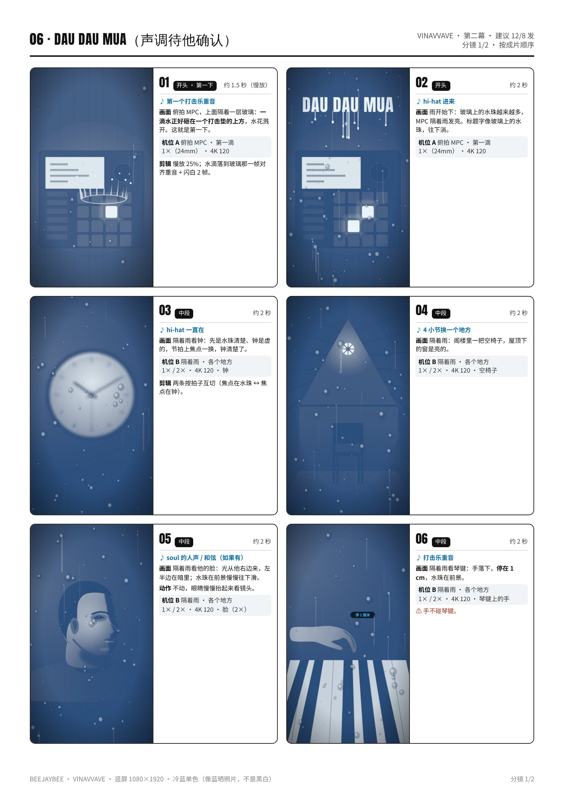
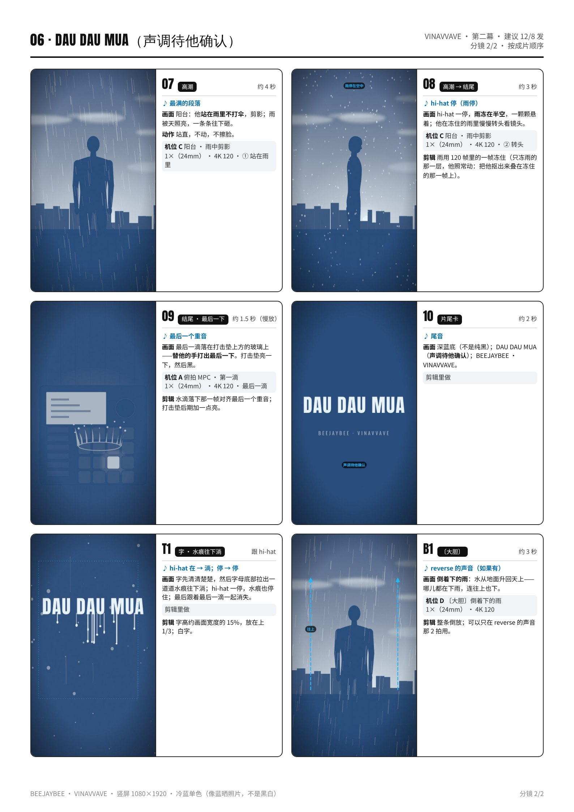

## 拍摄顺序（≤ 3 小时）
| 时间 | 地点 | 做什么 |
|---|---|---|
| 15:30–15:50 | 阁楼 | 布置：俯拍架（两把椅子 + 扫把杆）、MPC 上方 10 cm 架玻璃、毛巾；准备喷壶、滴管/勺子。 |
| 15:50–16:20 | 阁楼 | **机位 A**：滴水 × 10。 |
| 16:20–17:00 | 阁楼 | **机位 B**：湿玻璃在镜头前，钟 / 空椅子 / 镜子 / 脸 / 手，每处 2 条（两种焦点）。 |
| 17:00–17:40 | 阳台 | 挂“雨棚”（或者用真雨）；**机位 C**：站在雨里 × 2、转头 × 3（日落前，天要亮）。 |
| 17:40–18:00 | 阳台 | **机位 D**〔大胆〕：倒水 × 5。 |
| 18:00–18:15 | — | 擦干手机、玻璃、地面；回看、备份（约 2 小时 45 分）。 |

## 道具清单
- 相框玻璃（A4 左右，边角用胶带包住防割手）
- 喷壶、浇花壶、滴管或小勺
- 大塑料瓶 + 绳子（雨棚）
- 两把椅子 + 扫把杆 + 胶带 + 绳子（俯拍架）
- 书 4–6 本、毛巾 2 条
- 深蓝纯色 T 恤（会淋湿，带一件换的）

## 字（上屏设计）
- **DAU DAU MUA（声调待他确认）**：窄粗黑体，白字，上 1/3，字高约画面宽度的 15%。
- 字像玻璃上的水珠：先清楚，然后字母底部拉出水痕往下淌；hi-hat 停，水痕也停；最后一滴落下时字消失。
- 片尾卡用深蓝底（整片是冷蓝单色）。上屏前确认声调；英文意思只放 IG 文案。

## 剪辑要点
- 时间线 1080×1920 / 30p；**整片冷蓝单色**：去色 → 暗部压深蓝、亮部浅蓝（蓝晒照片的感觉），不是黑白。
- 雨跟 hi-hat：hi-hat 在，雨正常速度下；hi-hat 停，从 120 帧素材里取一帧把雨冻住（他那一层照常动）。
- “隔着雨”的地方，每 4 小节换一个；焦点在水珠 ↔ 后面的东西，在拍子上互切。
- 第一滴、最后一滴都慢放 25%，水滴落到玻璃那一帧对齐重音。
- 长度按小节表剪，30–50 秒都可以。

## 开拍前 / 收工前检查
- 开拍前：电量 100%、存储 50 GB、飞行模式；4K 120、锁定相机；手机旁放毛巾。
- 水只落在玻璃上，不落在 MPC、琴、插线板上；俯拍架下面的手机要绑牢。
- 阳台：地滑，穿防滑的鞋；玻璃边角包好胶带。
- 收工后：擦干手机（尤其是充电口），再充电。

---

# 07 · U NGON NGU NGANH（声调待他确认）
算了，睡了吧｜第二幕最后一夜｜约 40 秒

**1. 手法**
画面跟他一起睡着。他躺下以后，整个画面在 8 小节里慢慢转 90 度：他躺平了，在画面里却是站着的，世界横了过来。最后上下黑边像眼皮一样合上。
颜色：黑白。他睡着那一刻，T 恤上那点蓝慢慢褪掉，给第 8 集留空。

**2. 三位导演最好的一句**
- 音乐结构：拖慢、减速（tape stop）的声音一出来，画面就闭一下眼（上下黑边合一下）；长音来时，画面跟着呼吸慢推慢拉。
- 画面手法：俯拍架用家里的东西搭：一根扫把杆架在两把椅背上，手机用胶带绑在杆中间。他躺在地上，剪辑时把画面慢慢转 90 度。
- 情绪弧线：算了不是认输，是放下。睡着，就是进入第三幕的门。

**3. 段落草图**
- 开头：他坐在 MPC 前打瞌睡，每个 snare 头点一下（手离开打击垫）。
- 中段：他在每个地方睡着：琴上（头枕着琴身）、阳台地上、镜子前。4 小节换一个地方。
- 高潮：俯拍他躺在阁楼地板中央，画面慢慢转 90 度，他在画面里站了起来，世界躺下了。
- 结尾：最后一个长音，眼皮合上，上下黑边合拢，比片尾卡早 1 秒全黑。接片尾卡。

**4. 地方 / 道具 / 时长 / 难点**
- 地方：阁楼地板、MPC 桌前、阳台。
- 道具：两把椅子、扫把杆、胶带、一根绳（俯拍架用），枕头。
- 时长：约 2 小时。
- 难点：俯拍的手机必须绑牢，三道胶带外加一根绳做保险，正下方不放 MPC。因为要转 90 度，俯拍那条用横屏 4K 拍，给裁切留余量。

**5. 字**
U NGON NGU NGANH（声调待他确认）。字母一个个躺倒：原本站着的大写字母，每遇到一个慢下来的音就转 90 度躺平，最后横着睡在画面底部，像一排枕头。

**6. 〔大胆〕**
真睡一整夜：手机插着电放在地上，对着三角屋顶拍延时。路灯、月光、天亮的第一道光在屋顶上走一遍，最后一帧（天亮）直接接第 8 集的开头。

**7. 要问他**
1. 有没有 tape stop、减速这类声音？在哪？
2. 有没有像呼吸、打鼾的长音？
3. 结尾是突然停，还是慢慢没？

---

# 07 · U NGON NGU NGANH（声调待他确认） · 拍摄脚本

算了，睡了吧｜第二幕最后一夜 · 建议 12/15 发｜约 40 秒（30–50 秒都可以）｜颜色：黑白；他睡着时，T 恤上的蓝慢慢褪掉

设备：iPhone 16 Pro Max 一部，没有三脚架，靠家里现成的东西固定。通用设置见 [拍摄通用参数](拍摄通用参数_iPhone16ProMax.md)。完整版（含分镜图）见 [PDF](pdf/07_U_NGON_NGU_NGANH_分镜脚本.pdf)。

**本集手法：**画面跟他一起睡着：他躺下，整个画面在 8 小节里慢慢转 90 度，他躺平了，在画面里却站着，世界横过来；最后上下黑边像眼皮一样合上。

## 这一集的特殊设置
- **俯拍转 90° 的那条用横屏拍**：手机横着绑在俯拍架上，0.5×（13mm）· 4K 30，镜头离地约 **1 m**，他的全身都在画面里；时间线里放到 **102%**，转 90° 也不会露黑边。
- 俯拍架：两把椅子背对背，扫把杆横在中间，手机缠三道胶带 + 一根绳；**正下方是他，不放 MPC**。
- “睡着”要真的放松：脸、手、肩膀都松掉，别演。
- 颜色：默认黑白；他睡着的那几镜，T 恤的蓝从 30% 慢慢褪到 0（HSL 只留蓝 + 饱和度关键帧）。
- 晚上拍：屋里只开一盏台灯当“月光”，放在他右边；台灯是 LED 的话，慢动作用 **4K 100**（避开频闪）。

## 机位表（每个机位拍完之前不碰手机）
### 机位 A · MPC 桌前 · 打瞌睡（正面）
- 镜头 / 帧率：1×（24mm） · 4K 100
- 支撑：桌上叠书，手机竖拍，镜头高 = 他的眼睛，正对他，距离约 **1.2 m**。
- 曝光 / 对焦：锁他的脸，**−0.7EV**。
- 要录的条：他坐在 MPC 前，**每个 snare 头往下点一下**，手离开打击垫（不碰），20 秒 × 3 条。

### 机位 B · 各处睡着（琴上 / 镜子前 / 阳台地上）
- 镜头 / 帧率：1×（24mm） · 4K 100
- 支撑：书堆放在地上或椅子上，每处一个固定机位；他在画面里占 2/3。
- 曝光 / 对焦：锁他的身体，**−0.7EV**（阳台用天光时 **−1.0EV**）。
- 要录的条：每处“睡着” 12 秒 × 2 条：头枕在琴身上（不压琴键）；靠着镜子坐在地上；躺在阳台地上。

### 机位 C · 俯拍 · 躺在地板中央（转 90° 用）
- 镜头 / 帧率：0.5×（13mm） · 4K 30（横屏）
- 支撑：俯拍架，手机**横着**绑在杆中间，镜头朝下，离地约 **1 m**；他躺在正下方，头朝画面左边。
- 曝光 / 对焦：锁他的胸口，**−0.7EV**。
- 要录的条：躺好，慢慢闭眼，40 秒不动 × 3 条；再录一条他翻身侧睡。

### 机位 D · 脸的特写 · 闭眼
- 镜头 / 帧率：2×（48mm） · 4K 100
- 支撑：桌子 + 书，镜头和眼睛同高，在他右前方 45°，约 **0.9 m**。
- 曝光 / 对焦：锁他右眼，**−0.7EV**。
- 要录的条：慢慢闭眼、呼吸放慢，10 秒 × 3。

### 机位 E · 〔大胆〕整夜延时
- 镜头 / 帧率：0.5×（13mm） · 延时摄影
- 支撑：手机**屏幕朝下**平放在阁楼地板正中，后置镜头对着三角屋顶；插着充电线。
- 曝光 / 对焦：延时模式会自动曝光；先录 10 秒试拍，确认屋脊在画面中线上。
- 要录的条：他真的睡一整夜（睡在镜头旁边，不入画也行）；早上停止。

## 分镜（按成片顺序）
### 01 · 开头 · 约 3 秒
- 声音：snare（每下点一次头）
- 画面：他坐在 MPC 前打瞌睡：**每个 snare 头往下点一下**，又猛地抬起来。
- 动作：手离开打击垫，不碰。
- 机位：A

### 02 · 开头 · 约 0.5 秒
- 声音：tape stop / 减速（如果有）
- 画面：音乐一拖慢，**画面闭一下眼**：上下黑边合到一半，又睁开。
- 机位：A
- 剪辑：黑边 4 帧合上、4 帧打开。

### 03 · 中段 · 约 3 秒（4 小节）
- 声音：主段
- 画面：他趴在琴上睡着了，头枕在琴身上。
- 动作：不压琴键，脸朝镜头那一侧。
- 机位：B（琴上）

### 04 · 中段 · 约 3 秒
- 声音：主段
- 画面：阳台，天快黑了，他直接躺在地上睡着。
- 机位：B（阳台地上）

### 05 · 中段 · 约 3 秒
- 声音：主段
- 画面：他靠着镜子坐在地上睡着，镜子里的他也睡着了。
- 机位：B（镜子前）

### 06 · 高潮 · 0° · 约 2 秒
- 声音：最松的段落开始
- 画面：俯拍：他躺在阁楼地板正中，闭着眼。
- 机位：C（横屏）
- 剪辑：这一条开始慢慢转（8 小节转 90°）。

### 07 · 高潮 · 45° · （转动中）
- 声音：最松的段落
- 画面：画面在转：他和地板一起慢慢转过来。
- 机位：C
- 剪辑：用缓入缓出的旋转，速度均匀，不要突然。

### 08 · 高潮 · 90° · 约 2 秒
- 声音：最松的段落最后
- 画面：转完 90°：**他躺平了，在画面里却是站着的**，地板变成了墙，世界躺下了。字母一个个躺倒。
- 机位：C

### 09 · 结尾 · 约 2 秒
- 声音：最后一个长音
- 画面：脸的特写，闭着眼，呼吸很慢；T 恤上那点蓝**慢慢褪掉**。
- 机位：D
- 剪辑：饱和度关键帧：30% → 0，跟着长音。

### 10 · 结尾 · 约 1 秒 → 全黑
- 声音：长音结束前 1 秒
- 画面：**眼皮合上**：上下黑边慢慢合拢，比片尾卡早 1 秒全黑。
- 机位：D

### 11 · 片尾卡 · 约 2 秒
- 声音：尾音
- 画面：黑底；U NGON NGU NGANH（**声调待他确认**），字横着“睡”在画面底部；BEEJAYBEE · VINAVVAVE。
- 机位：剪辑里做

### T1 · 字 · 字母躺倒 · 跟慢下来的音
- 声音：每个拖慢的音倒一个
- 画面：一开始 16 个字母都站着；每遇到一个慢下来的音，就有一个字母转 90° 躺平；最后整行横着睡在画面底部，像一排枕头。
- 机位：剪辑里做
- 剪辑：旋转用 6 帧缓出；字高约画面宽度的 10%。

### B1 · 〔大胆〕 · 整首或结尾 8 秒
- 声音：最后的长音 → 接第 8 集
- 画面：整夜延时：三角屋顶上，路灯、月光、天亮的第一道光走一遍；最后一帧（天亮）直接接第 8 集的开头。
- 机位：E

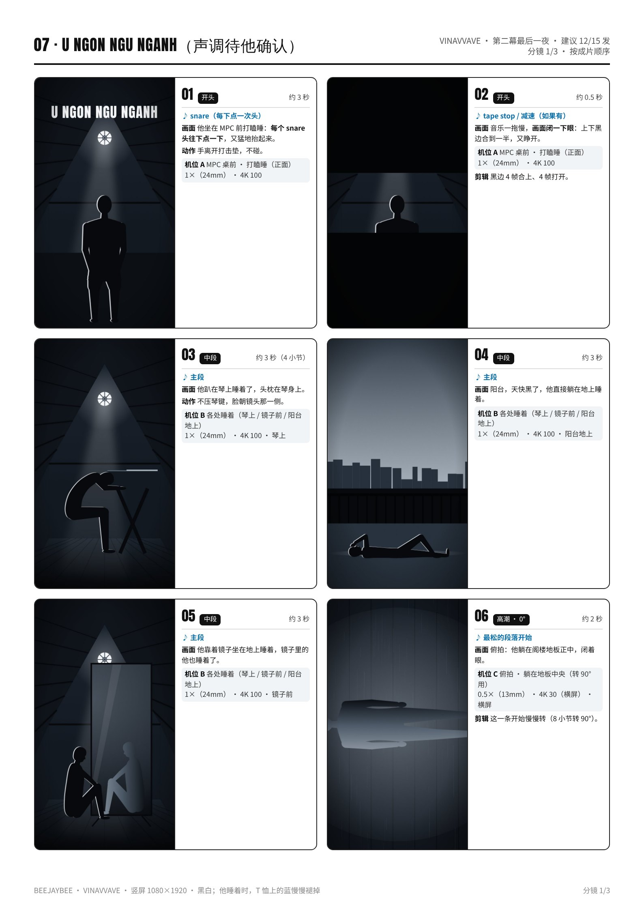
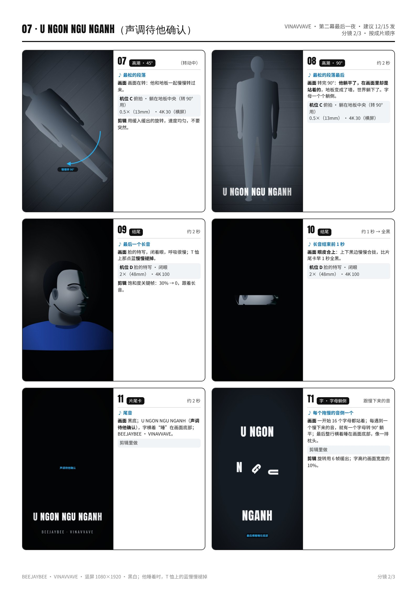
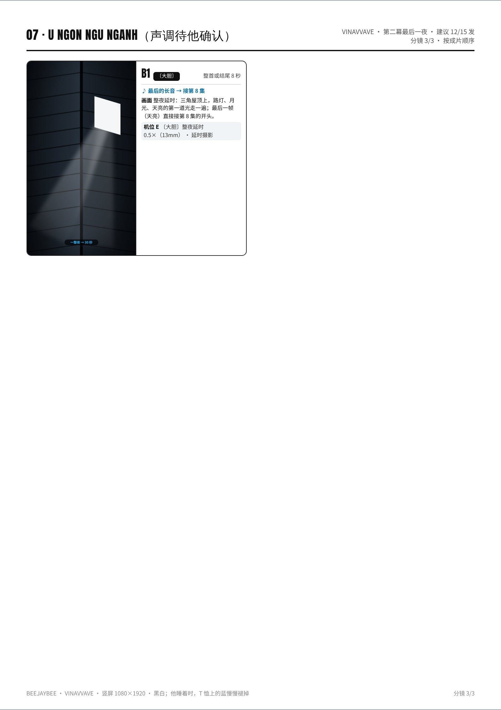

## 拍摄顺序（≤ 3 小时）
| 时间 | 地点 | 做什么 |
|---|---|---|
| 15:00–15:20 | 阁楼 | 布置：MPC 桌、书堆机位 A；台灯放在他右边。 |
| 15:20–15:50 | 阁楼 | **机位 A**：打瞌睡 × 3 条。 |
| 15:50–16:40 | 阁楼 / 阳台 | **机位 B**：琴上、镜子前、阳台地上，各 2 条（阳台放在天快黑的时候）。 |
| 16:40–17:20 | 阁楼 | 搭俯拍架（手机横着、0.5×）；**机位 C**：躺在地板中央 × 3 + 翻身 × 1。 |
| 17:20–17:40 | 阁楼 | **机位 D**：闭眼特写 × 3。 |
| 17:40–17:55 | 阁楼 | 回看、备份（约 2 小时 55 分）。〔大胆〕延时：晚上睡前摆好，早上停。 |

## 道具清单
- 两把椅子 + 扫把杆 + 胶带 + 绳子（俯拍架）
- 台灯 1 盏（当月光，放他右边）
- 枕头（可入画）
- 书 4–6 本
- 充电线（整夜延时用）
- 深蓝纯色 T 恤

## 字（上屏设计）
- **U NGON NGU NGANH（声调待他确认）**：窄粗黑体，白字，字高约画面宽度的 10%。
- 字母一个个躺倒：每个慢下来的音转 90° 躺平一个，最后整行横着睡在画面底部。
- 片尾卡上的字也是横着躺在底部。上屏前确认声调；英文意思只放 IG 文案。

## 剪辑要点
- 时间线 1080×1920 / 30p；黑白微冷。
- **画面转 90°**：俯拍那条（横屏 4K）放到 102%，在 8 小节里用缓入缓出转 90°，不露黑边。
- **眼皮**：上下两条黑边，拖慢的声音一出来，4 帧合到一半、4 帧打开；结尾合拢，比片尾卡早 1 秒全黑。
- 各处睡着：4 小节换一个地方，切点落在小节的第一拍。
- 颜色：只在他睡着的几镜开“只留蓝”，饱和度 30% → 0 跟着长音褪掉。
- 长度按小节表剪，30–50 秒都可以。

## 开拍前 / 收工前检查
- 开拍前：电量 100%、存储 50 GB、飞行模式；4K 100（台灯）、锁定相机。
- 俯拍架下面只有人，没有 MPC、琴、玻璃杯；手机三道胶带 + 一根绳。
- 每条回看：他的全身都在画面里、头的位置每条一样。
- 〔大胆〕延时：手机插着电；勿扰模式；开始前清出存储。

---

# 08 · TU VIỆN SÀI GÒN
西贡修道院｜第三幕高潮｜约 45 秒

**1. 手法**
她不现身，只有光。合唱一进来，窗口的白布被照亮成一个披着头纱的形状，画面涨成深蓝；她离开时，白布在 120 帧里慢慢从窗上滑落，蓝色退回黑白。
颜色：黑白 → 合唱进来，涨成深蓝（圣母的蓝）→ 她离开，退回黑白。这是全系列颜色最满的几秒。

**2. 三位导演最好的一句**
- 音乐结构：女声合唱就是“她”，只用光和蓝来表现。工业打击是他，在地上；合唱在天上。合唱进来前留 1 拍全黑。
- 画面手法：手机屏幕朝下平放在阁楼地板正中，镜头直冲三角屋顶，屋脊就是画面中线。他站在手机正上方往下看，像穹顶里的圣像。
- 情绪弧线：神来过，又走了；他还在。

**3. 段落草图**
- 开头（合唱前）：黑白。从地板往上拍三角屋顶，他走进画面，站在正中往下看。
- 中段（合唱进来）：先全黑 1 拍，然后窗口的白布亮起来，画面一点点涨成深蓝，他抬头看光。
- 高潮（合唱最满）：镜像祭坛，两个他面对面，中间是发光的白布。接着斗笠逆光放在他头后，只剩一圈放射的骨架，像光环，他正面居中，像一幅圣像。这 4 小节一刀不剪。
- 结尾（她离开）：白布在 120 帧里慢慢滑落，蓝退掉，只剩他一个人站在白场里的剪影。接片尾卡。

**4. 地方 / 道具 / 时长 / 难点**
- 地方：阁楼，白天窗光最强的时段。
- 道具：白床单、斗笠（只当剪影）、胶带、一根细绳（拉布用）、书。
- 时长：约 2.5 小时，要等光。
- 难点：手机朝下放，看不到屏幕。先录 10 秒试拍，回看后再调位置。逆光要锁 AE，压到 −1.5EV。白布滑落要一次到位，多拍几条。

**5. 字**
TU VIỆN / SÀI GÒN 两行，完全对称居中，字距拉开，像刻在祭坛上。合唱进来时，字从全黑里亮出来；合唱每一个长音，字发一次光；她离开时，字跟着白布一起往下滑、淡掉。

**6. 〔大胆〕**
整片只用一个镜头，从地板往上拍，从头到尾不剪。他走进来、站定、跪下、站起、离开，只有光和颜色在变。

**7. 要问他**
1. 合唱从哪进来？在哪最满？在哪离开？
2. 她离开以后，歌还有多长？
3. 合唱下面还有什么声部？

---

# 08 · TU VIỆN SÀI GÒN · 拍摄脚本

西贡修道院｜第三幕高潮 · 建议 12/22（圣诞那周）发｜约 45 秒（30–50 秒都可以）｜颜色：黑白 → 合唱进来涨成深蓝 → 她离开退回黑白

设备：iPhone 16 Pro Max 一部，没有三脚架，靠家里现成的东西固定。通用设置见 [拍摄通用参数](拍摄通用参数_iPhone16ProMax.md)。完整版（含分镜图）见 [PDF](pdf/08_TU_VIEN_SAI_GON_分镜脚本.pdf)。

**本集手法：**她不现身，只有光：合唱一进来，窗口的白布被照亮成一个披着头纱的形状，画面涨成深蓝；她离开时，白布在 120 帧里慢慢滑落，蓝退回黑白。

## 这一集的特殊设置
- 这一集全靠窗光：**选窗光最强的 1.5 小时**拍机位 B、D、E（太阳直射窗户时，白布最亮）。
- **白布**：一条白床单，上面两个角用胶带贴在窗框上；下角绑一根细绳，拉到画面外。拉一下绳，胶带脱开，白布就滑下来。每次重新挂好。
- **地板往上拍（机位 A）**：手机屏幕朝下平放在阁楼地板正中，用后置 **0.5×**；看不到屏幕，先录 10 秒试拍、回看，确认屋脊在画面中线上。
- **逆光**（白布、斗笠、窗）一律长按亮处锁 AE/AF，压到 **−1.5EV**，人是剪影或半剪影。
- **斗笠**只当剪影：挂在窗前，逆光里只剩一圈放射的骨架，他站在斗笠前面，头正好在斗笠中心。

## 机位表（每个机位拍完之前不碰手机）
### 机位 A · 地板往上 · 三角屋顶
- 镜头 / 帧率：0.5×（13mm） · 4K 60
- 支撑：手机**屏幕朝下**平放在阁楼地板正中，屋脊对准画面中线；他站在手机正上方（两脚在手机两边）。
- 曝光 / 对焦：长按屋顶靠窗那一侧锁 AE/AF，**−1.0EV**。
- 要录的条：① 走进画面、站定、低头看镜头 × 3；② 慢慢抬头看窗口 × 3；③〔大胆〕一镜到底：走进—站定—跪下—站起—离开 × 2。

### 机位 B · 窗口的白布（“她”）
- 镜头 / 帧率：1×（24mm） · 4K 120
- 支撑：书堆放在地上，离窗约 **2.5 m**，镜头稍微仰，窗和白布在画面上 2/3。
- 曝光 / 对焦：长按白布最亮处锁 AE/AF，**−1.5EV**。
- 要录的条：① 白布被照亮，20 秒 × 3；② 拉绳让白布滑落 × 5（每次重新挂）。

### 机位 C · 侧身 · 镜像祭坛
- 镜头 / 帧率：1×（24mm） · 4K 120
- 支撑：书堆放在椅子上，镜头高约 **120 cm**，正对窗；他站在画面中线左边，侧身脸朝中线（朝白布）。
- 曝光 / 对焦：锁白布，**−1.5EV**（他是半剪影）。
- 要录的条：侧身站定 4 拍，慢慢抬头看白布 4 拍 × 3 条。剪辑里把左半边镜像成右半边。

### 机位 D · 斗笠光环 · 正面居中
- 镜头 / 帧率：2×（48mm） · 4K 120
- 支撑：斗笠用绳挂在窗前；他站在斗笠前 **30 cm**，镜头高 = 他的眼睛，距离约 **2 m**；从镜头看，他的头正好在斗笠中心。
- 曝光 / 对焦：长按斗笠的亮处锁 AE/AF，**−1.5EV**。
- 要录的条：正面站定、闭眼 8 拍 × 3；睁眼看镜头 4 拍 × 3。

### 机位 E · 白场剪影（结尾）
- 镜头 / 帧率：1×（24mm） · 4K 120
- 支撑：同 B 的位置；白布拿掉，他站在窗前。
- 曝光 / 对焦：长按屋里暗处锁 AE/AF，**0EV**：窗全白，他是黑剪影。
- 要录的条：站定不动 10 秒 × 3。

## 分镜（按成片顺序）
### 01 · 开头 · 合唱前 · 约 4 秒
- 声音：工业打击（他在地上）
- 画面：黑白。从地板往上拍：三角屋顶像穹顶，屋脊是画面中线。他走进画面，站在正中，低头看镜头。
- 机位：A（① 走进）

### 02 · 合唱前最后一拍 · 1 拍
- 声音：合唱进来之前
- 画面：**全黑 1 拍**。
- 机位：剪辑里做
- 剪辑：硬切到黑，正好 1 拍，下一帧合唱进来。

### 03 · 合唱进来 · 约 4 秒
- 声音：女声合唱第一声
- 画面：窗口的白布被照亮，像一个披着头纱的形状——**她**。画面一点点涨成深蓝。字从黑里亮出来。
- 机位：B（① 白布亮）
- 剪辑：深蓝那一层透明度 0 → 60%，跟合唱的音量走。

### 04 · 中段 · 约 4 秒
- 声音：合唱铺开
- 画面：地板往上：光从窗口斜着打进来，他抬头看光；整片是深蓝。
- 机位：A（② 抬头）

### 05 · 高潮 · 镜像祭坛 · 约 4 秒
- 声音：合唱最满
- 画面：**两个他面对面**，中间是发光的白布；完全对称，像祭坛。
- 机位：C
- 剪辑：左半边镜像成右半边；中线加一道细白线。

### 06 · 高潮 · 光环 · 约 4 秒（不切）
- 声音：合唱最满的 4 小节
- 画面：斗笠在他头后逆光，只剩一圈放射的骨架，**像光环、像玫瑰窗**；他正面居中，闭眼，像一幅圣像。这 4 小节一刀不剪。
- 机位：D

### 07 · 高潮 → 她离开前 · 约 2 秒
- 声音：合唱最后一个长音
- 画面：他在光环里睁开眼，看着镜头。字发最后一次光。
- 机位：D（睁眼）

### 08 · 她离开 · 约 4 秒（慢放）
- 声音：合唱离开
- 画面：白布在 120 帧里**慢慢从窗上滑落**；蓝一点点退回黑白。
- 机位：B（② 白布滑落）
- 剪辑：慢放 25%；蓝的透明度 60% → 0，跟白布同步。

### 09 · 结尾 · 约 3 秒
- 声音：她走后的余音
- 画面：只剩他一个人：**白场里的剪影**，站着不动。
- 机位：E

### 10 · 片尾卡 · 约 2 秒
- 声音：尾音
- 画面：黑底；TU VIỆN / SÀI GÒN 两行完全对称；BEEJAYBEE · VINAVVAVE。
- 机位：剪辑里做

### T1 · 字 · 刻在祭坛上 · 跟合唱
- 声音：合唱的长音
- 画面：两行完全对称居中，字距拉开（约字高的 25%）；合唱进来时从全黑里“亮”出来；每一个长音发一次光（外发光 8 帧）；她离开时字跟白布一起往下滑、淡掉。
- 机位：剪辑里做
- 剪辑：字高约画面宽度的 12%；白字。

### B1 · 〔大胆〕 · 整首一个镜头
- 声音：从头到尾
- 画面：整片只有一个镜头：从地板往上拍，从头到尾不剪——他走进、站定、跪下、站起、离开，**只有光和颜色在变**。
- 机位：A（③ 一镜到底）

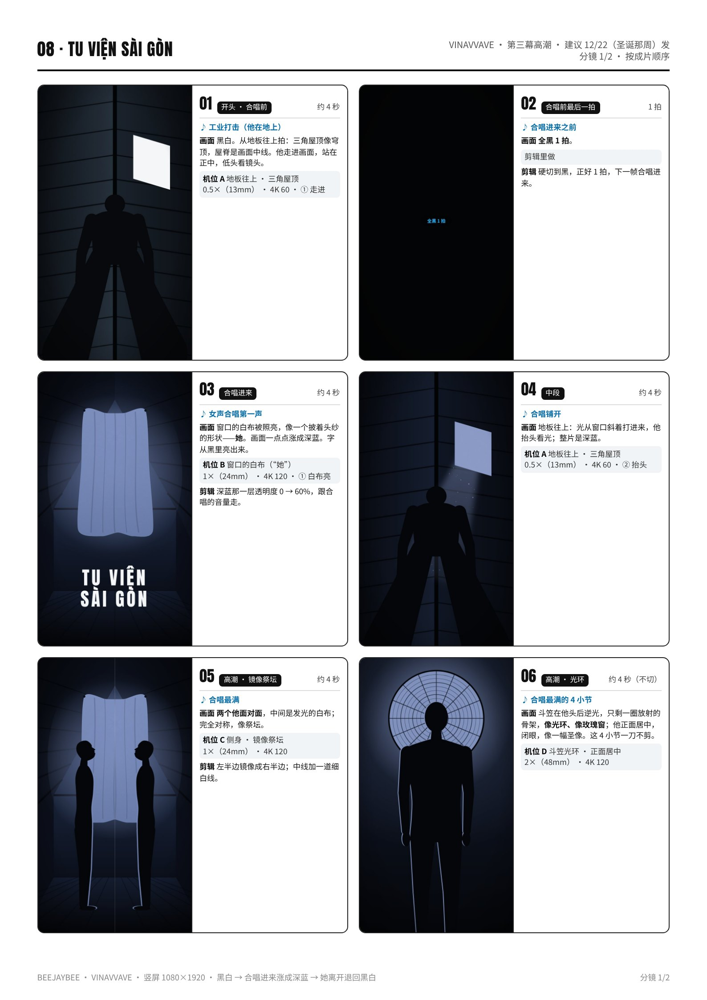
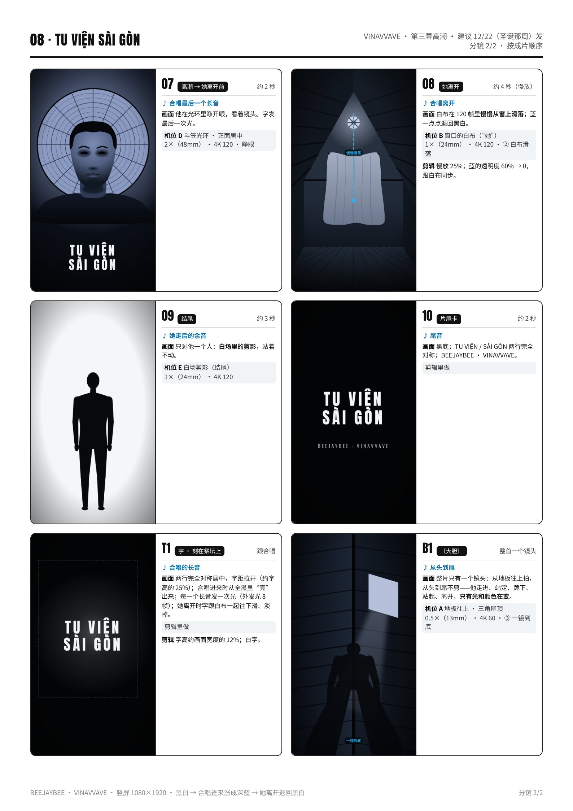

## 拍摄顺序（≤ 3 小时）
| 时间 | 地点 | 做什么 |
|---|---|---|
| （窗光最强前 20 分钟） | 阁楼 | 布置：白床单挂窗（上面两角贴胶带，下角绑细绳拉到画面外）；斗笠用绳挂好；书堆、椅子。 |
| +0:20 – +0:50 | 阁楼 | **机位 B**：白布亮 × 3、滑落 × 5（每次重新挂）。 |
| +0:50 – +1:20 | 阁楼 | **机位 A**：走进 × 3、抬头 × 3；〔大胆〕一镜到底 × 2。 |
| +1:20 – +1:50 | 阁楼 | **机位 C**：侧身对称 × 3。 |
| +1:50 – +2:20 | 阁楼 | **机位 D**：斗笠光环 × 6。 |
| +2:20 – +2:40 | 阁楼 | **机位 E**：白场剪影 × 3。 |
| +2:40 – +2:55 | 阁楼 | 回看、备份。 |

## 道具清单
- 白床单 1 条
- 胶带、细绳（拉白布）
- 斗笠 1 顶 + 挂斗笠的绳（只当剪影）
- 书、椅子（手机支撑）
- 深蓝纯色 T 恤

## 字（上屏设计）
- **TU VIỆN / SÀI GÒN**：窄粗黑体，两行完全对称居中，字距拉开，像刻在祭坛上；字高约画面宽度的 12%。
- 合唱进来时从全黑里“亮”出来；合唱的每个长音外发光一次（8 帧）；她离开时跟白布一起往下滑、淡掉。
- 片尾卡同样两行对称 + BEEJAYBEE · VINAVVAVE。英文意思只放 IG 文案：“Tu viện Sài Gòn — the Saigon monastery.”

## 剪辑要点
- 时间线 1080×1920 / 30p；开头黑白微冷。
- **涨蓝**：加一层深蓝（约 #1B3C96）用“正片叠底”或“颜色”混合，透明度 0 → 60% 跟着合唱的音量走；她离开时 60% → 0，跟白布滑落同步。
- 合唱进来前**全黑 1 拍**；合唱最满的 4 小节（斗笠光环）一刀不剪。
- 镜像祭坛：左半边镜像成右半边，中线加一道细白线。
- 白布滑落：120 → 30 慢放 25%。
- 长度按小节表剪，30–50 秒都可以（这一集可以放到 45–50 秒）。

## 开拍前 / 收工前检查
- 开拍前：电量 100%、存储 50 GB、飞行模式；地板往上那条用 0.5× · 4K 60。
- 白布每次滑落前检查胶带只贴了一点点，一拉就掉；绳子不入画。
- 逆光镜头每条回看：剪影干净、窗外没有招牌和旗。
- 斗笠只当剪影，不戴在头上。

---

# 09 · QUANG DAU（声调待他确认；人声素材里记作 quang đâu）
光在哪里｜全专辑最空的一点｜约 35 秒

**1. 手法**
手机就是唯一的光。全片只开手机电筒，镜头和光是同一样东西：拍到哪，哪才亮。每问一次「quang đâu」，光就扫一次，扫过去就黑。最后光扫到镜子，自己反打回来，炸成白场。
颜色：纯黑白，没有颜色，第 8 集的蓝走了。

**2. 三位导演最好的一句**
- 音乐结构：人声「quang đâu」一响，手电就扫一次；最空的那条长音，就是光慢慢移动。黑的时间要比亮的多。
- 画面手法：视频模式里把闪光灯设成常亮，一部手机既拍又照。这是全系列唯一一集手持。
- 情绪弧线：神走了，他自己找光。其实光一直在他手里。

**3. 段落草图**
- 开头：全黑 2 拍，只有第一声「quang đâu」；第二声，光才亮。
- 中段：光扫到一样东西就停一下：钟（秒针在走）、空椅子、MPC、他自己的手。扫过去就黑。
- 高潮：光停在地上不动，像是差点放弃。然后慢慢抬起来，扫到镜子，电筒在镜子里反打回来，画面炸成白场。
- 结尾：白场慢慢退回全黑，黑里传来最后一声「quang đâu」。接片尾卡。

**4. 地方 / 道具 / 时长 / 难点**
- 地方：关了灯的阁楼，夜里拍，窗用被子挡住。
- 道具：落地镜、钟、空椅子、MPC。
- 时长：约 1.5 小时。
- 难点：自动曝光会乱跳，先长按锁住 AE/AF，再拖到 −1EV。镜子斜 10–15 度放时光不会直接反进镜头，正对才会炸，要先试好角度。手持要稳，打开防抖。

**5. 字**
QUANG DAU（声调待他确认）。字一直在画面上，但只有被光扫到的那一部分看得见，光一走字就没了。白场时，整行字第一次完整出现，然后跟着白场一起退掉。

**6. 〔大胆〕**
最后一镜把手机转过来对着自己的脸，开着电筒拍：光一直在手里。画面里是他被强光照亮的半张脸，另一半在黑里。

**7. 要问他**
1. 「quang đâu」出现几次？分别在哪？
2. 最空的段落有多长？
3. 有没有哪个声音是最后才出来的？

---

# 09 · QUANG DAU（声调待他确认） · 拍摄脚本

光在哪里｜全专辑最空的一点 · 建议 12/29 发｜约 35 秒（30–50 秒都可以）｜颜色：纯黑白，没有颜色

设备：iPhone 16 Pro Max 一部，没有三脚架，靠家里现成的东西固定。通用设置见 [拍摄通用参数](拍摄通用参数_iPhone16ProMax.md)。完整版（含分镜图）见 [PDF](pdf/09_QUANG_DAU_分镜脚本.pdf)。

**本集手法：**手机就是唯一的光：全片只开手机电筒，镜头和光是同一样东西，拍到哪，哪才亮；每问一次「quang đâu」，光扫一次，扫过去就黑；最后光扫到镜子，自己反打回来，炸成白场。

## 这一集的特殊设置
- **全片手持**（全系列唯一一集）：视频模式里点闪电图标，把闪光灯设成**常亮**——电筒和镜头在同一个方向。
- 用 **1× · 4K 30**：只有电筒的光，30 帧比 120 帧亮得多、干净得多；打开“增强防抖”。
- 夜里拍，关掉所有灯，窗用被子挡住：**黑要真黑**。
- 曝光：先把电筒对着 1 m 外的一样东西，长按锁 AE/AF，再拖到 **−1.0EV**，扫到哪里都不会自己变亮变暗。
- 镜子的角度：**斜 10–15°** 时电筒不会直接反进镜头；**正对**才会炸成白场——先试好再录。
- “找光的路线”提前摆好：钟 → 空椅子 → MPC → 他的手 → 地面 → 镜子，按这个顺序扫。

## 机位表（每个机位拍完之前不碰手机）
### 机位 A · 手持 · 电筒视角（找光的路线）
- 镜头 / 帧率：1×（24mm） · 4K 30
- 支撑：手持，手肘贴着身体走，动作慢；电筒常亮。每个东西离镜头 **0.8–1.2 m**。
- 曝光 / 对焦：对着 1 m 外的东西锁 AE/AF，**−1.0EV**。
- 要录的条：一整条从黑开始：手机贴在胸口（全黑）→ 抬起来 → 扫到钟停 1 秒 → 扫走 → 椅子 → MPC → 自己的手伸进光里 → 光落到地上停住 → 慢慢抬起、扫到镜子。**5 条**，每条 40–60 秒。

### 机位 B · 镜子反打 · 白场
- 镜头 / 帧率：1×（24mm） · 4K 30
- 支撑：手持，正对镜子走近，最后停在离镜子 **1 m**，手机**正对**镜面。
- 曝光 / 对焦：同 A，不要重新锁。
- 要录的条：先斜 15° 走近（不炸），再转到正对（炸成白），停 3 秒 × 6 条。

### 机位 C · 〔大胆〕对着自己的脸
- 镜头 / 帧率：1×（24mm） · 4K 30
- 支撑：手机转过来，后置镜头对着自己，手臂伸直（约 **60 cm**），手机放在他**右前方**，让左半边脸落进暗里。
- 曝光 / 对焦：对着自己的脸锁 AE/AF，**−0.7EV**。
- 要录的条：慢慢把手机从下往上抬到脸前，光一下子照亮半张脸，停 3 秒 × 3 条。

## 分镜（按成片顺序）
### 01 · 开头 · 2 拍全黑
- 声音：第一声「quang đâu」
- 画面：**全黑**。只有第一声「quang đâu」。
- 机位：A（手机贴胸口）

### 02 · 开头 · 约 2 秒
- 声音：第二声「quang đâu」
- 画面：第二声，**光才亮**：一束光照在地上，画面里只有光圈里的东西。字只在光扫过的地方显形。
- 机位：A

### 03 · 中段 · 约 3 秒
- 声音：人声 + 最空的长音
- 画面：光扫到**钟**，停一下：秒针在走。然后光走了，钟沉回黑里。
- 机位：A（扫到钟）

### 04 · 中段 · 约 2.5 秒
- 声音：「quang đâu」
- 画面：光扫到一把**空椅子**——没人。
- 机位：A（扫到空椅子）

### 05 · 中段 · 约 2.5 秒
- 声音：某个打击乐
- 画面：光扫到 **MPC**：屏幕是黑的，打击垫一个都没亮。
- 机位：A（扫到 MPC）

### 06 · 中段 · 约 2 秒
- 声音：「quang đâu」
- 画面：他自己的手伸进光里，张开，又收回去——光里还是什么都没有。
- 机位：A（自己的手）

### 07 · 高潮前 · 约 3 秒
- 声音：最空的那一段
- 画面：光落到地上，**停住不动**——像是差点放弃了。黑占满画面。
- 机位：A（光落在地上）

### 08 · 高潮 · 约 2 秒
- 声音：唯一一次变亮的地方
- 画面：光慢慢抬起来，扫到**镜子**：电筒在镜子里反打回来，越来越亮。
- 机位：B

### 09 · 高潮 · 约 2 秒
- 声音：最亮的那一拍
- 画面：**炸成白场**。整行字第一次完整出现在白里。
- 机位：B

### 10 · 结尾 · 约 2 秒 → 黑
- 声音：最后一声「quang đâu」
- 画面：白场慢慢退回全黑；黑里最后一声「quang đâu」。
- 机位：B
- 剪辑：白 → 黑用 1 秒的曝光关键帧，字跟白场一起退掉。

### 11 · 片尾卡 · 约 2 秒
- 声音：尾音
- 画面：黑底；QUANG DAU（**声调待他确认**，人声素材里记作 quang đâu）；BEEJAYBEE · VINAVVAVE。
- 机位：剪辑里做

### T1 · 字 · 光扫到哪字就在哪 · 跟光
- 声音：每次扫过
- 画面：整行字一直在画面中间，但被一个跟着光圈走的遮罩挡着：只有光圈里的那几个字母看得见，光一走字就没；白场时整行第一次完整出现。
- 机位：剪辑里做
- 剪辑：遮罩用光圈的形状，边缘羽化 30 px。

### B1 · 〔大胆〕 · 约 3 秒（替换 10 之前）
- 声音：最后一声之前
- 画面：最后一镜把手机转过来对着自己：电筒照亮**半张脸**，另一半在黑里——光一直在他手里。
- 机位：C

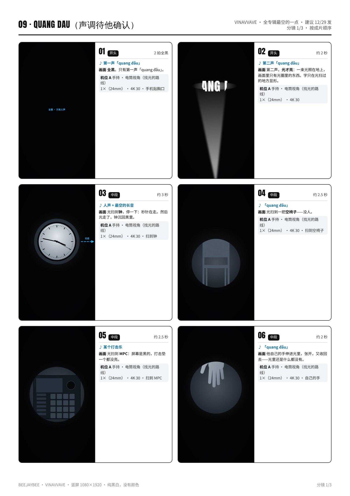
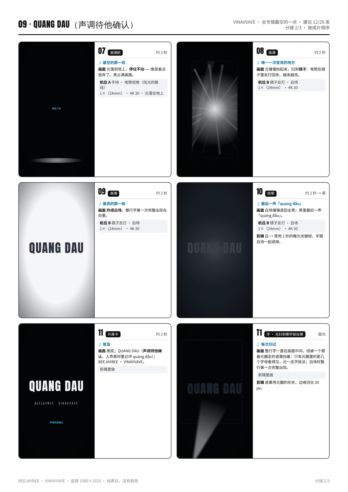
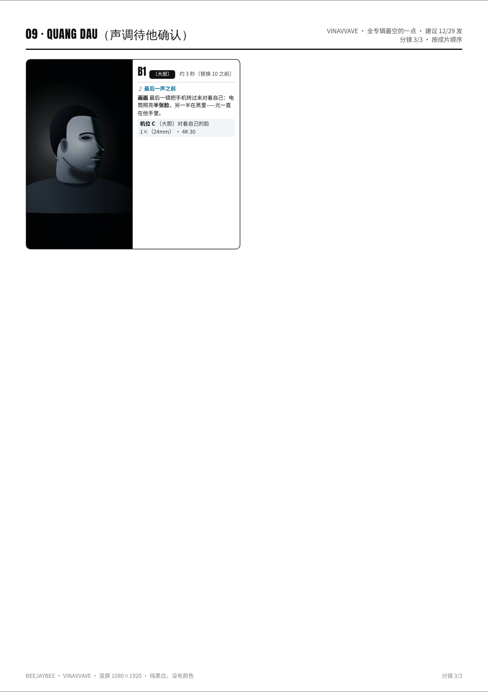

## 拍摄顺序（≤ 3 小时）
| 时间 | 地点 | 做什么 |
|---|---|---|
| 20:00–20:15 | 阁楼 | 布置：关灯、窗用被子挡住；钟、空椅子、MPC、镜子摆成一条路线；手机：1× · 4K 30、闪光灯常亮、防抖开。 |
| 20:15–21:00 | 阁楼 | **机位 A**：找光路线 × 5 条（每条 40–60 秒）。 |
| 21:00–21:20 | 阁楼 | **机位 B**：镜子反打 × 6（先试角度）。 |
| 21:20–21:35 | 阁楼 | **机位 C**〔大胆〕：对着自己的脸 × 3。 |
| 21:35–21:50 | 阁楼 | 回看、备份（约 1 小时 50 分）。 |

## 道具清单
- 落地镜
- 钟
- 空椅子
- MPC（不开机，屏幕黑）
- 被子或厚窗帘（挡窗）
- 深蓝纯色 T 恤

## 字（上屏设计）
- **QUANG DAU（声调待他确认；人声素材里记作 quang đâu）**：窄粗黑体，白字，居中，字高约画面宽度的 16%。
- 字一直在，但只有被光扫到的部分看得见（遮罩跟着光圈走），光走字就没。
- 白场时整行字第一次完整出现，然后跟白场一起退掉。上屏前确认声调；英文意思只放 IG 文案。

## 剪辑要点
- 时间线 1080×1920 / 30p；纯黑白，黑要压到真黑（暗部 0）。
- 每次「quang đâu」= 一次扫光：切点落在人声的起音上，扫过去就黑。
- 黑的时间要比亮的多：开头 2 拍全黑；光停在地上那段不要剪短。
- 镜子炸白：曝光关键帧把白再推满 8 帧，然后 1 秒退回黑。
- 长度按小节表剪，30–50 秒都可以（这一集短一点更空）。

## 开拍前 / 收工前检查
- 开拍前：电量 100%（电筒很耗电）、存储 30 GB、飞行模式；1× · 4K 30、闪光灯常亮。
- 屋里一点光都不能有（看一眼路由器、充电器的指示灯）。
- 每条回看：黑是不是真黑、光圈里的东西清不清楚。
- 手持走动时注意脚下：先把地上的线和杂物收好。

---

# 10 · PHAI
消散｜最后一首｜约 45 秒

**1. 手法**
phai 在越南语里本来就是“褪色”。这一集从彩色开始（全系列唯一一次），然后一层层褪：先褪成黑白，再褪成雾，最后他从前几集的每个地方褪掉，只剩空景。
颜色：冷调彩色（不要暖黄）→ 黑白 → 白。

**2. 三位导演最好的一句**
- 音乐结构：声部退一层，画面就褪一层：先是颜色，然后是对比度，最后是他本人。
- 画面手法：每个地方都拍“有他”和“没他”两条，用哈气起雾的玻璃做转场：他往镜头前的玻璃哈一口气，雾散开时他已经不在了。
- 情绪弧线：给过去的自己告别。最后一秒他笑了，“去他妈的吧这些 faith”。

**3. 段落草图**
- 开头：彩色的阁楼、阳台、河边（冷调），他在画面里，很平静。
- 中段：第一层声部撤掉，颜色褪成黑白；第二层撤掉，黑变灰、起雾。
- 高潮：回到前几集的地方：镜子、琴、MPC、空椅子、河边。每到一处，他都在一口气的雾里消失，只剩空景。
- 结尾：白场，然后硬切 1 秒：他放声大笑，剪影里肩膀在抖。片尾卡也一个字一个字褪掉。

**4. 地方 / 道具 / 时长 / 难点**
- 地方：阁楼、阳台、河边，复用前几集的机位。
- 道具：相框玻璃（哈气用），以及前几集的镜子、琴、MPC、椅子。
- 时长：约 3 小时。地方多，每处只有 15 分钟。
- 难点：“有他/没他”两条必须同一机位拍，中间不碰手机。彩色段要打开“锁定白平衡”，后期往冷调；大笑要真笑，多拍几条。

**5. 字**
PHAI 四个字母像褪色的油漆：开始是实心的，声部每撤一层，字就从底部往上淡一层，最后只剩一条细轮廓。片尾卡 BEEJAYBEE · VINAVVAVE 最后一个消失。

**6. 〔大胆〕**
最后一秒硬切到他放声大笑，一下打破整张专辑、整个系列的神圣：“去他妈的吧这些 faith 哈哈哈”。

**7. 要问他**
1. 结尾的声部是一层层撤，还是一刀断？
2. 有没有笑声或别的人声？
3. 最后一个声音是什么？

---

# 10 · PHAI · 拍摄脚本

消散｜最后一首 · 建议 1/5（新年第一周）发｜约 45 秒（30–50 秒都可以）｜颜色：冷调彩色 → 黑白 → 白（全系列唯一一次彩色）

设备：iPhone 16 Pro Max 一部，没有三脚架，靠家里现成的东西固定。通用设置见 [拍摄通用参数](拍摄通用参数_iPhone16ProMax.md)。完整版（含分镜图）见 [PDF](pdf/10_PHAI_分镜脚本.pdf)。

**本集手法：**phai 本来就是“褪色”：这一集从彩色开始，一层层褪——先褪成黑白，再褪成雾，最后他从前几集的每个地方褪掉，只剩空景；最后一秒，他笑了。

## 这一集的特殊设置
- **彩色**：只有这一集要保留颜色。设置里打开“锁定白平衡”；尽量在阴天光、窗光、蓝调时刻拍，后期整体往冷调（不要暖黄）。
- **有他 / 没他**：每个地方一个固定机位，按录制后不碰手机，先“有他”10 秒，再“哈气”，再“没他”10 秒，一条录完。
- **哈气起雾**：相框玻璃竖着夹在镜头前 **10 cm**；他从画面侧面探进来，对着玻璃哈一口长气，然后从侧面退出画面；雾散开时他已经不在了。
- 天冷不起雾的话：玻璃先放冰箱 5 分钟再拿出来，哈气就会起雾。
- 每个地方的机位尽量和前几集一样（同样的高度和距离），这一集是在“回访”。

## 机位表（每个机位拍完之前不碰手机）
### 机位 A · 阁楼四处（镜子 / 琴 / MPC / 空椅子）
- 镜头 / 帧率：1×（24mm） · 4K 30
- 支撑：书堆固定，机位和前几集一样；玻璃夹在镜头前 10 cm。
- 曝光 / 对焦：锁他的身体，**−0.7EV**；白平衡锁定。
- 要录的条：每处一条：有他 10 秒 → 哈气 → 没他 10 秒；**每处 2 条**。

### 机位 B · 阳台 · 彩色
- 镜头 / 帧率：1×（24mm） · 4K 30
- 支撑：书堆放在阳台地上，离地 15 cm；玻璃在镜头前。
- 曝光 / 对焦：锁他，**−0.7EV**（天太亮时 **−1.0EV**）。
- 要录的条：有他 → 哈气 → 没他 × 2 条（傍晚蓝调时刻）。

### 机位 C · Thủ Thiêm 河边 · 彩色
- 镜头 / 帧率：1×（24mm） · 4K 30
- 支撑：背包 + 书，离地 15 cm，和第 2 集同一个位置。
- 曝光 / 对焦：锁他，**−0.7EV**。
- 要录的条：有他 → 哈气 → 没他 × 2 条。

### 机位 D · 大笑（窗前剪影）
- 镜头 / 帧率：1×（24mm） · 4K 30
- 支撑：书堆放在椅子上，对着窗，离他约 **2 m**。
- 曝光 / 对焦：长按窗户锁 AE/AF，**−1.5EV**：他是剪影。
- 要录的条：真的笑出来（想一件真好笑的事），肩膀在抖，5 条；只取最好的 1 秒。

## 分镜（按成片顺序）
### 01 · 开头 · 彩色 · 约 3 秒
- 声音：开头（声部都在）
- 画面：**第一次看见颜色**：阁楼是冷调的彩色，他的 T 恤是深蓝，很平静地坐着。
- 机位：A（有他）

### 02 · 开头 · 彩色 · 约 2.5 秒
- 声音：开头
- 画面：阳台，傍晚的蓝调时刻，彩色；他站着，看着城市。
- 机位：B

### 03 · 开头 · 彩色 · 约 2.5 秒
- 声音：开头
- 画面：河边，彩色；对岸是城市，他站在第 2 集放琴的地方，手里什么也没有。
- 机位：C

### 04 · 中段 · 第一层撤 · 约 3 秒
- 声音：第一层声部撤掉
- 画面：第一层声部一撤，**颜色褪成黑白**。
- 机位：A
- 剪辑：饱和度 100% → 0，用 2 小节慢慢褪。

### 05 · 中段 · 第二层撤 · 约 3 秒
- 声音：第二层声部撤掉
- 画面：第二层一撤，**黑变灰、起雾**：他探过来对着镜头前的玻璃哈一口气，雾把画面盖住。
- 机位：A（哈气）
- 剪辑：黑位抬到 25% 灰；雾是真的（哈气）。

### 06 · 高潮 · 镜子 · 约 2 秒
- 声音：高潮（回访）
- 画面：回到第 1 集的镜子：雾散开时，**镜子前和镜子里都没有人了**。
- 机位：A（镜子：有他 → 雾 → 没他）

### 07 · 高潮 · 琴 · 约 2 秒
- 声音：高潮（回访）
- 画面：回到第 2 集的琴：琴还在，人已经褪掉了。
- 机位：A（琴：没他）

### 08 · 高潮 · MPC / 空椅子 · 约 2 秒
- 声音：高潮（回访）
- 画面：MPC 和空椅子，一个接一个，都没有他；画面越来越淡。
- 机位：A（没他）

### 09 · 高潮 · 河边 · 约 2 秒
- 声音：高潮最后
- 画面：河边：空的。只剩城市和河，淡得像要消失。
- 机位：C（没他）

### 10 · 结尾 · 约 2 秒
- 声音：最后一层撤掉
- 画面：**全白**。
- 机位：剪辑里做
- 剪辑：最后一个画面曝光拉满到白。

### 11 · 结尾 · 〔大胆〕大笑 · 1 秒（硬切）
- 声音：最后一个声音之后 / 之上
- 画面：**硬切 1 秒：他放声大笑**，剪影里肩膀在抖——把整张专辑、整个系列的神圣一下子打破：“去他妈的吧这些 faith 哈哈哈”。
- 机位：D
- 剪辑：只用 1 秒；可以带一点他真实的笑声（如果你想要）。

### 12 · 片尾卡 · 约 2.5 秒
- 声音：尾音结束
- 画面：黑底；PHAI 和 BEEJAYBEE · VINAVVAVE 一个字一个字褪掉，**BEEJAYBEE · VINAVVAVE 最后一个消失**。
- 机位：剪辑里做

### T1 · 字 · 褪色的油漆 · 跟声部撤
- 声音：每撤一层声部
- 画面：PHAI 四个字母开始是实心的；声部每撤一层，字从底部往上淡一层；最后只剩一条细轮廓。
- 机位：剪辑里做
- 剪辑：字高约画面宽度的 26%，字距拉开；用渐变遮罩从下往上推。

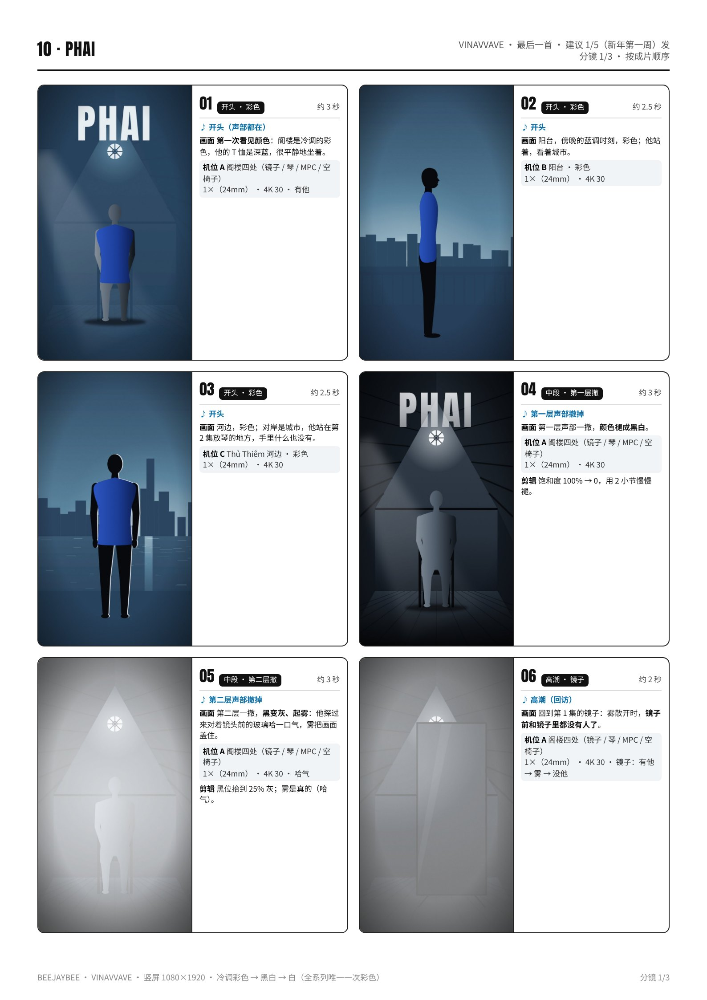
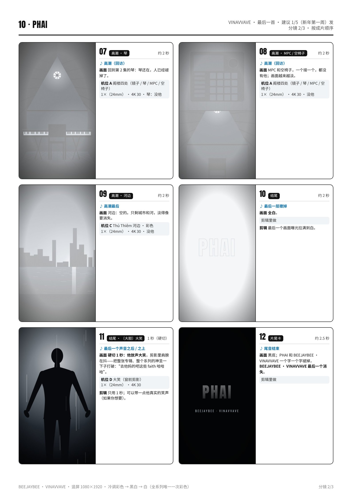
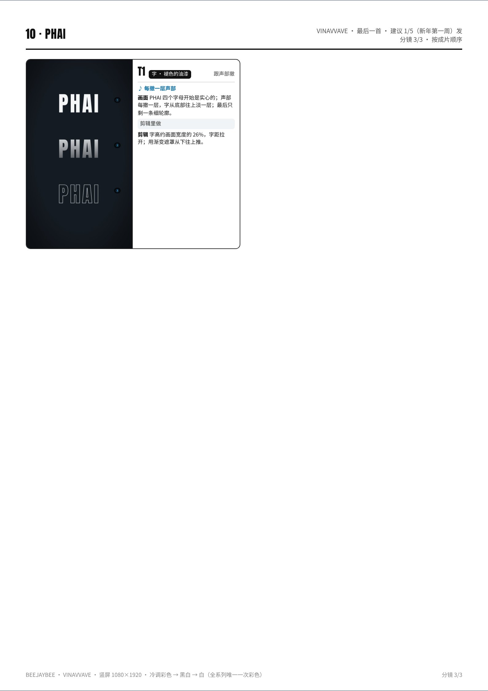

## 拍摄顺序（≤ 3 小时）
| 时间 | 地点 | 做什么 |
|---|---|---|
| 14:30–14:40 | 阁楼 | 布置：锁定白平衡；相框玻璃（先放冰箱 5 分钟）；书堆。 |
| 14:40–15:35 | 阁楼 | **机位 A**：镜子、琴、MPC、空椅子四处，每处“有他 → 哈气 → 没他” × 2（每处约 12 分钟）。 |
| 15:35–15:55 | 路上 | 去 Thủ Thiêm 河边（带玻璃、书、背包）。 |
| 15:55–16:30 | 河边 | **机位 C**：彩色，有他 → 哈气 → 没他 × 2。 |
| 16:30–16:50 | 路上 | 回家。 |
| 16:50–17:10 | 阳台 | **机位 B**：蓝调时刻，彩色 × 2。 |
| 17:10–17:25 | 阁楼 | **机位 D**：大笑 × 5（窗还亮的时候）。 |
| 17:25–17:30 | — | 回看、备份（约 3 小时）。 |

## 道具清单
- 相框玻璃（哈气起雾用；先冰 5 分钟）
- 前几集的道具：落地镜、GO:PIANO88、MPC、椅子
- 书、背包（支撑）
- 深蓝纯色 T 恤（这一集颜色看得见）

## 字（上屏设计）
- **PHAI**：窄粗黑体，白字，字距拉开，字高约画面宽度的 26%，放在上 1/3。
- 像褪色的油漆：开始实心；声部每撤一层，字从底部往上淡一层；最后只剩一条细轮廓。
- 片尾卡也一个字一个字褪掉，BEEJAYBEE · VINAVVAVE 最后一个消失。英文意思只放 IG 文案：“Phai — to fade.”

## 剪辑要点
- 时间线 1080×1920 / 30p。**开头彩色**（整体往冷调：色温偏蓝、去掉暖黄），这是全系列唯一一次彩色。
- **声部退一层，画面褪一层**：① 饱和度 100% → 0（2 小节）；② 黑位抬到 25% 灰 + 哈气的雾；③ 他从每个地方消失（雾当转场，雾后面换成“没他”那一段）。
- 回访的地方按前几集的顺序：镜子（第 1 集）→ 琴（第 2 集）→ MPC / 空椅子 → 河边。
- 最后一层撤掉：曝光拉满到白；然后**硬切 1 秒大笑**；再接片尾卡（字一个个褪掉）。
- 长度按小节表剪，30–50 秒都可以（这一集可以到 45–50 秒）。

## 开拍前 / 收工前检查
- 开拍前：电量 100%、存储 50 GB、飞行模式；**锁定白平衡**；4K 30。
- 每处“有他 / 没他”同一条录完，中途不碰手机。
- 外景：先转一圈，旗、横幅、招牌商标不入画（彩色更显眼，尤其注意）。
- 大笑要真笑：多拍几条，只用最好的 1 秒。
