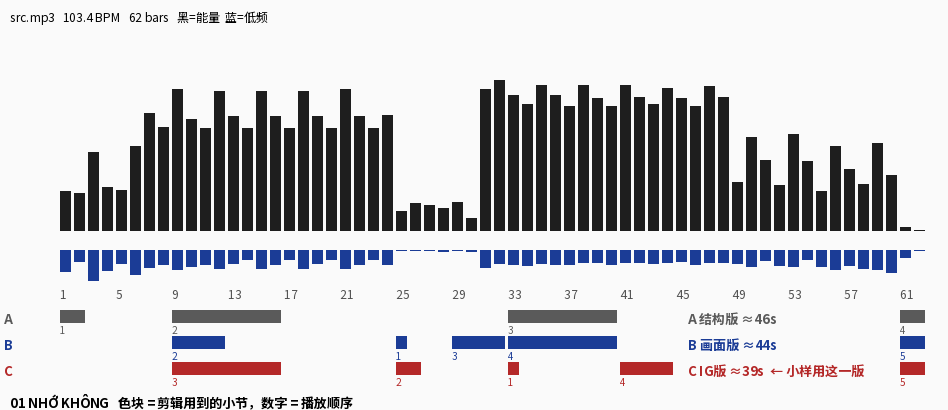
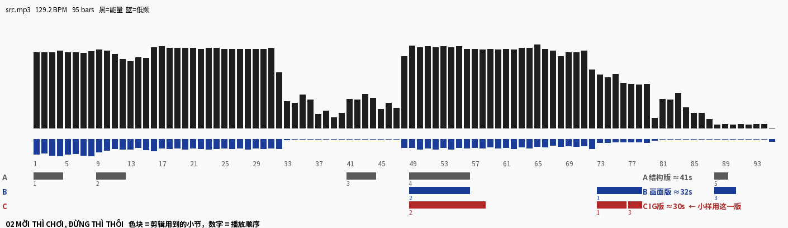
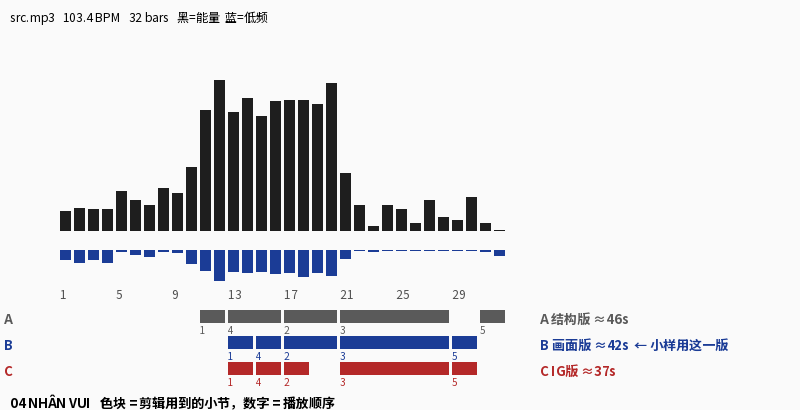
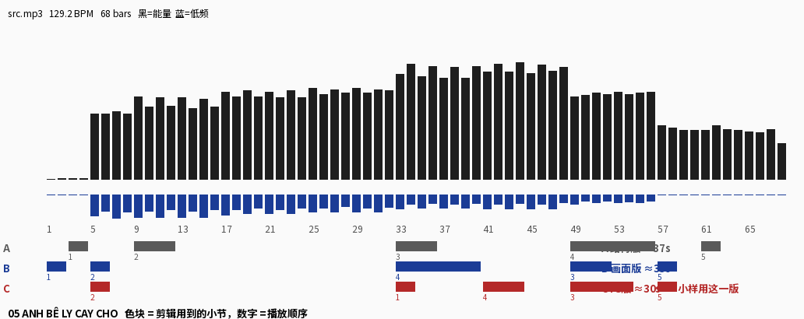
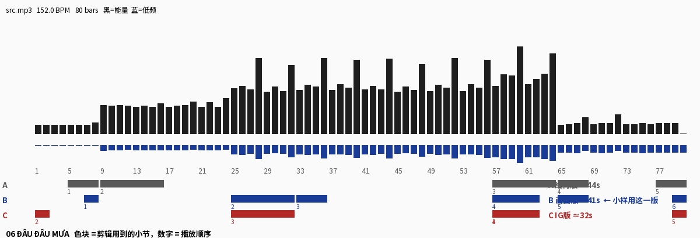
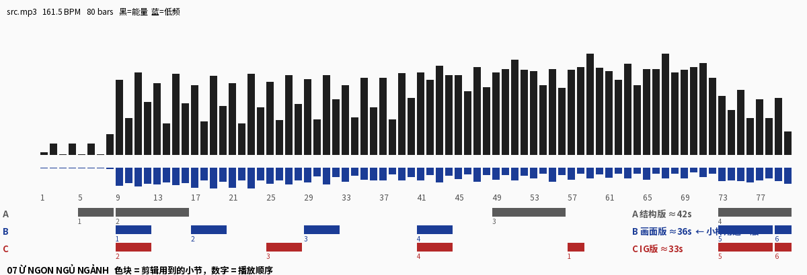
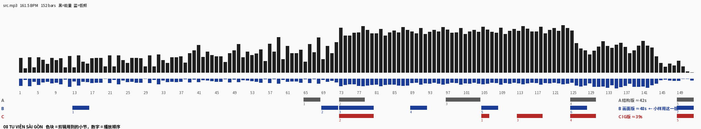
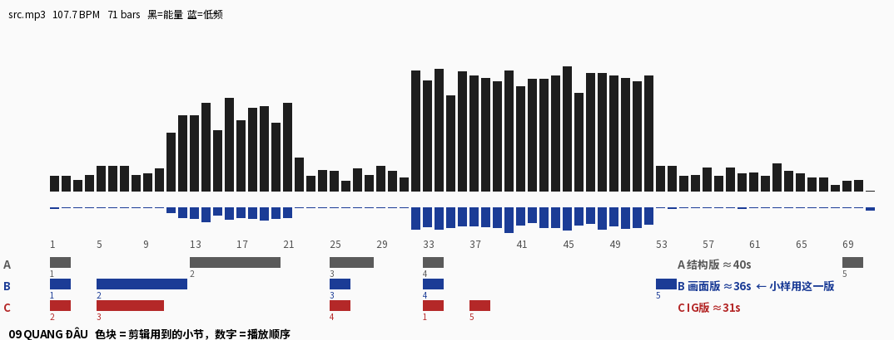
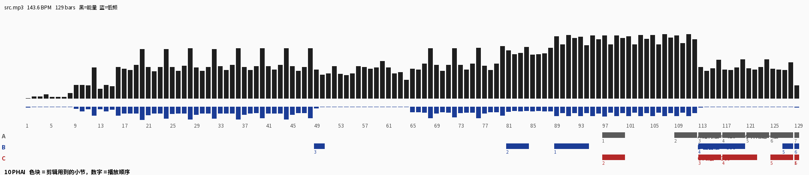

# 剪辑实际小节（对着母带）

三位导演各剪一版，30–50 秒，都按小节跳着剪：接口处 20 毫秒交叉淡化，响度统一到 −14 LUFS。剪好的音频和视频小样不放进仓库，只作为文件发出，免得音乐上传到 GitHub。

- 小节号是自动找的：先找拍子，再把能量变化最大的那一拍当作小节的第一拍。用之前对着 WAV 听一下，前后差一两个小节就挪一挪。
- 第 6、7、8 首测出来的速度可能是双倍（实际可能是 75–82 BPM 的慢歌）。所以这三首的每一段，都从段落的第一拍开始、取偶数个小节。
- 结构图：黑柱 = 每小节的能量，蓝柱 = 低频；下面三行色块是 A / B / C 用到的小节，数字是播放顺序。

## 01 · NHỚ KHÔNG
约 100 BPM · 1 小节 ≈ 2.40 秒 · 全曲 62 小节 · 小样用 **C 版**

- **A 结构版（音乐结构导演）**，48 秒：1–2（0:01.2） → 9–16（0:20.1） → 33–40（1:17.7） → 61–62（2:25.3）
- **B 画面版（画面手法导演）**，45 秒：25–25（0:58.8） → 9–12（0:20.1） → 29–32（1:08.3） → 33–40（1:17.7） → 61–62（2:25.3）
- **C IG 版（情绪弧线导演）**，41 秒：33–33（1:17.7） → 25–26（0:58.8） → 9–16（0:20.1） → 41–44（1:37.1） → 61–62（2:25.3）

## 02 · MỜI THÌ CHƠI, ĐỪNG THÌ THÔI
约 129 BPM · 1 小节 ≈ 1.86 秒 · 全曲 95 小节 · 小样用 **C 版**

- **A 结构版（音乐结构导演）**，41 秒：1–4（0:01.1） → 9–12（0:15.9） → 41–44（1:15.4） → 49–56（1:30.4） → 88–89（2:42.6）
- **B 画面版（画面手法导演）**，31 秒：73–78（2:14.8） → 49–56（1:30.4） → 88–90（2:42.6）
- **C IG 版（情绪弧线导演）**，30 秒：73–76（2:14.8） → 49–58（1:30.4） → 77–78（2:22.3）

## 04 · NHÂN VUI
约 106 BPM · 1 小节 ≈ 2.26 秒 · 全曲 32 小节 · 小样用 **B 版**

- **A 结构版（音乐结构导演）**，45 秒：11–12（0:25.7） → 17–20（0:39.1） → 21–28（0:48.2） → 13–16（0:30.3） → 31–32（1:10.5）
- **B 画面版（画面手法导演）**，40 秒：13–14（0:30.3） → 17–20（0:39.1） → 21–28（0:48.2） → 15–16（0:34.7） → 29–30（1:06.0）
- **C IG 版（情绪弧线导演）**，36 秒：13–14（0:30.3） → 17–18（0:39.1） → 21–28（0:48.2） → 15–16（0:34.7） → 29–30（1:06.0）

## 05 · ANH BÊ LY CAY CHO
约 130 BPM · 1 小节 ≈ 1.84 秒 · 全曲 68 小节 · 小样用 **C 版**

- **A 结构版（音乐结构导演）**，37 秒：3–4（0:03.7） → 9–12（0:15.0） → 33–36（0:59.3） → 49–56（1:28.8） → 61–62（1:50.8）
- **B 画面版（画面手法导演）**，33 秒：1–2（0:00.0） → 5–6（0:07.4） → 49–52（1:28.8） → 33–40（0:59.3） → 57–58（1:43.4）
- **C IG 版（情绪弧线导演）**，29 秒：33–34（0:59.3） → 5–6（0:07.4） → 49–54（1:28.8） → 41–44（1:14.1） → 57–58（1:43.4）

## 06 · ĐÂU ĐÂU MƯA
约 151 BPM · 1 小节 ≈ 1.59 秒 · 全曲 80 小节 · 小样用 **B 版**

- **A 结构版（音乐结构导演）**，45 秒：5–8（0:06.7） → 9–16（0:13.1） → 57–64（1:29.5） → 65–68（1:42.3） → 77–80（2:01.4）
- **B 画面版（画面手法导演）**，41 秒：7–8（0:09.9） → 25–32（0:38.6） → 33–36（0:51.3） → 57–62（1:29.5） → 65–68（1:42.3） → 79–80（2:04.6）
- **C IG 版（情绪弧线导演）**，32 秒：57–58（1:29.5） → 1–2（0:00.3） → 25–32（0:38.6） → 57–62（1:29.5） → 79–80（2:04.6）

## 07 · Ừ NGON NGỦ NGẢNH
约 160 BPM · 1 小节 ≈ 1.50 秒 · 全曲 80 小节 · 小样用 **B 版**

- **A 结构版（音乐结构导演）**，42 秒：5–8（0:06.3） → 9–16（0:12.3） → 49–56（1:12.3） → 73–80（1:48.2）
- **B 画面版（画面手法导演）**，36 秒：9–12（0:12.3） → 17–20（0:24.3） → 29–32（0:42.3） → 41–44（1:00.3） → 73–78（1:48.2） → 79–80（1:57.1）
- **C IG 版（情绪弧线导演）**，33 秒：57–58（1:24.3） → 9–12（0:12.3） → 25–28（0:36.3） → 41–44（1:00.3） → 73–78（1:48.2） → 79–80（1:57.1）

## 08 · TU VIỆN SÀI GÒN
约 164 BPM · 1 小节 ≈ 1.47 秒 · 全曲 152 小节 · 小样用 **B 版**

- **A 结构版（音乐结构导演）**，41 秒：65–68（1:34.4） → 73–78（1:46.4） → 97–104（2:21.5） → 125–130（3:02.5） → 149–152（3:37.6）
- **B 画面版（画面手法导演）**，47 秒：13–16（0:18.3） → 69–72（1:40.2） → 73–80（1:46.4） → 89–92（2:09.8） → 105–108（2:33.2） → 125–128（3:02.5） → 149–152（3:37.6）
- **C IG 版（情绪弧线导演）**，38 秒：105–106（2:33.2） → 73–80（1:46.4） → 113–118（2:44.9） → 125–130（3:02.5） → 149–152（3:37.6）

## 09 · QUANG ĐÂU
约 106 BPM · 1 小节 ≈ 2.25 秒 · 全曲 71 小节 · 小样用 **B 版**

- **A 结构版（音乐结构导演）**，41 秒：1–2（0:00.0） → 13–20（0:26.8） → 25–28（0:54.0） → 33–34（1:12.4） → 69–70（2:33.1）
- **B 画面版（画面手法导演）**，36 秒：1–2（0:00.0） → 5–12（0:08.9） → 25–26（0:54.0） → 33–34（1:12.4） → 53–54（1:57.2）
- **C IG 版（情绪弧线导演）**，32 秒：33–34（1:12.4） → 1–2（0:00.0） → 5–10（0:08.9） → 25–26（0:54.0） → 37–38（1:21.5）

## 10 · PHAI
约 140 BPM · 1 小节 ≈ 1.71 秒 · 全曲 129 小节 · 小样用 **A 版**

- **A 结构版（音乐结构导演）**，42 秒：97–100（2:44.6） → 109–112（3:05.2） → 113–116（3:12.1） → 117–120（3:18.9） → 121–124（3:25.8） → 125–128（3:32.7） → 129–129（3:39.3）
- **B 画面版（画面手法导演）**，39 秒：89–94（2:30.9） → 81–84（2:17.2） → 49–50（1:22.3） → 113–120（3:12.1） → 127–128（3:36.0） → 129–129（3:39.3）
- **C IG 版（情绪弧线导演）**，34 秒：129–129（3:39.3） → 97–100（2:44.6） → 113–116（3:12.1） → 117–122（3:18.9） → 125–128（3:32.7） → 129–129（3:39.3）

